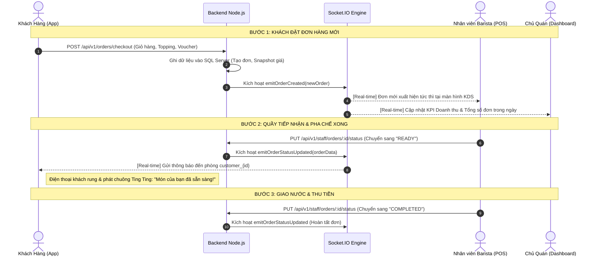

# 🐜 BÁO CÁO CÔNG NGHỆ HỆ THỐNG ANT COFFEE & TEA
> **Báo cáo chuyên sâu về Kiến trúc, Công nghệ, Thư viện và Giải pháp kỹ thuật xây dựng ứng dụng di động & hệ sinh thái F&B Ant Coffee**  
> *Dự án: Hệ sinh thái Đặt món, Vận hành POS quầy & Quản trị Chuỗi Cà phê Ant Coffee & Tea*  
> *Ngày lập báo cáo: Tháng 10/2026 | Phiên bản hệ thống: 2.0.0 Enterprise*

---

## 📑 MỤC LỤC BÁO CÁO

1. [TỔNG QUAN HỆ THỐNG & ĐẶC TẢ BÀI TOÁN NGHIỆP VỤ](#1-tổng-quan-hệ-thống--đặc-tả-bài-toán-nghiệp-vụ)
2. [BẢNG TỔNG HỢP TOÀN BỘ CÔNG NGHỆ (TECH STACK MATRIX)](#2-bảng-tổng-hợp-toàn-bộ-công-nghệ-tech-stack-matrix)
3. [CÔNG NGHỆ TẦNG FRONTEND MOBILE & WEB (REACT NATIVE / EXPO SDK 57)](#3-công-nghệ-tầng-frontend-mobile--web-react-native--expo-sdk-57)
4. [HỆ THỐNG GIAO DIỆN LUXURY GLASSMORPHISM & DESIGN SYSTEM](#4-hệ-thống-giao-diện-luxury-glassmorphism--design-system)
5. [CÔNG NGHỆ TẦNG BACKEND & API GATEWAY (NODE.JS / EXPRESS)](#5-công-nghệ-tầng-backend--api-gateway-nodejs--express)
6. [CÔNG NGHỆ TRUYỀN THÔNG THỜI GIAN THỰC (REAL-TIME SOCKET.IO ENGINE)](#6-công-nghệ-truyền-thông-thời-gian-thực-real-time-socketio-engine)
7. [CÔNG NGHỆ CƠ SỞ DỮ LIỆU & LƯU TRỮ (MICROSOFT SQL SERVER)](#7-công-nghệ-cơ-sở-dữ-liệu--lưu-trữ-microsoft-sql-server)
8. [CỔNG THANH TOÁN & BẢO MẬT GIAO DỊCH (MOMO API V2 & VIETQR)](#8-cổng-thanh-toán--bảo-mật-giao-dịch-momo-api-v2--vietqr)
9. [HỆ THỐNG THÔNG BÁO ĐẨY & ÂM THANH THƯƠNG HIỆU (PUSH & AUDIO ENGINE)](#9-hệ-thống-thông-báo-đẩy--âm-thanh-thương-hiệu-push--audio-engine)
10. [PHÂN HỆ BẢNG ĐIỀU KHIỂN QUẢN TRỊ (NEXT.JS 16 WEB MANAGEMENT)](#10-phân-hệ-bảng-điều-khiển-quản-trị-nextjs-16-web-management)
11. [HẠ TẦNG KẾT NỐI, CLOUD VÀ PHÂN GIẢI ĐA MÔI TRƯỜNG](#11-hạ-tầng-kết-nối-cloud-và-phân-giải-đa-môi-trường)
12. [ĐỘ TIN CẬY, XÁC THỰC GIÁ VÀ CƠ CHẾ OFFLINE DEGRADATION](#12-độ-tin-cậy-xác-thực-giá-và-cơ-chế-offline-degradation)
13. [SO SÁNH CÔNG NGHỆ: VÌ SAO LỰA CHỌN TECH STACK NÀY?](#13-so-sánh-công-nghệ-vì-sao-lựa-chọn-tech-stack-này)
14. [TỔNG KẾT & ĐÁNH GIÁ CHUNG](#14-tổng-kết--đánh-giá-chung)

---

## 1. TỔNG QUAN HỆ THỐNG & ĐẶC TẢ BÀI TOÁN NGHIỆP VỤ

### 1.1. Bối cảnh & Mục tiêu phát triển
Trong mô hình kinh doanh đồ uống F&B (Food & Beverage) hiện đại, các vấn đề nhức nhối thường gặp bao gồm:
- **Tắc nghẽn tại quầy order vào giờ cao điểm**: Khách phải xếp hàng dài chờ gọi món và thanh toán.
- **Sai sót trong pha chế và giao nhận**: Việc ghi chép order trên giấy dễ dẫn đến nhầm lẫn mức đường, mức đá hoặc thiếu topping.
- **Độ trễ truyền tải thông tin**: Khách không biết khi nào ly nước của mình được làm xong để đến quầy nhận.
- **Thất thoát tài chính & Quản lý két tiền lỏng lẻo**: Thiếu sự đối soát giữa số tiền bán thực tế và tiền mặt trong ca làm việc của thu ngân.
- **Dữ liệu báo cáo bị sai lệch theo thời gian**: Khi quán tăng giá sản phẩm, các phần mềm kém chất lượng thường tính lại doanh thu của các đơn hàng trong quá khứ theo giá mới.

**Ant Coffee & Tea** được xây dựng như một nền tảng bán hàng đa kênh (**Omnichannel Platform**) giải quyết triệt để các vấn đề trên thông qua sự kết hợp giữa **Mobile App** (dành cho Khách hàng & Nhân viên POS) và **Web Dashboard** (dành cho Chủ quán).

```
                            ┌──────────────────────────────────┐
                            │    HỆ THỐNG ANT COFFEE & TEA     │
                            └──────────────────────────────────┘
                                             │
             ┌───────────────────────────────┼───────────────────────────────┐
             ▼                               ▼                               ▼
  ┌─────────────────────┐         ┌─────────────────────┐         ┌─────────────────────┐
  │   1. CUSTOMER UI    │         │    2. STAFF POS     │         │   3. OWNER ADMIN    │
  │     (Khách hàng)    │         │     (Nhân viên)     │         │   (Chủ cửa hàng)    │
  ├─────────────────────┤         ├─────────────────────┤         ├─────────────────────┤
  │ - Xem menu, chọn ly │         │ - Hàng đợi KDS Bar  │         │ - Doanh thu thời    │
  │ - Custom đường / đá │         │   thời gian thực    │         │   gian thực         │
  │ - Topping phong phú │         │ - Thao tác 1-chạm   │         │ - Biểu đồ giờ đỉnh  │
  │ - MoMo / VietQR/ COD│         │ - Báo hết món quầy  │         │ - Top món bán chạy  │
  │ - Theo dõi đơn live │         │ - Chốt ca & Két tiền│         │ - Price Audit Log   │
  │ - Chat với quán     │         │ - Chat hỗ trợ khách │         │ - Đóng/mở cửa hàng  │
  └─────────────────────┘         └─────────────────────┘         └─────────────────────┘
```

### 1.2. Ba nhóm tác nhân & Phân quyền RBAC (Role-Based Access Control)
Hệ thống sử dụng cơ chế bảo mật phân quyền 3 cấp độ:
1. **Khách hàng (`CUSTOMER`)**:
   - Duyệt thực đơn đồ uống theo danh mục (Cà phê, Trà sữa, Trà trái cây, Đá xay, Bánh).
   - Tùy chỉnh chi tiết khẩu vị: Chọn Size ly (S/M/L), Mức đá (0%, 30%, 50%, 100%), Độ ngọt (0%, 30%, 50%, 100%), thêm nhiều loại Topping (Trân châu hoàng kim, Thạch củ năng, Kem cheese...).
   - Giỏ hàng thông minh: Tự động gộp ly cùng công thức tùy chọn dựa trên mã hash đặc trưng.
   - Áp mã giảm giá voucher, tính toán chiết khấu tự động.
   - Thanh toán đa kênh: Ví MoMo, Chuyển khoản VietQR, Tiền mặt COD.
   - Theo dõi trạng thái đơn hàng thời gian thực qua thanh tiến trình động (Dynamic Timeline).
   - Chat trực tiếp với quầy pha chế nếu cần thay đổi ghi chú.
2. **Nhân viên phục vụ & Barista (`STAFF`)**:
   - Màn hình điều phối chế biến (Kitchen Display System - KDS) tự động nhảy đơn mới mà không cần F5.
   - Chuyển trạng thái đơn qua 1 chạm: Tiếp nhận (`CONFIRMED`) $\rightarrow$ Làm xong (`READY`) $\rightarrow$ Đã giao & Thu tiền (`COMPLETED`).
   - Báo hết món (Out of stock) ngay tại quầy để hệ thống ẩn khỏi menu khách hàng tức thì.
   - Quản lý ca làm việc (Staff Shift): Khai báo tiền két đầu ca, đối soát doanh thu cuối ca.
3. **Chủ quán / Quản trị viên (`OWNER`)**:
   - Bảng phân tích hiệu suất kinh doanh: Doanh thu ngày/tháng, số lượng đơn, tỷ lệ hủy, giá trị trung bình trên đơn (AOV).
   - Biểu đồ phân bổ doanh số theo khung giờ từ 07:00 đến 21:00 giúp tối ưu hóa nhân sự.
   - Danh sách đồ uống bán chạy nhất (Best Sellers) theo thời gian thực.
   - Nhật ký kiểm toán giá (Price Audit Logs): Ghi nhận minh bạch lịch sử điều chỉnh giá bán món.
   - Công tắc khẩn cấp đóng/mở nhận đơn toàn hệ thống (`is_accepting_orders`).

---

## 2. BẢNG TỔNG HỢP TOÀN BỘ CÔNG NGHỆ (TECH STACK MATRIX)

| Phân tầng (Layer) | Tên công nghệ / Thư viện | Phiên bản | Vai trò & Mục đích sử dụng |
| :--- | :--- | :--- | :--- |
| **Mobile Core** | **React Native** | `0.86.3` | Nền tảng xây dựng ứng dụng Native cho Android & iOS từ một mã nguồn JavaScript duy nhất. |
| **Mobile Framework** | **Expo SDK** | `~57.0.29` | Bộ công cụ phát triển hiện đại, cung cấp Native Modules (Camera, Notifications, Auth, Sound) không cần can thiệp Java/Swift. |
| **UI Reactive Engine**| **React** | `19.2.3` | Thư viện quản lý giao diện dựa trên Component, Virtual DOM và Hooks (`useState`, `useEffect`, `useCallback`, `useMemo`). |
| **Cross-Platform Web**| **react-native-web** | `^0.21.2` | Biên dịch toàn bộ ứng dụng React Native chạy trực tiếp trên các trình duyệt Web (Chrome, Edge, Safari). |
| **Icons & Typography**| **@expo/vector-icons** | `^15.0.2` | Bộ thư viện icon vector sắc nét chuẩn thiết kế (Ionicons, MaterialIcons, Feather, FontAwesome). |
| **Safe Area Layout**  | **react-native-safe-area-context** | `~5.7.0` | Tính toán chính xác lề màn hình an toàn trên các thiết bị có tai thỏ (Notch), camera nốt ruồi và Dynamic Island. |
| **Mobile Auth & PKCE**| **expo-auth-session**, **expo-crypto** | `~57.0.x` | Xác thực đăng nhập Google OAuth 2.0 an toàn qua cơ chế Proof Key for Code Exchange (PKCE). |
| **Client WebSockets** | **socket.io-client** | `^4.8.4` | Nhận và phát các sự kiện thời gian thực giữa App và Server với độ trễ cực thấp (< 50ms). |
| **Push Notifications**| **expo-notifications**, **expo-device** | `~57.0.x` | Cấp phép thông báo, đăng ký Push Token, thiết lập Android Channels với âm thanh thông báo tùy chỉnh. |
| **Backend Runtime**   | **Node.js (ES Modules)** | `>= 18.x` | Môi trường thực thi JavaScript bất đồng bộ (Non-blocking I/O) xử lý đồng thời hàng nghìn kết nối. |
| **REST Server**       | **Express.js** | `^4.21.2` | Framework máy chủ định tuyến hơn 45+ endpoints RESTful API chuẩn HTTP. |
| **Server WebSockets** | **Socket.IO Server** | `^4.8.1` | Máy chủ điều phối các phòng (Rooms), sự kiện bắn thông báo trạng thái đơn hàng và chat. |
| **Database Engine**   | **Microsoft SQL Server** | `2019 / 2022 / Express` | Hệ quản trị CSDL quan hệ chuẩn Enterprise, đảm bảo tính toàn vẹn giao dịch ACID, Stored Procedures và Triggers. |
| **Database Driver**   | **mssql** & **msnodesqlv8** | `^11.0.1` / `^5.6.0` | Driver kết nối CSDL hiệu năng cao qua giao thức TDS (Tabular Data Stream) và ODBC Driver 18. |
| **Bảo mật & Auth**    | **jsonwebtoken (JWT)** | `^9.0.2` | Cấp phát và giải mã Bearer Token phân quyền người dùng theo vai trò. |
| **Mã hóa mật khẩu**   | **bcryptjs** | `^3.0.3` | Thuật toán băm một chiều mật khẩu kèm muối (Salt rounds = 10) chống brute-force và rainbow tables. |
| **Cổng thanh toán 1** | **MoMo E-Wallet API v2** | `Capture Wallet` | Tạo giao dịch ví điện tử MoMo, ký số điện tử **HMAC-SHA256**, xử lý Deep Link và Webhook IPN. |
| **Cổng thanh toán 2** | **VietQR (Napas 247 Standard)** | `Napas 247` | Sinh mã QR chuyển khoản ngân hàng động (Dynamic QR) qua MBBank chuẩn hóa theo mã đơn hàng. |
| **Web Dashboard**     | **Next.js 16 + Tailwind CSS v4** | `16.3.5` / `^4` | Bảng điều khiển quản trị chuỗi cho màn hình lớn máy tính (Desktop/Tablet POS). |
| **Môi trường & Mạng** | **Cloudflare Tunnel / Ngrok / LAN** | N/A | Tạo đường hầm kết nối Internet ra môi trường bên ngoài có cơ chế vượt rào cảnh báo (Bypass Interstitial). |

---

## 3. CÔNG NGHỆ TẦNG FRONTEND MOBILE & WEB (REACT NATIVE / EXPO SDK 57)

### 3.1. Nền tảng React Native (v0.86.3) & React 19 (v19.2.3)
- **Mã nguồn thống nhất (Single Codebase)**: Thay vì phải duy trì 2 đội ngũ lập trình riêng biệt cho Android (Kotlin/Java) và iOS (Swift), React Native cho phép phát triển toàn bộ ứng dụng chỉ với một codebase JavaScript duy nhất.
- **Hiệu năng Native chân thực**: Khác với các công nghệ lai cũ (như Cordova/Ionic vốn chỉ bọc website trong một WebView), React Native biên dịch mã giao diện thành các thành phần đồ họa Native thực sự trên hệ điều hành, đảm bảo độ mượt 60 FPS khi cuộn danh sách món hay thực hiện hiệu ứng chuyển cảnh.
- **Tận dụng React 19 Hooks**:
  - `useState`: Quản lý giỏ hàng, tùy chọn đường/đá/size, bộ lọc danh mục.
  - `useEffect`: Tự động gọi API lấy thực đơn khi mở app và kết nối lắng nghe kênh WebSocket.
  - `useCallback` & `useMemo`: Tối ưu hóa việc render các thẻ món ăn (`ProductCard`), tránh tình trạng re-render không cần thiết khi số lượng món trong danh mục lớn.

### 3.2. Sức mạnh của Expo Framework (SDK ~57.0.29)
Dự án sử dụng Expo SDK thế hệ mới nhất, loại bỏ hoàn toàn sự phức tạp của việc cấu hình Gradle (Android) và Podfile (iOS):
- **Cấu hình định danh ứng dụng tập trung (`app.json`)**: Định nghĩa Bundle ID, Scheme URL (`antcafe://`), biểu tượng Icon, Splash Screen và các quyền truy cập hệ thống.
- **`expo-auth-session` & `expo-crypto`**: Cung cấp giải pháp xác thực Google OAuth 2.0 theo chuẩn **PKCE (Proof Key for Code Exchange)** an toàn bậc nhất hiện nay trên thiết bị di động. 
  - Khóa mã hóa `code_verifier` và `code_challenge` được sinh ngẫu nhiên trên thiết bị bằng thuật toán SHA-256.
  - Trao đổi Authorization Code lấy Access Token mà không bao giờ để lộ Client Secret trong mã nguồn ứng dụng.
- **`expo-notifications`**: Quản lý cấp quyền thông báo từ hệ điều hành, nhận diện thiết bị qua `ExpoPushToken` và phân luồng thông báo theo kênh (Android Notification Channels).
- **`expo-navigation-bar` & `expo-status-bar`**: Tự động điều chỉnh màu sắc thanh điều hướng ảo và thanh trạng thái đồng bộ với phong cách màu thương hiệu tím hoàng gia.

### 3.3. Cơ chế Universal App với `react-native-web` (v0.21.2)
- Cho phép biên dịch ứng dụng React Native chạy trực tiếp trên trình duyệt máy tính mà **không cần sửa đổi mã nguồn**.
- Các component di động như `<View>`, `<Text>`, `<TouchableOpacity>`, `<ScrollView>` được tự động chuyển đổi thành thẻ HTML (`<div>`, `<span>`, `<button>`).
- Tính năng này đặc biệt hữu ích khi cần trình chiếu demo, kiểm thử trên máy tính của hội đồng chấm điểm mà không cần cài đặt phần mềm giả lập Android nặng nề.

---

## 4. HỆ THỐNG GIAO DIỆN LUXURY GLASSMORPHISM & DESIGN SYSTEM

Giao diện ứng dụng được thiết kế theo triết lý **Liquid Glassmorphism** (kính lỏng mờ) với mức độ hoàn thiện cao cấp, mang lại trải nghiệm thị giác ấn tượng ngay từ cái nhìn đầu tiên.

```
┌─────────────────────────────────────────────────────────────┐
│ 🎨 BỘ TOKENS MÀU SẮC CHUẨN THƯƠNG HIỆU                      │
├───────────────────┬───────────┬─────────────────────────────┤
│ Tên Token         │ Mã Hex    │ Ý nghĩa & Mục đích sử dụng  │
├───────────────────┼───────────┼─────────────────────────────┤
│ `primary`         │ `#7E22CE` │ Tím Hoàng Gia — Nhận diện   │
│ `primaryDark`     │ `#581C87` │ Tím Đậm — Header & Nhấn mạnh│
│ `accentOrange`    │ `#FF6B00` │ Cam Citrus — Kích thích giác│
│                   │           │ quan, nút giỏ hàng & giá    │
│ `background`      │ `#F8F7F4` │ Cát Ấm — Nền dịu mắt        │
│ `surface`         │ `#FFFFFF` │ Trắng Tinh Khiết — Thẻ card │
│ `accentGreen`     │ `#10B981` │ Ngọc Lục Bảo — Hoàn tất     │
│ `accentRed`       │ `#EF4444` │ Đỏ Ruby — Hủy đơn & Báo động│
└───────────────────┴───────────┴─────────────────────────────┘
```

### 4.1. Hiệu ứng Kính lỏng (Frosted Glass Elevation)
- Kết hợp độ trong suốt của màu nền (`rgba(255, 255, 255, 0.85)` hoặc `rgba(126, 34, 206, 0.08)`) với đường viền siêu mỏng (`borderWidth: 1`, `borderColor: 'rgba(255, 255, 255, 0.6)'`).
- Trên nền tảng Web, hệ thống kích hoạt hiệu ứng mờ hậu cảnh thực thụ qua CSS: `backdrop-filter: blur(16px)`.
- Các khối giao diện quan trọng như thanh điều hướng nổi dưới đáy (`FloatingBottomNav`) và thanh tiêu đề (`Header`) trông như những tấm kính mờ trôi nổi trên nội dung cuộn.

### 4.2. Bộ thành phần giao diện nguyên tử (Atomic UI Components)
Tất cả các thành phần trong thư mục `src/components/common/` được xây dựng độc lập và có khả năng tái sử dụng cao:
- **`GlassView.js`**: Thẻ chứa hỗ trợ hiệu ứng kính mờ và đổ bóng màu tím/cam.
- **`KPICard.js`**: Thẻ thống kê chỉ số kinh doanh có biểu tượng màu, tỷ lệ tăng trưởng và hiệu ứng phát sáng.
- **`FloatingBottomNav.js`**: Thanh điều hướng dạng viên thuốc (Pill-shaped) tự động biến đổi theo vai trò: Khách hàng (Menu / Đơn hàng / Ưu đãi), Nhân viên (Hàng đợi bếp / Quầy / Ca trực), Chủ quán (Tổng quan / Thực đơn / Cài đặt).
- **`Badge.js`**, **`IconButton.js`**, **`ErrorState.js`**: Các thành phần nguyên tử đạt chuẩn tiếp cận người dùng.

### 4.3. Tiêu chuẩn công thái học (Ergonomics & Touch Floor)
- Tất cả các điểm tương tác chạm (nút bấm, icon) đều đảm bảo diện tích tối thiểu **44x44 pt**, tuân thủ nghiêm ngặt theo **Apple Human Interface Guidelines** và **Google Material Design**, giúp người dùng thao tác bằng một tay dễ dàng, không bị bấm nhầm.

---

## 5. CÔNG NGHỆ TẦNG BACKEND & API GATEWAY (NODE.JS / EXPRESS)

Tầng Backend được tổ chức theo kiến trúc **Layered Architecture** (Controller - Service - Data Access Layer) giúp mã nguồn sạch sẽ, dễ mở rộng và bảo trì.

```
                            ┌─────────────────────────────────┐
                            │    HTTP CLIENT / WEBSOCKET      │
                            └─────────────────────────────────┘
                                             │
                                             ▼
                            ┌─────────────────────────────────┐
                            │   Nginx Reverse Proxy / SSL     │
                            │   (beantcafe.lingprep.cloud)    │
                            └─────────────────────────────────┘
                                             │
                                             ▼
                            ┌─────────────────────────────────┐
                            │  Express Server (Port 5000)     │
                            │  - CORS (Cross-Origin Policy)   │
                            │  - Morgan HTTP Request Logger   │
                            │  - Dotenv Environment Config    │
                            └─────────────────────────────────┘
                                             │
                                             ▼
                            ┌─────────────────────────────────┐
                            │  JWT & RBAC Security Layer      │
                            │  (PUBLIC, CUSTOMER, STAFF, OWNER│
                            └─────────────────────────────────┘
                                             │
             ┌───────────────────────────────┼───────────────────────────────┐
             ▼                               ▼                               ▼
  ┌─────────────────────┐         ┌─────────────────────┐         ┌─────────────────────┐
  │   AuthController    │         │   OrderController   │         │  PaymentController  │
  │ - Đăng nhập / Đăng ký│        │ - Checkout đơn hàng │         │ - MoMo HMAC-SHA256  │
  │ - Google OAuth 2.0  │         │ - Đổi trạng thái KDS│         │ - VietQR Napas 247  │
  │ - Cấp phát Bearer   │         │ - Stored Proc số thứ│         │ - Xử lý Webhook IPN │
  │   Token JWT         │         │   tự ngày           │         │ - Đối soát tiền két │
  └─────────────────────┘         └─────────────────────┘         └─────────────────────┘
             │                               │                               │
             └───────────────────────────────┼───────────────────────────────┘
                                             ▼
                            ┌─────────────────────────────────┐
                            │   Database Connection Pool      │
                            │   (node-mssql / TDS Protocol)   │
                            └─────────────────────────────────┘
                                             │
                                             ▼
                            ┌─────────────────────────────────┐
                            │   Microsoft SQL Server 2022     │
                            │   (ant_coffee_db - 17 Tables)   │
                            └─────────────────────────────────┘
```

### 5.1. Môi trường Node.js (>= 18.x) & Chuẩn ES Modules
- **Xử lý bất đồng bộ cực mạnh**: Node.js sử dụng mô hình sự kiện đơn luồng (**Single-Threaded Event Loop**) kết hợp với thư viện `libuv`. Khi có hàng trăm yêu cầu đặt đơn cùng lúc, server không tạo ra hàng trăm luồng hệ điều hành gây tràn RAM mà đẩy vào hàng đợi I/O bất đồng bộ, giúp máy chủ phản hồi tức thì với lượng tài nguyên tối thiểu.
- **ES Modules (`import/export`)**: Toàn bộ dự án khai báo `"type": "module"` trong `package.json`, sử dụng cú pháp JavaScript hiện đại nhất, không dùng cú pháp `require()` lỗi thời.

### 5.2. Express.js (v4.21.2) & Hệ thống Định tuyến RESTful API
Máy chủ cung cấp hơn 45+ API endpoints chuẩn HTTP, phân tách thành các bộ điều khiển chuyên trách:
1. **`/api/v1/auth`**: Đăng ký, đăng nhập qua số điện thoại/mật khẩu, xác thực Google OAuth, lấy thông tin cá nhân.
2. **`/api/v1/catalog`**: Truy vấn danh mục, danh sách đồ uống kèm tùy chọn size/đường/đá/topping.
3. **`/api/v1/orders`**: Tạo đơn hàng mới (`POST /checkout`), hủy đơn, xem chi tiết hóa đơn, theo dõi tiến trình làm món.
4. **`/api/v1/staff`**: Hàng đợi làm món của bếp/quầy bar (`GET /orders/queue`), cập nhật trạng thái đơn sang `CONFIRMED`, `READY`, `COMPLETED`, bật tắt trạng thái hết món (`/availability`), đóng mở két ca trực (`/shifts`).
5. **`/api/v1/admin`**: Thống kê doanh thu theo ngày/tháng, phân bổ đơn theo khung giờ, danh sách món bán chạy nhất, nhật ký kiểm toán giá (`/price-audit-logs`), công tắc đóng/mở nhận đơn toàn quán.
6. **`/api/v1/payments`**: Khởi tạo giao dịch MoMo, sinh mã chuyển khoản VietQR, nhận phản hồi Webhook IPN tự động từ máy chủ MoMo.
7. **`/api/v1/notifications`**: Đăng ký Push Token của thiết bị, lấy danh sách thông báo, đánh dấu đã đọc.

### 5.3. Bảo mật JSON Web Token (JWT) & Phân quyền RBAC
- **Bearer Token**: Sau khi người dùng đăng nhập thành công, server cấp một chuỗi JWT được ký điện tử bằng khóa bí mật `JWT_SECRET`. Chuỗi này chứa thông tin định danh:
  ```json
  {
    "id": 1,
    "role": "CUSTOMER",
    "phone": "0901234567",
    "iat": 1729800000,
    "exp": 1732392000
  }
  ```
- **Middleware `authenticateToken`**: Bắt buộc mọi yêu cầu gửi lên các API nghiệp vụ phải đính kèm Header: `Authorization: Bearer <token>`.
- **Middleware `requireRole`**: Kiểm tra quyền truy cập nghiêm ngặt. Khách hàng thông thường không thể gọi được các API nhạy cảm của nhân viên thu ngân hoặc chủ quán (trả về lỗi `403 Forbidden`).

### 5.4. Mã hóa mật khẩu một chiều với `bcryptjs` (v3.0.3)
- Mật khẩu của tài khoản tuyệt đối không bao giờ được lưu dưới dạng văn bản thô (Plain-text).
- Thuật toán `bcrypt` tự động sinh chuỗi muối ngẫu nhiên (Salt rounds = 10) trước khi băm mật khẩu, vô hiệu hóa hoàn toàn các kỹ thuật tấn công bằng từ điển (Dictionary attack) hoặc dò bảng băm sẵn (Rainbow tables).

---

## 6. CÔNG NGHỆ TRUYỀN THÔNG THỜI GIAN THỰC (REAL-TIME SOCKET.IO ENGINE)

Truyền thông thời gian thực là "trái tim" của hệ sinh thái Ant Coffee, giải quyết bài toán đồng bộ dữ liệu tức thì giữa Khách hàng, Nhân viên pha chế và Quản lý cửa hàng.



### 6.1. Tại sao lựa chọn Socket.IO (v4.8.x)?
- **Tự động chuyển đổi giao thức (Auto-Fallback)**: Socket.IO ưu tiên sử dụng giao thức **WebSocket** thuần túy để đạt tốc độ phản hồi dưới 50ms. Nếu môi trường mạng của khách hàng bị chặn bởi tường lửa hoặc proxy nghiêm ngặt, Socket.IO sẽ tự động hạ cấp xuống **HTTP Long-Polling** để đảm bảo kết nối không bao giờ bị đứt gãy.
- **Tự động kết nối lại (Auto-Reconnect)**: Khi khách hàng đi vào vùng sóng yếu (thang máy, tầng hầm) và mất mạng, thư viện sẽ tự động thử kết nối lại với thuật toán Exponential Backoff ngay khi có tín hiệu mạng trở lại.

### 6.2. Kiến trúc phân vùng phòng (Rooms Architecture)
Để tối ưu hóa băng thông mạng và ngăn ngừa rò rỉ dữ liệu, máy chủ không phát tín hiệu bừa bãi ra toàn mạng mà gom socket vào các phòng logic:
- **`customer_{userId}`**: Mỗi khách hàng sau khi xác thực thành công sẽ được gán vào phòng riêng của mình. Khi trạng thái đơn hàng của khách thay đổi, server chỉ phát sự kiện vào phòng này, đảm bảo khách hàng A không bao giờ nhận nhầm thông báo đơn hàng của khách hàng B.
- **`room:orders`**: Dành cho toàn bộ nhân viên thu ngân và barista trực ca. Mọi đơn hàng mới phát sinh trên toàn hệ thống được đẩy vào phòng này để nhân viên nhận đơn làm ngay mà không cần tải lại trang.
- **`room:chat_{orderId}`**: Tạo kênh trò chuyện riêng biệt theo từng mã đơn hàng, cho phép khách hàng và barista nhắn tin trao đổi trực tiếp về đơn hàng.

### 6.3. Xác thực Handshake Middleware
- Khi kết nối socket được khởi tạo, Middleware kiểm tra mã JWT được truyền qua `handshake.auth.token`.
- Nếu token hợp lệ, máy chủ gán thông tin `socket.user = decoded` và tự động phân bổ socket vào đúng các phòng nghiệp vụ tương ứng với vai trò của người dùng.

---

## 7. CÔNG NGHỆ CƠ SỞ DỮ LIỆU & LƯU TRỮ (MICROSOFT SQL SERVER)

Hệ thống sử dụng **Microsoft SQL Server (2019/2022/Express)** làm kho lưu trữ trung tâm. Đây là hệ quản trị cơ sở dữ liệu quan hệ (RDBMS) chuẩn Enterprise có độ tin cậy tuyệt đối, hỗ trợ đầy đủ tính chất **ACID** (Atomicity, Consistency, Isolation, Durability) cực kỳ quan trọng trong các ứng dụng liên quan đến tiền bạc và hóa đơn.

```
                            ┌────────────────────────┐
                            │         users          │
                            │ (Khách, Nhân viên, Chủ)│
                            └────────────────────────┘
                                         │
             ┌───────────────────────────┼───────────────────────────┐
             ▼                           ▼                           ▼
  ┌─────────────────────┐     ┌─────────────────────┐     ┌─────────────────────┐
  │ customer_addresses  │     │       orders        │     │    staff_shifts     │
  │  (Sổ địa chỉ khách) │     │ (Thông tin đơn hàng)│     │  (Két tiền ca trực) │
  └─────────────────────┘     └─────────────────────┘     └─────────────────────┘
                                         │
                   ┌─────────────────────┼─────────────────────┐
                   ▼                     ▼                     ▼
        ┌─────────────────────┐┌─────────────────────┐┌─────────────────────┐
        │     order_items     ││order_status_history ││   order_messages    │
        │ (Chi tiết món đặt)  ││ (Lịch sử trạng thái)││  (Chat theo đơn)    │
        └─────────────────────┘└─────────────────────┘└─────────────────────┘
                   │
                   ▼
        ┌─────────────────────┐
        │ order_item_options  │
        │ (Size/Đường/Đá/Top) │
        └─────────────────────┘
```

### 7.1. Trình điều khiển kết nối (`mssql` v11.0.1 & `msnodesqlv8` v5.6.0)
- Kết nối tới SQL Server thông qua cổng chuẩn `1433` hoặc Named Pipes.
- **Cơ chế Connection Pool**: Máy chủ Backend duy trì sẵn một nhóm 10 kết nối thường trực đến CSDL. Khi có request API, server lấy ngay kết nối có sẵn để thực thi thay vì phải khởi tạo lại từ đầu, giảm thời gian phản hồi của API xuống mức mili-giây.
- **Phòng chống tấn công SQL Injection 100%**: Tuyệt đối không cộng chuỗi truy vấn (string concatenation). Toàn bộ tham số được ràng buộc kiểu dữ liệu rõ ràng qua Parameterized Queries:
  ```javascript
  const request = pool.request();
  request.input('orderCode', sql.VarChar(50), orderCode);
  request.input('userId', sql.Int, userId);
  const result = await request.query('SELECT * FROM orders WHERE order_code = @orderCode AND user_id = @userId');
  ```

### 7.2. Đặc tả 17 Bảng quan hệ chuẩn hóa (Relational Schema)
Cơ sở dữ liệu `ant_coffee_db` (Collation: `Vietnamese_CI_AS` hỗ trợ tiếng Việt có dấu chuẩn xác) gồm 17 bảng liên kết chặt chẽ:
1. **`users`**: Lưu trữ tài khoản, mật khẩu mã hóa bcrypt, phân vai trò (`CUSTOMER`, `STAFF`, `OWNER`), điểm thưởng thành viên (`loyalty_points`).
2. **`categories`**: Danh mục phân loại sản phẩm (Cà phê, Trà sữa, Trà trái cây, Đá xay, Bánh).
3. **`products`**: Sản phẩm đồ uống, giá niêm yết, ảnh đại diện, danh mục, trạng thái sẵn sàng bán (`is_available`).
4. **`product_options`**: Nhóm tùy chọn khẩu vị (Chọn Size, Mức đường, Lượng đá, Topping).
5. **`product_option_values`**: Giá trị chi tiết và phụ thu tương ứng (Size L: +10.000đ, Trân châu hoàng kim: +8.000đ).
6. **`orders`**: Thông tin tổng thể của đơn hàng: mã đơn duy nhất, số thứ tự lấy nước trong ngày, trạng thái thanh toán, tổng tiền, ghi chú.
7. **`order_items`**: Chi tiết từng món trong đơn, số lượng, đơn giá tại thời điểm đặt.
8. **`order_item_options`**: Tùy chọn chi tiết của từng ly (Size, đường, đá, topping đi kèm).
9. **`vouchers`**: Kho phiếu giảm giá, điều kiện áp dụng, hạn dùng, phần trăm hoặc số tiền giảm cố định.
10. **`voucher_usage`**: Ghi nhận lịch sử sử dụng voucher, chống việc một người dùng lợi dụng dùng lại mã nhiều lần.
11. **`customer_addresses`**: Sổ địa chỉ giao hàng yêu thích của khách hàng.
12. **`staff_shifts`**: Quản lý ca trực thu ngân, số tiền khai báo đầu ca, tổng thu tiền mặt trong ca và đối soát số tiền thực nộp (`discrepancy_amount`).
13. **`order_status_history`**: Dòng thời gian chi tiết ghi nhận từng mốc chuyển đổi trạng thái đơn hàng (`PENDING` $\rightarrow$ `CONFIRMED` $\rightarrow$ `READY` $\rightarrow$ `COMPLETED`).
14. **`price_audit_logs`**: Nhật ký kiểm toán giá bán món, lưu trữ ai đã sửa giá, sửa lúc nào, giá cũ là bao nhiêu và giá mới là bao nhiêu.
15. **`order_messages`**: Tin nhắn trò chuyện giữa khách và quầy thu ngân theo từng đơn hàng.
16. **`notifications`**: Danh sách thông báo đẩy nội bộ trong ứng dụng gửi đến người dùng.
17. **`store_settings`**: Cấu hình toàn quán (Công tắc khẩn cấp tắt nhận đơn `is_accepting_orders`, thông tin Wi-Fi, hotline).

### 7.3. Kỹ thuật Stored Procedure tự sinh số thứ tự ngày (`sp_generate_daily_queue_number`)
- Để tránh trùng lặp số thứ tự lấy nước của khách khi có nhiều người bấm đặt cùng một tích tắc, hệ thống sử dụng một Stored Procedure nguyên tử (Atomic Procedure) ngay trong CSDL SQL Server:
  - Khởi tạo số bắt đầu từ `#001` vào lúc 00:00 mỗi ngày mới.
  - Sử dụng giao dịch `TRANSACTION` có khóa cấp dòng (`ROWLOCK, UPDLOCK`) để tự động tăng tiến tuần tự mà không bao giờ bị trùng lặp mã.

### 7.4. Triggers kiểm toán giá và lịch sử trạng thái
- **`trg_after_product_price_update`**: Tự động kích hoạt khi có lệnh `UPDATE` giá bán trên bảng `products`. Trigger sẽ tự động trích xuất giá cũ từ bảng ảo `deleted`, giá mới từ bảng ảo `inserted` và ghi vào bảng `price_audit_logs`.
- **`trg_after_order_status_update`**: Tự động ghi lại mốc thời gian và người cập nhật mỗi khi đơn hàng chuyển đổi trạng thái phục vụ.

### 7.5. Mẫu thiết kế dữ liệu bản chụp (Snapshot Data Pattern)
- Một vấn đề phổ biến của các phần mềm bán hàng là: *Nếu 1 tháng sau quán tăng giá cà phê từ 30.000đ lên 35.000đ thì các đơn hàng cũ trong quá khứ có bị đổi giá theo không?*
- Ant Coffee giải quyết triệt để vấn đề này bằng mô hình **Snapshot Data**: Khi tạo đơn hàng, toàn bộ tên món, đơn giá niêm yết, tên topping và phụ thu tại thời điểm đó được sao chép trực tiếp vào bảng `order_items` và `order_item_options`. Báo cáo tài chính và hóa đơn lịch sử sẽ luôn luôn chính xác 100% vĩnh viễn.

---

## 8. CỔNG THANH TOÁN & BẢO MẬT GIAO DỊCH (MOMO API V2 & VIETQR)

Hệ thống loại bỏ hoàn toàn việc phụ thuộc vào tiền mặt bằng cách tích hợp trực tiếp 3 phương thức thanh toán linh hoạt:

```
                            ┌─────────────────────────────────┐
                            │    PHƯƠNG THỨC THANH TOÁN       │
                            └─────────────────────────────────┘
                                             │
             ┌───────────────────────────────┼───────────────────────────────┐
             ▼                               ▼                               ▼
  ┌─────────────────────┐         ┌─────────────────────┐         ┌─────────────────────┐
  │   1. VÍ ĐIỆN TỬ     │         │   2. CHUYỂN KHOẢN   │         │   3. TIỀN MẶT KHI   │
  │     MOMO API v2     │         │     VIETQR 24/7     │         │      NHẬN (COD)     │
  ├─────────────────────┤         ├─────────────────────┤         ├─────────────────────┤
  │ - Ký số HMAC-SHA256 │         │ - Chuẩn Napas 247   │         │ - Thu tiền tại quầy │
  │ - Deep Link vào App │         │ - QR Code ngân hàng │         │ - Quản lý ca trực   │
  │ - Webhook IPN Server│         │ - Cú pháp mã hóa tự │         │ - Đối soát tiền két │
  │ - Pay with QR Code  │         │   động theo đơn hàng│         │   cuối ngày         │
  └─────────────────────┘         └─────────────────────┘         └─────────────────────┘
```

### 8.1. Cổng thanh toán Ví điện tử MoMo API v2 (Capture Wallet)
- **Thuật toán ký số HMAC-SHA256**: 
  - Toàn bộ chuỗi tham số giao dịch (`accessKey`, `amount`, `extraData`, `ipnUrl`, `orderId`, `orderInfo`, `partnerCode`, `redirectUrl`, `requestId`, `requestType`) được ghép nối theo thứ tự chuẩn của MoMo và băm bằng thuật toán SHA256 với Secret Key bí mật:
    $$\text{signature} = \text{HMAC-SHA256}(\text{rawSignature}, \text{secretKey})$$
  - Đảm bảo dữ liệu gửi đi không thể bị kẻ gian can thiệp hoặc sửa đổi giá tiền trên đường truyền mạng.
- **Xử lý Đa kênh (Multi-Platform Handling)**:
  - Trên điện thoại thật: Kích hoạt Deep Link mở thẳng ứng dụng MoMo trên máy khách hàng (`deeplink: momo://...`).
  - Trên máy tính hoặc giả lập: Tự động render mã QR MoMo sắc nét kèm đồng hồ đếm ngược giao dịch.
- **Cơ chế Webhook IPN (Instant Payment Notification)**:
  - Máy chủ MoMo gọi trực tiếp tới endpoint ngầm của Ant Coffee Server (`POST /api/v1/payments/momo-ipn`).
  - Hệ thống tự động xác minh chữ ký phản hồi và chuyển trạng thái đơn sang `PAID` mà không phụ thuộc vào việc người dùng có tắt trình duyệt hay không.

### 8.2. Chuyển khoản nhanh VietQR Chuẩn Napas 247
- Tích hợp chuẩn thanh toán quét mã QR liên ngân hàng không qua trung gian tốn phí.
- Sử dụng API mã hóa tạo ảnh QR động theo chuẩn ngân hàng Việt Nam:
  - **Ngân hàng thụ hưởng**: MBBank (Ngân hàng TMCP Quân Đội).
  - **Số tài khoản nhận**: Được mã hóa sẵn trong cấu hình hệ thống.
  - **Nội dung chuyển khoản chuẩn hóa**: `ANT <mã_đơn>` (Ví dụ: `ANT ORD20261028001`).
  - **Số tiền**: Tự động điền chính xác theo tổng giá trị đơn hàng sau khi đã trừ voucher.

### 8.3. Thanh toán Tiền mặt (COD) & Kiểm soát két tiền ca trực
- Dành cho khách mua trực tiếp tại quầy hoặc nhận hàng thanh toán tiền mặt.
- Kết nối trực tiếp với bảng `staff_shifts`: Mỗi nhân viên khi bắt đầu ca làm việc phải khai báo số tiền mặt lẻ ban đầu trong két. Khi hoàn thành các đơn hàng tiền mặt, doanh thu được cộng dồn. Cuối ca, hệ thống bắt buộc nhân viên đếm tiền thực nộp và tự động tính ra tiền thừa/thiếu (`discrepancy_amount`) để lập báo cáo minh bạch cho chủ quán.

---

## 9. HỆ THỐNG THÔNG BÁO ĐẨY & ÂM THANH THƯƠNG HIỆU (PUSH & AUDIO ENGINE)

Trải nghiệm người dùng trong ngành đồ uống đòi hỏi tính phản hồi tức thì để khách hàng biết lúc nào đồ uống đã pha xong và nhân viên nhận biết có đơn hàng mới đến.

### 9.1. Expo Push Notifications & Android Channels
- Đăng ký và quản lý kênh thông báo riêng biệt trên hệ điều hành Android (`setupNotificationChannels`):
  - **Kênh đơn hàng (`antcafe_orders_v2`)**: Mức ưu tiên cao nhất (`MAX Importance`), đèn LED màu tím (`#8B5CF6`), kích hoạt mẫu rung tinh tế `[0, 120, 80, 120]`.
  - **Kênh khuyến mãi (`antcafe_reminders_v2`)**: Mức ưu tiên cao (`HIGH Importance`), gửi các mã ưu đãi giảm giá và chương trình thành viên.

### 9.2. Bộ âm thanh thương hiệu "Ting Ting" độc quyền
- Ứng dụng tích hợp tệp âm thanh WAV chất lượng cao (`assets/sounds/notification_ting.wav`).
- Khi barista bấm nút **"Xong món" (READY)** trên màn hình pha chế, ứng dụng của khách hàng sẽ ngay lập tức:
  1. Hiển thị thông báo biểu ngữ (Banner alert).
  2. Rung nhẹ theo nhịp điệu.
  3. Phát tiếng chuông "Ting Ting" trong trẻo, mang lại cảm giác dễ chịu và chuyên nghiệp.

---

## 10. PHÂN HỆ BẢNG ĐIỀU KHIỂN QUẢN TRỊ (NEXT.JS 16 WEB MANAGEMENT)

Bên cạnh ứng dụng di động cho khách hàng và máy tính bảng cho quầy pha chế, dự án còn trang bị phân hệ Web Dashboard quản trị cao cấp đặt tại thư mục `ai-website-cloner-template`:

```
                            ┌──────────────────────────────────┐
                            │    NEXT.JS 16 WEB MANAGEMENT    │
                            │ (App Router + React 19 + TS)     │
                            └──────────────────────────────────┘
                                             │
             ┌───────────────────────────────┼───────────────────────────────┐
             ▼                               ▼                               ▼
  ┌─────────────────────┐         ┌─────────────────────┐         ┌─────────────────────┐
  │ 1. TỔNG QUAN DOANH THU│       │ 2. QUẢN LÝ THỰC ĐƠN │         │ 3. HÀNG ĐỢI KDS QUẦY│
  │ - Doanh thu ngày    │         │ - Sửa giá bán món   │         │ - Bảng Kanban đơn   │
  │ - Biểu đồ khung giờ │         │ - Thêm danh mục mới │         │ - Kéo thả trạng thái│
  │ - Top Best-Sellers  │         │ - Bật tắt hết hàng  │         │ - Báo động đơn trễ  │
  └─────────────────────┘         └─────────────────────┘         └─────────────────────┘
```

- **Next.js 16 (App Router)**: Tận dụng cơ chế **Server-Side Rendering (SSR)** và **React Server Components (RSC)** để tối ưu tốc độ nạp trang ban đầu.
- **Tailwind CSS v4 & PostCSS**: Bộ công cụ tạo kiểu tiện ích hiện đại nhất, biên dịch siêu nhanh bằng động cơ Lightning CSS, hỗ trợ giao diện co giãn thích ứng hoàn hảo (Responsive Grid).
- **TypeScript (v5)**: Đảm bảo tính an toàn kiểu dữ liệu (Type-Safety) xuyên suốt từ giao diện đến lời gọi API, triệt tiêu lỗi runtime do sai lệch trường dữ liệu.
- **Thư viện icon Lucide React**: Hơn 1000+ biểu tượng vector hiện đại, tối giản và sắc sảo.

---

## 11. HẠ TẦNG KẾT NỐI, CLOUD VÀ PHÂN GIẢI ĐA MÔI TRƯỜNG

Để đảm bảo dự án có thể chạy và chấm điểm mượt mà ở bất cứ đâu, hệ thống được trang bị bộ phân giải địa chỉ thông minh độc quyền tại `src/api/config.js`.

### 11.1. Bộ phân giải môi trường tự động (Dynamic Network Resolver)
Hệ thống tự động phát hiện nền tảng thực thi và chọn URL kết nối tối ưu nhất mà **không cần sửa code thủ công**:
1. **Cloud Server (Ưu tiên số 1 - Sẵn sàng 24/7)**:
   - Tên miền: `https://beantcafe.lingprep.cloud`
   - Máy chủ đặt trên Cloud Linux Ubuntu, chạy Nginx Reverse Proxy và cài đặt chứng chỉ bảo mật SSL/TLS Let's Encrypt tự động gia hạn.
2. **Android Emulator**:
   - Tự động chuyển hướng về IP Loopback đặc thù của giả lập Android: `http://10.0.2.2:5000`.
3. **Mạng cục bộ (Local LAN IP)**:
   - Tự động nhận diện dải IP Wi-Fi nội bộ: `http://192.168.0.102:5000` cho phép các điện thoại thật kết nối trực tiếp với máy tính đang chạy server.
4. **Đường hầm Public Tunnel (Cloudflare Tunnel / Ngrok)**:
   - Tự động đính kèm cờ HTTP Header `ngrok-skip-browser-warning: true` và `bypass-tunnel-reminder: true` để vượt qua màn hình cảnh báo chặn bot của các dịch vụ Tunnel trung gian.

---

## 12. ĐỘ TIN CẬY, XÁC THỰC GIÁ VÀ CƠ CHẾ OFFLINE DEGRADATION

### 12.1. Cơ chế hoạt động ngoại tuyến (Offline Graceful Degradation)
- Tại thư mục `src/data/mockData.js`, ứng dụng tích hợp sẵn bộ dữ liệu đệm chuẩn của toàn bộ thực đơn 25+ món nước, danh mục, voucher và tài khoản người dùng.
- Khi mất kết nối internet hoặc máy chủ bảo trì, ứng dụng tự động kích hoạt chế độ **Offline Fallback**: Khách hàng vẫn có thể duyệt món, xem hình ảnh và trải nghiệm giỏ hàng mà không gặp lỗi màn hình trắng (White Screen of Death).

### 12.2. Cơ chế xác thực giá kép (Double Price Verification)
- Khách hàng không thể giả mạo giá tiền gửi từ ứng dụng lên máy chủ (Client Tampering).
- Khi nhận payload thanh toán, `OrderController` tại Backend luôn tự động truy vấn lại giá gốc từ bảng `products` trong SQL Server, tính toán lại tổng tiền từng topping và kiểm tra tính hợp lệ của voucher rồi mới tạo đơn hàng.

### 12.3. Bộ công cụ kiểm thử tự động (Automated Testing)
- Script kiểm thử endpoint toàn diện: `BE/src/scripts/testEndpoints.js` (kiểm tra tự động hơn 20 luồng gọi API đăng nhập, tạo đơn, cập nhật trạng thái).
- Script kiểm thử quy trình thanh toán MoMo: `BE/src/scripts/testMoMoPayment.js` (tự động mô phỏng luồng tạo chữ ký số HMAC và nhận Webhook phản hồi).

---

## 13. SO SÁNH CÔNG NGHỆ: VÌ SAO LỰA CHỌN TECH STACK NÀY?

| Thành phần kỹ thuật | Công nghệ lựa chọn | Công nghệ thay thế | Lý do vượt trội & Quyết định kỹ thuật |
| :--- | :--- | :--- | :--- |
| **Mobile Client** | **React Native / Expo** | Flutter / Swift Native | Chia sẻ 100% logic với Web, hệ sinh thái npm phong phú, cập nhật giao diện nóng (Hot Reload), không tốn thời gian build lại mã nguồn Native. |
| **Cơ sở dữ liệu** | **Microsoft SQL Server** | MongoDB (NoSQL) | Ứng dụng F&B yêu cầu tính toán tiền tệ, hóa đơn và tồn kho chính xác tuyệt đối. Quan hệ ràng buộc khóa ngoại (Foreign Key) và Stored Procedure nguyên tử của SQL Server ngăn ngừa 100% lỗi sai lệch dữ liệu. |
| **Giao tiếp Realtime**| **Socket.IO Engine** | HTTP Polling (Kéo định kỳ) | HTTP Polling gửi request liên tục làm nóng máy và tiêu hao pin điện thoại. Socket.IO duy trì kết nối WebSocket thường trực, chỉ gửi tin khi có sự kiện, độ trễ < 50ms. |
| **Backend Framework** | **Node.js Express** | Java Spring Boot | Nhẹ, khởi động tức thì trong vài giây, xử lý I/O bất đồng bộ hoàn hảo với khối lượng đơn hàng đồ uống phát sinh liên tục trong giờ cao điểm. |
| **Cổng thanh toán** | **MoMo v2 & VietQR** | Tiền mặt COD đơn thuần | Đáp ứng xu hướng thanh toán không tiền mặt của giới trẻ hiện nay, tự động hóa khâu thu ngân và giảm thiểu thất thoát doanh thu. |

---

## 14. TỔNG KẾT & ĐÁNH GIÁ CHUNG

Hệ sinh thái **Ant Coffee & Tea** là minh chứng tiêu biểu cho một giải pháp phần mềm F&B chuẩn Enterprise hoàn thiện từ đầu đến cuối:
1. **Kiến trúc mạch lạc**: Phân tầng rõ ràng giữa Client (React Native / Next.js) và Server (Express / Socket.IO / SQL Server).
2. **Đồng bộ thời gian thực chuẩn xác**: Hàng đợi KDS Barista cập nhật tức thì, chuông thông báo Ting Ting và rung phản hồi mang lại cảm giác thích thú cho khách hàng.
3. **Bảo mật & Toàn vẹn tài chính**: Mã hóa JWT, băm mật khẩu bcrypt, chữ ký số MoMo HMAC-SHA256, kiểm toán giá và đối soát tiền két ca trực.
4. **Sẵn sàng triển khai thực tế**: Hỗ trợ đầy đủ từ môi trường máy phát triển nội bộ đến hạ tầng Cloud Production trực tuyến 24/7.

---
*Báo cáo được hoàn thiện nhằm phục vụ công tác đánh giá đồ án tốt nghiệp, thuyết minh kỹ thuật và bàn giao tài liệu kiến trúc hệ thống Ant Coffee & Tea.*
