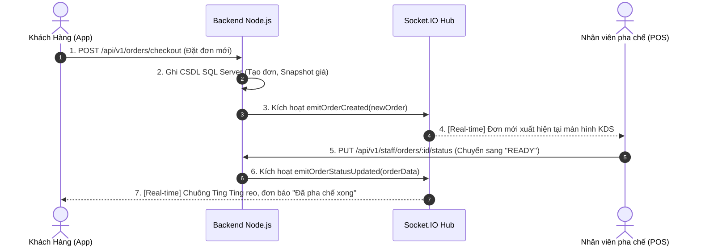

# 🐜 BÁO CÁO CÔNG NGHỆ HỆ THỐNG ANT COFFEE & TEA
> **Báo cáo chi tiết về Kiến trúc, Công nghệ, Thư viện và Giải pháp kỹ thuật xây dựng ứng dụng di động & hệ sinh thái F&B Ant Coffee**  
> *Dự án: Hệ sinh thái Đặt hàng, Vận hành POS quầy & Quản trị Chuỗi Cà phê Ant Coffee & Tea*  
> *Ngày lập báo cáo: Tháng 10/2026 | Phiên bản hệ thống: 2.0.0 Enterprise*

---

## 📑 MỤC LỤC BÁO CÁO

1. [TỔNG QUAN HỆ THỐNG & ĐẶC TẢ BÀI TOÁN](#1-tổng-quan-hệ-thống--đặc-tả-bài-toán)
2. [BẢNG TỔNG HỢP TOÀN BỘ CÔNG NGHỆ (TECH STACK MATRIX)](#2-bảng-tổng-hợp-toàn-bộ-công-nghệ-tech-stack-matrix)
3. [CÔNG NGHỆ TẦNG FRONTEND MOBILE & WEB (EXPO / REACT NATIVE)](#3-công-nghệ-tầng-frontend-mobile--web-expo--react-native)
4. [CÔNG NGHỆ TẦNG BACKEND & API GATEWAY (NODE.JS / EXPRESS)](#4-công-nghệ-tầng-backend--api-gateway-nodejs--express)
5. [CÔNG NGHỆ TRUYỀN THÔNG THỜI GIAN THỰC (REAL-TIME SOCKET.IO)](#5-công-nghệ-truyền-thông-thời-gian-thực-real-time-socketio)
6. [CÔNG NGHỆ CƠ SỞ DỮ LIỆU & LƯU TRỮ (MICROSOFT SQL SERVER)](#6-công-nghệ-cơ-sở-dữ-liệu--lưu-trữ-microsoft-sql-server)
7. [CÔNG NGHỆ CỔNG THANH TOÁN & BẢO MẬT GIAO DỊCH (PAYMENT GATEWAYS)](#7-công-nghệ-cổng-thanh-toán--bảo-mật-giao-dịch-payment-gateways)
8. [HỆ THỐNG THÔNG BÁO & ÂM THANH SỰ KIỆN (PUSH & AUDIO ENGINE)](#8-hệ-thống-thông-báo--âm-thanh-sự-kiện-push--audio-engine)
9. [CÔNG NGHỆ WEB DASHBOARD QUẢN TRỊ (NEXT.JS & TAILWIND V4)](#9-công-nghệ-web-dashboard-quản-trị-nextjs--tailwind-v4)
10. [HẠ TẦNG MẠNG, TRIỂN KHAI CLOUD & CƠ CHẾ ĐA MÔI TRƯỜNG](#10-hạ-tầng-mạng-triển-khai-cloud--cơ-chế-đa-môi-trường)
11. [KIỂM THỬ, TỐI ƯU HIỆU NĂNG & ĐỘ BỀN VỮNG HỆ THỐNG](#11-kiểm-thử-tối-ưu-hiệu-năng--độ-bền-vững-hệ-thống)
12. [TỔNG KẾT & ĐÁNH GIÁ ƯU THẾ CỦA BỘ GIẢI PHÁP CÔNG NGHỆ](#12-tổng-kết--đánh-giá-ưu-thế-của-bộ-giải-pháp-công-nghệ)

---

## 1. TỔNG QUAN HỆ THỐNG & ĐẶC TẢ BÀI TOÁN

Hệ thống **Ant Coffee & Tea** là nền tảng quản trị và vận hành chuỗi cà phê/trà sữa đa kênh (**Omnichannel Food & Beverage Platform**). Hệ thống được thiết kế theo mô hình **Client-Server kiến trúc hướng sự kiện (Event-Driven Architecture)**, đáp ứng đồng thời 3 nhóm tác nhân thông qua phân quyền **RBAC (Role-Based Access Control)**:

```
                            ┌──────────────────────────────────┐
                            │    HỆ THỐNG ANT COFFEE & TEA     │
                            └──────────────────────────────────┘
                                             │
             ┌───────────────────────────────┼───────────────────────────────┐
             ▼                               ▼                               ▼
  ┌─────────────────────┐         ┌─────────────────────┐         ┌─────────────────────┐
  │   1. CUSTOMER UI    │         │    2. STAFF POS     │         │   3. OWNER ADMIN    │
  │     (Khách hàng)    │         │     (Nhân viên)     │         │   (Chủ cửa hàng)    │
  ├─────────────────────┤         ├─────────────────────┤         ├─────────────────────┤
  │ - Thực đơn & Size   │         │ - Hàng đợi bếp/bar  │         │ - KPI & Doanh thu   │
  │ - Tùy chọn đường/đá │         │   (KDS Real-time)   │         │ - Biểu đồ khung giờ │
  │ - Áp voucher/mã giảm│         │ - Chốt ca & Két tiền│         │ - Price Audit Log   │
  │ - MoMo/VietQR/COD   │         │ - Báo hết món tức thì│        │ - Đóng mở cửa hàng  │
  │ - Theo dõi đơn live │         │ - Chat CSKH realtime│         │ - Quản lý nhân viên │
  └─────────────────────┘         └─────────────────────┘         └─────────────────────┘
```

Để giải quyết bài toán tải tức thời trong giờ cao điểm (Peak Hours), cập nhật trạng thái đơn hàng song công hai chiều (Full-Duplex) và tính toàn vẹn của số liệu kế toán tài chính, dự án đã lựa chọn một tổ hợp công nghệ tiên tiến, chặt chẽ và chuẩn hóa công nghiệp.

---

## 2. BẢNG TỔNG HỢP TOÀN BỘ CÔNG NGHỆ (TECH STACK MATRIX)

| Phân tầng (Layer) | Tên công nghệ / Thư viện | Phiên bản | Vai trò & Mục đích sử dụng |
| :--- | :--- | :--- | :--- |
| **Mobile Core** | **React Native** | `0.86.3` | Nền tảng xây dựng ứng dụng Native trên cả Android và iOS từ một codebase JavaScript duy nhất. |
| **Mobile Runtime** | **Expo SDK** | `~57.0.29` | Bộ công cụ phát triển hiện đại, cung cấp Native Modules (Camera, Notifications, AuthSession, Navigation Bar) mà không cần can thiệp Java/Swift thủ công. |
| **UI Engine** | **React** | `19.2.3` | Thư viện quản lý component, state reactivity, Virtual DOM và Hooks (`useState`, `useEffect`, `useCallback`, `useMemo`). |
| **Cross-Platform Web** | **react-native-web** | `^0.21.2` | Biên dịch toàn bộ màn hình React Native chạy trực tiếp trên các trình duyệt Web (Chrome, Edge, Safari). |
| **Icons & Media** | **@expo/vector-icons** | `^15.0.2` | Bộ thư viện icon vector sắc nét chuẩn thiết kế (Ionicons, MaterialIcons, Feather, FontAwesome5). |
| **Screen Safety** | **react-native-safe-area-context** | `~5.7.0` | Tính toán chính xác vùng an toàn màn hình, hỗ trợ tốt các thiết bị có tai thỏ (Notch), nốt ruồi và Dynamic Island. |
| **Client Auth & PKCE** | **expo-auth-session**, **expo-web-browser**, **expo-crypto** | `~57.0.x` | Xác thực người dùng Google OAuth 2.0 theo chuẩn PKCE an toàn nhất cho thiết bị di động. |
| **Client Real-time** | **socket.io-client** | `^4.8.4` | Nhận và phát các sự kiện WebSocket với độ trễ dưới 50ms giữa App và Server. |
| **Push Notifications** | **expo-notifications**, **expo-device**, **expo-constants** | `~57.0.x` | Đăng ký Push Token, thiết lập Android Channels với âm thanh thông báo tùy chỉnh (`notification_ting.wav`). |
| **Backend Runtime** | **Node.js (ES Modules)** | `>= 18.x` | Nền tảng thực thi JavaScript non-blocking, I/O bất đồng bộ xử lý đồng thời hàng nghìn kết nối. |
| **REST Server** | **Express.js** | `^4.21.2` | Web Framework nhỏ gọn, linh hoạt định tuyến hơn 45+ endpoints RESTful API chuẩn HTTP. |
| **Server Real-time** | **Socket.IO Server** | `^4.8.1` | Quản lý kết nối WebSocket tập trung, phân tách phòng (Rooms: `room:orders`, `customer_{id}`, `room:staff`). |
| **Database Engine** | **Microsoft SQL Server** | `2019 / 2022 / Express` | Hệ quản trị CSDL quan hệ chuẩn Enterprise, giao dịch ACID, Stored Procedures, Triggers và ràng buộc toàn vẹn. |
| **Database Driver** | **mssql** & **msnodesqlv8** | `^11.0.1` / `^5.6.0` | Driver kết nối CSDL hiệu năng cao qua giao thức TDS (Tabular Data Stream) và ODBC Driver 18. |
| **Bảo mật & Auth** | **jsonwebtoken (JWT)** | `^9.0.2` | Cấp phát chữ ký số Bearer Token mã hóa thông tin người dùng (id, role, phone). |
| **Mã hóa mật khẩu** | **bcryptjs** | `^3.0.3` | Thuật toán băm một chiều an toàn kèm muối (Salt rounds = 10) chống brute-force và rainbow tables. |
| **Cổng thanh toán 1** | **MoMo API v2 (Capture Wallet)** | `v2.x` | Tạo giao dịch, ký số bảo mật bằng thuật toán **HMAC-SHA256**, xử lý Deep Link và Webhook IPN tự động. |
| **Cổng thanh toán 2** | **VietQR (Napas 247 Standard)** | `Napas 247` | Tự động sinh mã QR chuyển khoản liên ngân hàng 24/7 qua MBBank với cú pháp đơn hàng chuẩn hóa. |
| **Web Dashboard** | **Next.js 16 + Tailwind CSS v4** | `16.3.5` / `^4` | Bảng điều khiển quản trị chuyên sâu cho màn hình lớn máy tính (Desktop/Tablet POS). |
| **Môi trường & Mạng** | **Cloudflare Tunnel / Ngrok / LAN** | N/A | Tạo đường hầm kết nối Internet ra môi trường bên ngoài có cơ chế vượt rào cảnh báo (Bypass Interstitial). |

---

## 3. CÔNG NGHỆ TẦNG FRONTEND MOBILE & WEB (EXPO / REACT NATIVE)

### 3.1. Nền tảng React Native (v0.86.3) & React 19 (v19.2.3)
- **Kiến trúc đa nền tảng (Write Once, Run Anywhere)**: Toàn bộ giao diện cho cả khách hàng, nhân viên và chủ cửa hàng được viết bằng một ngôn ngữ JavaScript duy nhất, nhưng khi biên dịch sang Android và iOS sẽ tạo ra các View Native thực thụ, đem lại hiệu năng 60 FPS mượt mà.
- **Mô hình lập trình hướng Component (Component-Driven)**: Tách nhỏ giao diện thành các thành phần độc lập (`ProductCard`, `CartModal`, `Header`, `FloatingBottomNav`), dễ dàng tái sử dụng và kiểm thử.
- **React 19 Hooks**:
  - `useState`, `useReducer`: Quản lý trạng thái cục bộ của giỏ hàng, bộ lọc danh mục và trạng thái đơn hàng.
  - `useEffect`: Đồng bộ hóa dữ liệu từ API và đăng ký lắng nghe sự kiện WebSocket.
  - `useCallback`, `useMemo`: Ngăn chặn việc tạo lại hàm và render dư thừa khi danh sách món ăn có nhiều phần tử.

### 3.2. Bộ công cụ Expo SDK (v~57.0.29)
Dự án sử dụng Expo SDK mới nhất với các module chuyên biệt:
- **`expo-auth-session` & `expo-crypto`**: Xử lý đăng nhập Google bảo mật bằng chuẩn **PKCE (Proof Key for Code Exchange)**. Khóa mã hóa được sinh ngay trên thiết bị và xác thực chéo với Google Auth Server mà không làm lộ Client Secret.
- **`expo-notifications` & `expo-device`**: Quản lý cấp quyền, sinh mã `ExpoPushToken` định danh thiết bị để gửi thông báo đẩy từ xa.
- **`expo-navigation-bar` & `expo-status-bar`**: Tùy biến thanh điều hướng ảo trên Android và màu chữ trạng thái (Light/Dark) hài hòa với thiết kế sang trọng của ứng dụng.
- **`expo-font`**: Nạp bộ phông chữ tùy biến, tối ưu typography trên thiết bị di động.

### 3.3. Hỗ trợ chạy Web trực tiếp với `react-native-web` (v0.21.2)
- Toàn bộ các component như `<View>`, `<Text>`, `<TouchableOpacity>`, `<ScrollView>` được tự động ánh xạ sang các thẻ HTML tương ứng (`<div>`, `<span>`, `<button>`).
- Cho phép demo trực tiếp hệ thống trên trình duyệt máy tính mà không cần cài đặt giả lập Android hay máy thật, cực kỳ tiện lợi cho hội đồng chấm điểm hoặc kiểm thử nhanh.

### 3.4. Hệ thống thiết kế giao diện (Luxury Glassmorphism Design System)
Ứng dụng không sử dụng giao diện mặc định đơn điệu mà xây dựng một **Design System nguyên tử (Atomic Design System)** độc quyền:
- **Thư viện thẻ kính mờ (Liquid Glass / Glassmorphism)**: 
  - Sử dụng thuộc tính `backdrop-filter: blur(16px)` trên Web và phối trộn nhiều lớp màu nền bán trong suốt (`rgba(255, 255, 255, 0.85)` / `rgba(126, 34, 206, 0.08)`) trên Mobile.
- **Bảng màu Semantic HSL / Hex chuẩn nhận diện thương hiệu**:
  - `primary` (`#7E22CE` - Tím Hoàng Gia): Nhận diện thương hiệu chính, nút CTA, thanh điều hướng active.
  - `primaryDark` (`#581C87` - Tím Đậm): Header thương hiệu, các điểm nhấn quan trọng.
  - `accentOrange` (`#FF6B00` - Cam Citrus): Kích thích vị giác, hiển thị giá tiền, nút giỏ hàng nổi (FAB), badge "Món Hot".
  - `background` (`#F8F7F4` - Cát Ấm): Nền giao diện dịu mắt, sang trọng, không gây mỏi mắt khi sử dụng lâu.
  - `accentGreen` (`#10B981` - Ngọc Lục Bảo): Trạng thái hoàn tất, thông báo thành công.
  - `accentRed` (`#EF4444` - Đỏ Ruby): Nút hủy đơn, công tắc khẩn cấp đóng cửa hàng.
- **Hệ thống đổ bóng đa tầng (Layered Glow & Elevation)**:
  - Các bộ bóng mờ màu tím (`glowPurple`) và màu cam (`glowOrange`) tạo cảm giác các khối nổi khối 3D trên màn hình.
- **Quy chuẩn kích thước bấm (Touch Target Floor)**:
  - Toàn bộ nút bấm, icon thao tác đều đạt tối thiểu **44x44 pt**, tuân thủ nghiêm ngặt tiêu chuẩn công thái học Human Interface Guidelines của Apple và Material Design của Google.

---

## 4. CÔNG NGHỆ TẦNG BACKEND & API GATEWAY (NODE.JS / EXPRESS)

```
                            ┌─────────────────────────────────┐
                            │    HTTP CLIENT / WEBSOCKET      │
                            └─────────────────────────────────┘
                                             │
                                             ▼
                            ┌─────────────────────────────────┐
                            │      Nginx / Cloudflare SSL     │
                            └─────────────────────────────────┘
                                             │
                                             ▼
                            ┌─────────────────────────────────┐
                            │  Express Server (Port 5000)     │
                            │  - CORS, Morgan Logger, Dotenv  │
                            └─────────────────────────────────┘
                                             │
                                             ▼
                            ┌─────────────────────────────────┐
                            │  Bảo mật JWT & RBAC Middleware  │
                            │  (PUBLIC, CUSTOMER, STAFF, OWNER│
                            └─────────────────────────────────┘
                                             │
                      ┌──────────────────────┼──────────────────────┐
                      ▼                      ▼                      ▼
           ┌─────────────────────┐┌─────────────────────┐┌─────────────────────┐
           │   AuthController    ││   OrderController   ││  PaymentController  │
           │  (Login, Register,  ││  (Checkout, Status, ││  (MoMo HMAC-SHA256, │
           │   Google OAuth 2.0) ││   Stored Procedure) ││   VietQR Napas 247) │
           └─────────────────────┘└─────────────────────┘└─────────────────────┘
                      │                      │                      │
                      └──────────────────────┼──────────────────────┘
                                             ▼
                            ┌─────────────────────────────────┐
                            │   Tầng Dịch vụ & Kết nối DB    │
                            │   (node-mssql / TDS Connection) │
                            └─────────────────────────────────┘
                                             │
                                             ▼
                            ┌─────────────────────────────────┐
                            │   Microsoft SQL Server 2022     │
                            └─────────────────────────────────┘
```

### 4.1. Môi trường Node.js (>= 18.x) & ES Modules (`import/export`)
- **Hiệu năng I/O vượt trội**: Nhờ cơ chế **Single-Thread Event Loop** và kiến trúc bất đồng bộ (Asynchronous Non-blocking), Node.js có khả năng đáp ứng hàng ngàn yêu cầu truy vấn thực đơn và đặt hàng song song mà tiêu tốn cực kỳ ít tài nguyên RAM.
- **Chuẩn mã nguồn ES Modules hiện đại**: Khai báo `"type": "module"` trong `package.json`, sử dụng cú pháp `import/export` tường minh, tương thích tối đa với hệ sinh thái JavaScript mới nhất.

### 4.2. Bộ khung Express.js (v4.21.2)
- Cung cấp kiến trúc định tuyến RESTful API phân tách theo module rõ ràng:
  - `/api/v1/auth`: Đăng ký, đăng nhập tài khoản, xác thực Google OAuth.
  - `/api/v1/catalog`: Danh mục đồ uống, danh sách món, nhóm topping, mức đường/đá.
  - `/api/v1/orders`: Đặt hàng (checkout), lấy danh sách đơn, hủy đơn, dòng thời gian trạng thái.
  - `/api/v1/staff`: Hàng đợi pha chế (KDS Queue), cập nhật trạng thái đơn, bật tắt món hết hàng, đối soát ca trực.
  - `/api/v1/admin`: Báo cáo doanh thu, phân tích đơn theo khung giờ, danh sách món bán chạy, kiểm toán giá.
  - `/api/v1/notifications`: Đăng ký Push Token thiết bị, lấy danh sách thông báo, đánh dấu đã đọc.
  - `/api/v1/payments`: Xử lý thanh toán MoMo, sinh mã VietQR, Webhook IPN từ cổng thanh toán.

### 4.3. Cơ chế bảo mật JWT & Phân quyền RBAC (Role-Based Access Control)
- **JSON Web Token (JWT - `jsonwebtoken` v9.0.2)**: 
  - Sau khi đăng nhập thành công, server cấp phát Bearer Token chứa payload mã hóa danh tính người dùng (`id`, `role`, `phone`).
  - Middleware `authenticateToken` giải mã và kiểm tra tính toàn vẹn của chữ ký ở mỗi request được gửi lên.
- **Middleware kiểm soát phân quyền (`requireRole`)**:
  - Ngăn chặn triệt để tình trạng khách hàng truy cập trái phép vào các API của nhân viên hoặc chủ quán.
  - Quyền hạn được chia làm 3 bậc nghiêm ngặt: `CUSTOMER`, `STAFF`, `OWNER`.

### 4.4. Mã hóa bảo vệ mật khẩu với `bcryptjs` (v3.0.3)
- Mật khẩu người dùng tuyệt đối không lưu dạng plain text (văn bản thô) trong cơ sở dữ liệu.
- Thuật toán `bcrypt` tự động sinh muối ngẫu nhiên (Salt rounds = 10) trước khi băm một chiều, vô hiệu hóa hoàn toàn các phương pháp tấn công tra từ điển hoặc dò bảng băm sẵn.

---

## 5. CÔNG NGHỆ TRUYỀN THÔNG THỜI GIAN THỰC (REAL-TIME SOCKET.IO)

Một trong những điểm sáng kỹ thuật nổi bật nhất của hệ thống Ant Coffee là **Khả năng đồng bộ thời gian thực hai chiều (Full-Duplex Real-time Sync)** nhờ công nghệ **Socket.IO (v4.8.x)**.

### 5.1. Cơ chế hoạt động & Luồng sự kiện
Socket.IO hoạt động dựa trên giao thức WebSocket, tự động hạ cấp xuống HTTP Long-Polling nếu môi trường mạng của khách hàng bị chặn tường lửa.



### 5.2. Kiến trúc phân chia phòng (Socket Rooms Architecture)
Để tối ưu băng thông mạng và bảo mật dữ liệu, máy chủ không phát quảng bá bừa bãi (broadcast) mà phân luồng sự kiện vào các phòng riêng:
- **`customer_{userId}`**: Phòng riêng tư của từng khách hàng. Khi đơn hàng của khách chuyển trạng thái (ví dụ: từ `CONFIRMED` sang `READY`), chỉ duy nhất điện thoại của khách hàng đó nhận được sự kiện và phát chuông báo.
- **`room:orders`**: Phòng chung của nhân viên thu ngân và barista. Mọi đơn hàng mới phát sinh trên toàn hệ sinh thái đều được đẩy tức thì vào phòng này để nhân viên nhận đơn làm ngay mà **không cần bấm F5 hay kéo tải lại trang**.
- **`room:chat_{orderId}`**: Phòng trao đổi tin nhắn trực tiếp giữa nhân viên phục vụ và khách hàng theo từng mã đơn hàng cụ thể.

### 5.3. Xác thực Handshake qua JWT
- Khi thiết bị khởi tạo kết nối WebSocket, Socket.IO Middleware sẽ bóc tách Bearer Token từ `handshake.auth.token`.
- Server kiểm tra token hợp lệ mới phân bổ socket vào đúng các phòng tương ứng với vai trò của người dùng đó. Khách vãng lai chưa đăng nhập vẫn được cấp quyền xem menu nhưng không thể can thiệp vào các kênh nghiệp vụ.

---

## 6. CÔNG NGHỆ CƠ SỞ DỮ LIỆU & LƯU TRỮ (MICROSOFT SQL SERVER)

Hệ thống sử dụng **Microsoft SQL Server (2019/2022/Express)** làm kho lưu trữ trung tâm. Đây là hệ quản trị cơ sở dữ liệu quan hệ (RDBMS) chuẩn Enterprise có độ tin cậy cực cao, hỗ trợ đầy đủ các tính chất ACID (Atomicity, Consistency, Isolation, Durability).

### 6.1. Trình điều khiển kết nối (`mssql` v11.0.1 & `msnodesqlv8` v5.6.0)
- Kết nối tới SQL Server thông qua cổng chuẩn `1433` hoặc Named Pipes.
- Tận dụng Connection Pool thông minh: Duy trì sẵn một nhóm kết nối thường trực, tái sử dụng các socket TCP mở sẵn tới CSDL giúp giảm thiểu độ trễ phản hồi của API xuống dưới mức miligiây.
- Phòng chống triệt để lỗ hổng **SQL Injection** bằng cách áp dụng 100% Prepared Statements và Parameterized Queries (`request.input('param', sql.VarChar, value)`).

### 6.2. Cấu trúc 17 Bảng quan hệ chuẩn hóa (Relational Schema)
Cơ sở dữ liệu `ant_coffee_db` (Collation `Vietnamese_CI_AS`) bao gồm 17 bảng được thiết kế chuẩn hóa:

```
                            ┌────────────────────────┐
                            │         users          │
                            └────────────────────────┘
                                         │
             ┌───────────────────────────┼───────────────────────────┐
             ▼                           ▼                           ▼
  ┌─────────────────────┐     ┌─────────────────────┐     ┌─────────────────────┐
  │ customer_addresses  │     │       orders        │     │    staff_shifts     │
  └─────────────────────┘     └─────────────────────┘     └─────────────────────┘
                                         │
                   ┌─────────────────────┼─────────────────────┐
                   ▼                     ▼                     ▼
        ┌─────────────────────┐┌─────────────────────┐┌─────────────────────┐
        │     order_items     ││order_status_history ││   order_messages    │
        └─────────────────────┘└─────────────────────┘└─────────────────────┘
                   │
                   ▼
        ┌─────────────────────┐
        │ order_item_options  │
        └─────────────────────┘
```

1. **`users`**: Tài khoản người dùng, mã hóa mật khẩu, phân vai trò (`CUSTOMER`, `STAFF`, `OWNER`), điểm tích lũy thành viên (`loyalty_points`).
2. **`categories`**: Danh mục phân loại sản phẩm (Cà phê, Trà sữa, Trà trái cây, Đá xay, Bánh & Snack).
3. **`products`**: Sản phẩm đồ uống, giá gốc, hình ảnh đại diện, danh mục, trạng thái sẵn sàng bán (`is_available`).
4. **`product_options`**: Các nhóm tùy chọn của món (Chọn Size, Độ ngọt, Lượng đá, Topping đi kèm).
5. **`product_option_values`**: Chi tiết từng giá trị lựa chọn (Size L +10.000đ, Trân châu hoàng kim +8.000đ).
6. **`orders`**: Thông tin đơn hàng tổng quát, mã đơn duy nhất, số thứ tự lấy nước trong ngày, trạng thái thanh toán, tổng tiền.
7. **`order_items`**: Chi tiết từng món trong đơn, số lượng, đơn giá tại thời điểm đặt hàng.
8. **`order_item_options`**: Chi tiết cấu hình ly đã chọn (Size, Đường, Đá, Danh sách topping).
9. **`vouchers`**: Kho phiếu giảm giá, điều kiện áp dụng, hạn sử dụng, phần trăm hoặc số tiền giảm cố định.
10. **`voucher_usage`**: Lịch sử sử dụng voucher, chống gian lận dùng nhiều lần quá giới hạn.
11. **`customer_addresses`**: Sổ địa chỉ giao hàng của khách hàng.
12. **`staff_shifts`**: Quản lý ca làm việc của thu ngân, kiểm kê tiền mặt đầu ca và đối soát chênh lệch cuối ca (`discrepancy_amount`).
13. **`order_status_history`**: Nhật ký chuyển đổi trạng thái đơn hàng (`PENDING` -> `CONFIRMED` -> `READY` -> `COMPLETED`).
14. **`price_audit_logs`**: Nhật ký kiểm toán giá bán món, lưu trữ ai sửa, sửa lúc nào, giá cũ và giá mới là bao nhiêu.
15. **`order_messages`**: Tin nhắn trao đổi theo đơn hàng giữa khách và quầy phục vụ.
16. **`notifications`**: Danh sách thông báo trong ứng dụng gửi đến người dùng.
17. **`store_settings`**: Cấu hình toàn quán (Công tắc nhận đơn khẩn cấp `is_accepting_orders`, thông tin Wi-Fi, hotline).

### 6.3. Kỹ thuật Stored Procedure tự sinh số thứ tự ngày (`sp_generate_daily_queue_number`)
- Để tránh trùng lặp số thứ tự lấy nước của khách khi có nhiều người bấm đặt cùng một tích tắc, hệ thống sử dụng một Stored Procedure nguyên tử (Atomic Procedure) ngay trong CSDL SQL Server:
  - Khởi tạo số bắt đầu từ `#001` vào lúc 00:00 mỗi ngày mới.
  - Sử dụng giao dịch `TRANSACTION` có khóa cấp dòng (`ROWLOCK, UPDLOCK`) để tự động tăng tiến tuần tự mà không bao giờ bị trùng lặp mã.

### 6.4. Triggers kiểm toán tự động
- **`trg_after_product_price_update`**: Tự động kích hoạt khi có lệnh `UPDATE` giá bán trên bảng `products`. Trigger sẽ tự động trích xuất giá cũ từ bảng ảo `deleted`, giá mới từ bảng ảo `inserted` và ghi vào bảng `price_audit_logs`.
- **`trg_after_order_status_update`**: Tự động ghi lại mốc thời gian và người cập nhật mỗi khi đơn hàng chuyển đổi trạng thái phục vụ.

### 6.5. Mẫu thiết kế dữ liệu bản chụp (Snapshot Data Pattern)
- Một vấn đề phổ biến của các phần mềm bán hàng là: *Nếu 1 tháng sau quán tăng giá cà phê từ 30.000đ lên 35.000đ thì các đơn hàng cũ trong quá khứ có bị đổi giá theo không?*
- Ant Coffee giải quyết triệt để vấn đề này bằng mô hình **Snapshot Data**: Khi tạo đơn hàng, toàn bộ tên món, đơn giá niêm yết, tên topping và phụ thu tại thời điểm đó được sao chép trực tiếp vào bảng `order_items` và `order_item_options`. Báo cáo tài chính và hóa đơn lịch sử sẽ luôn luôn chính xác 100% vĩnh viễn.

---

## 7. CÔNG NGHỆ CỔNG THANH TOÁN & BẢO MẬT GIAO DỊCH (PAYMENT GATEWAYS)

Hệ thống loại bỏ hoàn toàn việc phụ thuộc vào tiền mặt bằng cách tích hợp trực tiếp 3 phương thức thanh toán linh hoạt:

```
                            ┌─────────────────────────────────┐
                            │    PHƯƠNG THỨC THANH TOÁN       │
                            └─────────────────────────────────┘
                                             │
             ┌───────────────────────────────┼───────────────────────────────┐
             ▼                               ▼                               ▼
  ┌─────────────────────┐         ┌─────────────────────┐         ┌─────────────────────┐
  │   1. VÍ ĐIỆN TỬ     │         │   2. CHUYỂN KHOẢN   │         │   3. TIỀN MẶT KHI   │
  │     MOMO API v2     │         │     VIETQR 24/7     │         │      NHẬN (COD)     │
  ├─────────────────────┤         ├─────────────────────┤         ├─────────────────────┤
  │ - Ký số HMAC-SHA256 │         │ - Chuẩn Napas 247   │         │ - Thu tiền tại quầy │
  │ - Deep Link vào App │         │ - QR Code ngân hàng │         │ - Quản lý ca trực   │
  │ - Webhook IPN Server│         │ - Cú pháp mã hóa tự │         │ - Đối soát tiền két │
  │ - Pay with QR Code  │         │   động theo đơn hàng│         │   cuối ngày         │
  └─────────────────────┘         └─────────────────────┘         └─────────────────────┘
```

### 7.1. Cổng thanh toán Ví điện tử MoMo API v2 (Capture Wallet)
- **Thuật toán ký số HMAC-SHA256**: 
  - Toàn bộ chuỗi tham số giao dịch (`accessKey`, `amount`, `extraData`, `ipnUrl`, `orderId`, `orderInfo`, `partnerCode`, `redirectUrl`, `requestId`, `requestType`) được ghép nối theo thứ tự chuẩn của MoMo và băm bằng thuật toán SHA256 với Secret Key bí mật:
    $$\text{signature} = \text{HMAC-SHA256}(\text{rawSignature}, \text{secretKey})$$
  - Đảm bảo dữ liệu gửi đi không thể bị kẻ gian can thiệp hoặc sửa đổi giá tiền trên đường truyền mạng.
- **Xử lý Đa kênh (Multi-Platform Handling)**:
  - Trên điện thoại thật: Kích hoạt Deep Link mở thẳng ứng dụng MoMo trên máy khách hàng (`deeplink: momo://...`).
  - Trên máy tính hoặc giả lập: Tự động render mã QR MoMo sắc nét kèm đồng hồ đếm ngược giao dịch.
- **Cơ chế Webhook IPN (Instant Payment Notification)**:
  - Máy chủ MoMo gọi trực tiếp tới endpoint ngầm của Ant Coffee Server (`POST /api/v1/payments/momo-ipn`).
  - Hệ thống tự động xác minh chữ ký phản hồi và chuyển trạng thái đơn sang `PAID` mà không phụ thuộc vào việc người dùng có tắt trình duyệt hay không.

### 7.2. Chuyển khoản nhanh VietQR Chuẩn Napas 247
- Tích hợp chuẩn thanh toán quét mã QR liên ngân hàng không qua trung gian tốn phí.
- Sử dụng API mã hóa tạo ảnh QR động theo chuẩn ngân hàng Việt Nam:
  - **Ngân hàng thụ hưởng**: MBBank (Ngân hàng TMCP Quân Đội).
  - **Số tài khoản nhận**: Được mã hóa sẵn trong cấu hình hệ thống.
  - **Nội dung chuyển khoản chuẩn hóa**: `ANT <mã_đơn>` (Ví dụ: `ANT ORD20261028001`).
  - **Số tiền**: Tự động điền chính xác theo tổng giá trị đơn hàng sau khi đã trừ voucher.

### 7.3. Thanh toán Tiền mặt (COD) & Kiểm soát két tiền ca trực
- Dành cho khách mua trực tiếp tại quầy hoặc nhận hàng thanh toán tiền mặt.
- Kết nối trực tiếp với bảng `staff_shifts`: Mỗi nhân viên khi bắt đầu ca làm việc phải khai báo số tiền mặt lẻ ban đầu trong két. Khi hoàn thành các đơn hàng tiền mặt, doanh thu được cộng dồn. Cuối ca, hệ thống bắt buộc nhân viên đếm tiền thực nộp và tự động tính ra tiền thừa/thiếu (`discrepancy_amount`) để lập báo cáo minh bạch cho chủ quán.

---

## 8. HỆ THỐNG THÔNG BÁO & ÂM THANH SỰ KIỆN (PUSH & AUDIO ENGINE)

Trải nghiệm người dùng trong ngành đồ uống đòi hỏi tính phản hồi tức thì để khách hàng biết lúc nào đồ uống đã pha xong và nhân viên nhận biết có đơn hàng mới đến.

### 8.1. Expo Push Notifications & Android Channels
- Đăng ký và quản lý kênh thông báo riêng biệt trên hệ điều hành Android (`setupNotificationChannels`):
  - **Kênh đơn hàng (`antcafe_orders_v2`)**: Mức ưu tiên cao nhất (`MAX Importance`), đèn LED màu tím (`#8B5CF6`), kích hoạt mẫu rung tinh tế `[0, 120, 80, 120]`.
  - **Kênh khuyến mãi (`antcafe_reminders_v2`)**: Mức ưu tiên cao (`HIGH Importance`), gửi các mã ưu đãi giảm giá và chương trình thành viên.

### 8.2. Bộ âm thanh thương hiệu "Ting Ting" độc quyền
- Ứng dụng tích hợp tệp âm thanh WAV chất lượng cao (`assets/sounds/notification_ting.wav`).
- Khi barista bấm nút **"Xong món" (READY)** trên màn hình pha chế, ứng dụng của khách hàng sẽ ngay lập tức:
  1. Hiển thị thông báo biểu ngữ (Banner alert).
  2. Rung nhẹ theo nhịp điệu.
  3. Phát tiếng chuông "Ting Ting" trong trẻo, mang lại cảm giác dễ chịu và chuyên nghiệp.

---

## 9. CÔNG NGHỆ WEB DASHBOARD QUẢN TRỊ (NEXT.JS & TAILWIND V4)

Bên cạnh ứng dụng di động cho khách hàng và máy tính bảng cho quầy pha chế, dự án còn trang bị phân hệ Web Dashboard quản trị cao cấp đặt tại thư mục `ai-website-cloner-template`:

```
                            ┌──────────────────────────────────┐
                            │    NEXT.JS 16 WEB MANAGEMENT    │
                            │ (App Router + React 19 + TS)     │
                            └──────────────────────────────────┘
                                             │
             ┌───────────────────────────────┼───────────────────────────────┐
             ▼                               ▼                               ▼
  ┌─────────────────────┐         ┌─────────────────────┐         ┌─────────────────────┐
  │ 1. TỔNG QUAN DOANH THU│       │ 2. QUẢN LÝ THỰC ĐƠN │         │ 3. HÀNG ĐỢI KDS QUẦY│
  │ - Doanh thu ngày    │         │ - Sửa giá bán món   │         │ - Bảng Kanban đơn   │
  │ - Biểu đồ khung giờ │         │ - Thêm danh mục mới │         │ - Kéo thả trạng thái│
  │ - Top Best-Sellers  │         │ - Bật tắt hết hàng  │         │ - Báo động đơn trễ  │
  └─────────────────────┘         └─────────────────────┘         └─────────────────────┘
```

- **Next.js 16 (App Router)**: Tận dụng cơ chế **Server-Side Rendering (SSR)** và **React Server Components (RSC)** để tối ưu tốc độ nạp trang ban đầu.
- **Tailwind CSS v4 & PostCSS**: Bộ công cụ tạo kiểu tiện ích hiện đại nhất, biên dịch siêu nhanh bằng động cơ Lightning CSS, hỗ trợ giao diện co giãn thích ứng hoàn hảo (Responsive Grid).
- **TypeScript (v5)**: Đảm bảo tính an toàn kiểu dữ liệu (Type-Safety) xuyên suốt từ giao diện đến lời gọi API, triệt tiêu lỗi runtime do sai lệch trường dữ liệu.
- **Thư viện icon Lucide React**: Hơn 1000+ biểu tượng vector hiện đại, tối giản và sắc sảo.

---

## 10. HẠ TẦNG MẠNG, TRIỂN KHAI CLOUD & CƠ CHẾ ĐA MÔI TRƯỜNG

Để đảm bảo dự án có thể chạy và chấm điểm mượt mà ở bất cứ đâu, hệ thống được trang bị bộ phân giải địa chỉ thông minh độc quyền tại `src/api/config.js`.

### 10.1. Bộ phân giải môi trường tự động (Dynamic Network Resolver)
Hệ thống tự động phát hiện nền tảng thực thi và chọn URL kết nối tối ưu nhất mà **không cần sửa code thủ công**:
1. **Cloud Server (Ưu tiên số 1 - Sẵn sàng 24/7)**:
   - Tên miền: `https://beantcafe.lingprep.cloud`
   - Máy chủ đặt trên Cloud Linux Ubuntu, chạy Nginx Reverse Proxy và cài đặt chứng chỉ bảo mật SSL/TLS Let's Encrypt tự động gia hạn.
2. **Android Emulator**:
   - Tự động chuyển hướng về IP Loopback đặc thù của giả lập Android: `http://10.0.2.2:5000`.
3. **Mạng cục bộ (Local LAN IP)**:
   - Tự động nhận diện dải IP Wi-Fi nội bộ: `http://192.168.0.102:5000` cho phép các điện thoại thật kết nối trực tiếp với máy tính đang chạy server.
4. **Đường hầm Public Tunnel (Cloudflare Tunnel / Ngrok)**:
   - Tự động đính kèm cờ HTTP Header `ngrok-skip-browser-warning: true` và `bypass-tunnel-reminder: true` để vượt qua màn hình cảnh báo chặn bot của các dịch vụ Tunnel trung gian.

---

## 11. KIỂM THỬ, TỐI ƯU HIỆU NĂNG & ĐỘ BỀN VỮNG HỆ THỐNG

### 11.1. Cơ chế hoạt động ngoại tuyến (Offline Graceful Degradation)
- Tại thư mục `src/data/mockData.js`, ứng dụng tích hợp sẵn bộ dữ liệu đệm chuẩn của toàn bộ thực đơn 25+ món nước, danh mục, voucher và tài khoản người dùng.
- Khi mất kết nối internet hoặc máy chủ bảo trì, ứng dụng tự động kích hoạt chế độ **Offline Fallback**: Khách hàng vẫn có thể duyệt món, xem hình ảnh và trải nghiệm giỏ hàng mà không gặp lỗi màn hình trắng (White Screen of Death).

### 11.2. Cơ chế xác thực giá kép (Double Price Verification)
- Khách hàng không thể giả mạo giá tiền gửi từ ứng dụng lên máy chủ (Client Tampering).
- Khi nhận payload thanh toán, `OrderController` tại Backend luôn tự động truy vấn lại giá gốc từ bảng `products` trong SQL Server, tính toán lại tổng tiền từng topping và kiểm tra tính hợp lệ của voucher rồi mới tạo đơn hàng.

### 11.3. Bộ công cụ kiểm thử tự động (Automated Testing)
- Script kiểm thử endpoint toàn diện: `BE/src/scripts/testEndpoints.js` (kiểm tra tự động hơn 20 luồng gọi API đăng nhập, tạo đơn, cập nhật trạng thái).
- Script kiểm thử quy trình thanh toán MoMo: `BE/src/scripts/testMoMoPayment.js` (tự động mô phỏng luồng tạo chữ ký số HMAC và nhận Webhook phản hồi).

---

## 12. TỔNG KẾT & ĐÁNH GIÁ ƯU THẾ CỦA BỘ GIẢI PHÁP CÔNG NGHỆ

Việc lựa chọn tổ hợp công nghệ **React Native + Expo SDK 57 + Node.js Express + Socket.IO + Microsoft SQL Server + MoMo API v2** mang lại những lợi thế cạnh tranh vượt trội:

1. **Hiệu năng & Tốc độ**: Khả năng cập nhật trạng thái đơn hàng thời gian thực qua WebSockets dưới 50ms giúp loại bỏ hoàn toàn độ trễ giữa khách và quầy pha chế.
2. **Trải nghiệm người dùng (UX) đỉnh cao**: Thiết kế Liquid Glassmorphism hiện đại, phối màu tím hoàng gia - cam citrus bắt mắt, âm thanh thông báo chuông "Ting Ting" cao cấp.
3. **Toàn vẹn & An toàn dữ liệu**: CSDL quan hệ SQL Server với Stored Procedure sinh số thứ tự nguyên tử, Trigger kiểm toán giá và cơ chế Snapshot dữ liệu đơn hàng giúp số liệu kế toán chính xác 100%.
4. **Thanh toán không tiền mặt toàn diện**: Tích hợp đồng thời cả Ví điện tử MoMo API v2 bảo mật HMAC-SHA256 lẫn Chuyển khoản nhanh VietQR Napas 247 và Tiền mặt COD.
5. **Khả năng triển khai linh hoạt**: Ứng dụng chạy mượt mà trên cả điện thoại Android, iOS, máy tính bảng và trình duyệt Web, kết nối linh hoạt từ mạng nội bộ đến máy chủ Cloud Production.

---
*Báo cáo được hoàn thành phục vụ công tác đánh giá kỹ thuật, tài liệu bàn giao kiến trúc và thuyết minh sản phẩm hệ thống Ant Coffee & Tea.*
