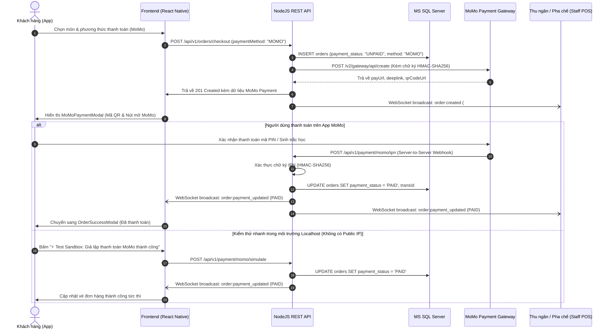

# HƯỚNG DẪN TÍCH HỢP CỔNG THANH TOÁN MOMO & TIỀN MẶT BẰNG NODEJS RESTFUL API (HỆ THỐNG ANT COFFEE)

Tài liệu này hướng dẫn chi tiết quy trình thiết kế, tích hợp và kiểm thử cổng thanh toán **MoMo (API v2 - Capture Wallet)** và hình thức **Tiền mặt (Cash on Delivery - COD)** trong hệ thống đặt đồ uống **Ant Coffee & Tea**, sử dụng kiến trúc **NodeJS Express RESTful API**, cơ sở dữ liệu **Microsoft SQL Server**, và đồng bộ trạng thái thời gian thực qua **WebSocket (Socket.IO)**.

---

## MỤC LỤC
1. [Kiến Trúc & Luồng Thanh Toán Tổng Thể](#1-kiến-trúc--luồng-thanh-toán-tổng-thể)
2. [Cấu Hình Môi Trường & Thông Số MoMo Sandbox](#2-cấu-hình-môi-trường--thông-số-momo-sandbox)
3. [Thuật Toán Tạo & Xác Thực Chữ Ký Số HMAC-SHA256](#3-thuật-toán-tạo--xác-thực-chữ-ký-số-hmac-sha256)
4. [Đặc Tả Danh Sách RESTful API Thanh Toán](#4-đặc-tả-danh-sách-restful-api-thanh-toán)
   - [4.1. Khởi tạo đơn hàng & liên kết MoMo (`POST /api/v1/orders/checkout`)](#41-khởi-tạo-đơn-hàng--liên-kết-momo-post-apiv1orderscheckout)
   - [4.2. Tạo phiên thanh toán MoMo độc lập (`POST /api/v1/payment/momo/create`)](#42-tạo-phiên-thanh-toán-momo-độc-lập-post-apiv1paymentmomocreate)
   - [4.3. Xử lý Webhook IPN từ MoMo (`POST /api/v1/payment/momo/ipn`)](#43-xử-lý-webhook-ipn-từ-momo-post-apiv1paymentmomoipn)
   - [4.4. Callback chuyển hướng khách hàng (`GET /api/v1/payment/momo/callback`)](#44-callback-chuyển-hướng-khách-hàng-get-apiv1paymentmomocallback)
   - [4.5. Tra cứu trạng thái thanh toán (`GET /api/v1/payment/momo/status/:orderCode`)](#45-tra-cứu-trạng-thái-thanh-toán-get-apiv1paymentmomostatusordercode)
   - [4.6. Giả lập thanh toán MoMo trong Dev (`POST /api/v1/payment/momo/simulate`)](#46-giả-lập-thanh-toán-momo-trong-dev-post-apiv1paymentmomosimulate)
5. [Quy Trình Xử Lý Thanh Toán Tiền Mặt (COD)](#5-quy-trình-xử-lý-thanh-toán-tiền-mặt-cod)
6. [Đồng Bộ Trạng Thái Thời Gian Thực Qua WebSocket](#6-đồng-bộ-trạng-thái-thời-gian-thực-qua-websocket)
7. [Hướng Dẫn Kiểm Thử & Debug](#7-hướng-dẫn-kiểm-thử--debug)
8. [Bảo Mật & Xử Lý Idempotency Chống Trùng Lặp](#8-bảo-mật--xử-lý-idempotency-chống-trùng-lặp)

---

## 1. KIẾN TRÚC & LUỒNG THANH TOÁN TỔNG THỂ

Hệ thống hỗ trợ 2 phương thức thanh toán chủ đạo khi khách hàng đặt đồ uống:
1. **Ví điện tử MoMo**: Khách hàng quét mã QR trên màn hình hoặc mở ứng dụng MoMo thanh toán online tức thì.
2. **Tiền mặt (COD)**: Khách hàng thanh toán trực tiếp cho nhân viên giao hàng hoặc thu ngân tại quầy khi nhận món.

### Sơ đồ tuần tự giao dịch MoMo (Sequence Diagram)



---

## 2. CẤU HÌNH MÔI TRƯỜNG & THÔNG SỐ MOMO SANDBOX

Các thông số cấu hình được lưu trong file `BE/.env`:

```env
# MoMo Payment Gateway Configuration (Môi trường Sandbox Thử Nghiệm)
MOMO_PARTNER_CODE=MOMO
MOMO_ACCESS_KEY=F8BBA842ECF85
MOMO_SECRET_KEY=K951B6PE1waDMi640xX08PD3vg6EkVlz
MOMO_API_ENDPOINT=https://test-payment.momo.vn/v2/gateway/api/create
MOMO_QUERY_ENDPOINT=https://test-payment.momo.vn/v2/gateway/api/query
MOMO_REDIRECT_URL=http://localhost:5000/api/v1/payment/momo/callback
MOMO_IPN_URL=http://localhost:5000/api/v1/payment/momo/ipn
```

### Ý nghĩa các tham số:
- **`MOMO_PARTNER_CODE`**: Mã đối tác định danh gian hàng trên MoMo (Sandbox mặc định: `MOMO`).
- **`MOMO_ACCESS_KEY`**: Khóa truy cập công khai đi kèm request HTTP.
- **`MOMO_SECRET_KEY`**: Khóa bí mật dùng để băm tạo chữ ký điện tử HMAC-SHA256 (tuyệt đối không để lộ cho Client).
- **`MOMO_API_ENDPOINT`**: Đường dẫn API v2 tạo phiên thanh toán (`captureWallet`).
- **`MOMO_QUERY_ENDPOINT`**: Đường dẫn API kiểm tra trạng thái đơn hàng.
- **`MOMO_REDIRECT_URL`**: Đường dẫn người dùng được chuyển hướng về trình duyệt sau khi hoàn tất hoặc hủy thanh toán.
- **`MOMO_IPN_URL`**: Địa chỉ Webhook nhận thông báo kết quả ngầm giữa Server MoMo và Server Ant Coffee.

---

## 3. THUẬT TOÁN TẠO & XÁC THỰC CHỮ KÝ SỐ HMAC-SHA256

MoMo API v2 áp dụng thuật toán **HMAC-SHA256** để đảm bảo tính toàn vẹn dữ liệu và chống giả mạo.

### 3.1. Tạo chữ ký khi gửi yêu cầu thanh toán (`createPayment`)
Các trường thông tin bắt buộc phải được sắp xếp theo đúng **thứ tự bảng chữ cái alphabet (A-Z)**:

```javascript
// Chuỗi raw signature
const rawSignature = 
  `accessKey=${accessKey}` +
  `&amount=${amount}` +
  `&extraData=${extraData}` +
  `&ipnUrl=${ipnUrl}` +
  `&orderId=${orderId}` +
  `&orderInfo=${orderInfo}` +
  `&partnerCode=${partnerCode}` +
  `&redirectUrl=${redirectUrl}` +
  `&requestId=${requestId}` +
  `&requestType=${requestType}`;

// Băm HMAC-SHA256 bằng secretKey
const signature = crypto
  .createHmac('sha256', secretKey)
  .update(rawSignature)
  .digest('hex');
```

> **Cảnh báo quan trọng**: Nếu thứ tự các trường hoặc kiểu dữ liệu bị sai lệch dù chỉ 1 ký tự, MoMo sẽ từ chối với mã lỗi `resultCode: 11007` (hoặc `66: Invalid signature`).

### 3.2. Xác thực chữ ký khi nhận Webhook IPN (`verifyMoMoIpnSignature`)
Khi MoMo gửi kết quả thanh toán về qua Webhook, Server phải tính lại chữ ký và so sánh với trường `signature` đính kèm:

```javascript
const rawSignature = 
  `accessKey=${accessKey}` +
  `&amount=${amount}` +
  `&extraData=${extraData}` +
  `&message=${message}` +
  `&orderId=${orderId}` +
  `&orderInfo=${orderInfo}` +
  `&orderType=${orderType}` +
  `&partnerCode=${partnerCode}` +
  `&payType=${payType}` +
  `&requestId=${requestId}` +
  `&responseTime=${responseTime}` +
  `&resultCode=${resultCode}` +
  `&transId=${transId}`;

const expectedSignature = crypto
  .createHmac('sha256', secretKey)
  .update(rawSignature)
  .digest('hex');

const isValid = (signature === expectedSignature);
```

---

## 4. ĐẶC TẢ DANH SÁCH RESTFUL API THANH TOÁN

### 4.1. Khởi tạo đơn hàng & liên kết MoMo (`POST /api/v1/orders/checkout`)
- **Mô tả:** Đặt hàng từ giỏ hàng. Nếu `paymentMethod: 'MOMO'`, server sẽ vừa lưu đơn vào cơ sở dữ liệu vừa tự động gọi MoMo Gateway để lấy thông tin thanh toán (`payUrl`, `qrCodeUrl`, `deeplink`).
- **Headers:** `Content-Type: application/json`
- **Request Body mẫu:**
  ```json
  {
    "address": {
      "recipient_name": "Nguyễn Văn A",
      "phone": "0901234567",
      "address_detail": "123 Nguyễn Huệ, Quận 1, TP.HCM"
    },
    "items": [
      {
        "product": { "id": 101, "name": "Cà phê Muối", "base_price": 35000 },
        "quantity": 2,
        "totalPrice": 70000,
        "selectedSize": { "name": "Size M", "extra_price": 6000 }
      }
    ],
    "subtotalAmount": 70000,
    "shippingFee": 15000,
    "discountAmount": 0,
    "totalAmount": 85000,
    "paymentMethod": "MOMO",
    "customerNote": "Giao nhanh giúp mình"
  }
  ```
- **Response `201 Created`:**
  ```json
  {
    "success": true,
    "message": "Đã tạo đơn hàng & tạo liên kết MoMo thành công!",
    "data": {
      "id": 1009,
      "orderCode": "ANT-4237",
      "sequence_number": "A007",
      "status": "PENDING",
      "total_amount": 85000,
      "payment_status": "UNPAID",
      "payment_method": "Ví MoMo",
      "momoPayment": {
        "success": true,
        "orderCode": "ANT-4237",
        "requestId": "ANT-4237_1792500364011",
        "orderId": "ANT-4237_1792500364011",
        "amount": 85000,
        "payUrl": "https://test-payment.momo.vn/v2/gateway/pay?t=...",
        "deeplink": "momo://app?action=payWithApp&...",
        "qrCodeUrl": "momo://app?action=payWithApp&isScanQR=true...",
        "message": "Thành công."
      }
    },
    "momoPayment": { ... }
  }
  ```

---

### 4.2. Tạo phiên thanh toán MoMo độc lập (`POST /api/v1/payment/momo/create`)
- **Mô tả:** Dùng khi người dùng mở lại trang thanh toán cho đơn hàng đã đặt trước đó nhưng chưa thanh toán.
- **Request Body:**
  ```json
  {
    "orderCode": "ANT-4237",
    "amount": 85000,
    "orderInfo": "Thanh toan don hang ANT-4237 tai Ant Coffee"
  }
  ```
- **Response `200 OK`:**
  ```json
  {
    "success": true,
    "message": "Khởi tạo giao dịch MoMo thành công",
    "data": {
      "orderCode": "ANT-4237",
      "amount": 85000,
      "payUrl": "https://test-payment.momo.vn/v2/gateway/pay?t=...",
      "deeplink": "momo://app?action=payWithApp&...",
      "qrCodeUrl": "momo://app?action=payWithApp&isScanQR=true..."
    }
  }
  ```

---

### 4.3. Xử lý Webhook IPN từ MoMo (`POST /api/v1/payment/momo/ipn`)
- **Mô tả:** Server MoMo tự động gọi tới endpoint này sau khi khách hàng chuyển tiền thành công.
- **Quyền:** Public Webhook (Xác thực bằng chữ ký số HMAC-SHA256).
- **Request Body (Từ MoMo gửi sang):**
  ```json
  {
    "partnerCode": "MOMO",
    "orderId": "ANT-4237_1792500364011",
    "requestId": "ANT-4237_1792500364011",
    "amount": 85000,
    "orderInfo": "Thanh toan Ant Coffee cho don #ANT-4237",
    "orderType": "momo_wallet",
    "transId": 2458923145,
    "resultCode": 0,
    "message": "Thành công.",
    "payType": "qr",
    "responseTime": 1792500375000,
    "extraData": "",
    "signature": "ad85ad8c9e3cd63e0f9d519595b229abe9d8..."
  }
  ```
- **Quy trình xử lý của Server:**
  1. Kiểm tra chữ ký `verifyMoMoIpnSignature`. Nếu sai -> trả về HTTP `400 Bad Request`.
  2. Tách `orderCode` từ `orderId`.
  3. Nếu `resultCode === 0`:
     - Cập nhật cơ sở dữ liệu: `UPDATE orders SET payment_status = 'PAID', payment_transaction_ref = @transId WHERE order_code = @orderCode`.
     - Phát sự kiện WebSocket `order:payment_updated` để App khách hàng và màn hình Thu ngân nhận thông báo ngay lập tức mà không cần F5/tải lại trang.
  4. Phản hồi cho MoMo với HTTP `200 OK`:
     ```json
     { "partnerCode": "MOMO", "orderId": "ANT-4237_...", "resultCode": 0, "message": "Acknowledged" }
     ```

---

### 4.4. Callback chuyển hướng khách hàng (`GET /api/v1/payment/momo/callback`)
- **Mô tả:** Khi khách hàng thanh toán xong trên Web MoMo Gateway, trình duyệt sẽ tự động chuyển hướng về URL này.
- **Query Params:** `?partnerCode=MOMO&orderId=ANT-4237_...&resultCode=0&message=Thanh+cong`
- **Response:** Trang HTML giao diện Dark theme sang trọng hiển thị trạng thái thanh toán và nút bấm quay lại ứng dụng Ant Coffee.

---

### 4.5. Tra cứu trạng thái thanh toán (`GET /api/v1/payment/momo/status/:orderCode`)
- **Mô tả:** Client gọi API này để kiểm tra xem đơn hàng đã được cập nhật thanh toán thành công hay chưa.
- **Response `200 OK`:**
  ```json
  {
    "success": true,
    "data": {
      "orderCode": "ANT-4237",
      "paymentStatus": "PAID",
      "paymentMethod": "MOMO",
      "transactionRef": "2458923145",
      "isPaid": true,
      "totalAmount": 85000
    }
  }
  ```

---

### 4.6. Giả lập thanh toán MoMo trong Dev (`POST /api/v1/payment/momo/simulate`)
- **Mô tả:** Dành cho việc chấm điểm, chạy thử nghiệm cục bộ trên localhost mà không bắt buộc phải mở cổng tunnel hoặc dùng App MoMo thật.
- **Request Body:**
  ```json
  {
    "orderCode": "ANT-4237"
  }
  ```
- **Response `200 OK`:**
  ```json
  {
    "success": true,
    "message": "Giả lập thanh toán MoMo thành công cho đơn hàng #ANT-4237",
    "data": {
      "id": 1009,
      "order_code": "ANT-4237",
      "payment_status": "PAID",
      "payment_method": "MOMO",
      "payment_transaction_ref": "SIM_MOMO_1792500452041"
    }
  }
  ```

---

## 5. QUY TRÌNH XỬ LÝ THANH TOÁN TIỀN MẶT (COD)

Khi khách hàng chọn **Tiền mặt khi nhận (COD)**:
1. Client gửi `paymentMethod: 'CASH'` trong payload `POST /api/v1/orders/checkout`.
2. Server tạo đơn trong SQL Server với:
   - `payment_method = 'CASH'`
   - `payment_status = 'UNPAID'`
   - Không gọi ra cổng thanh toán MoMo bên ngoài (`momoPayment = null`).
3. Client đóng giỏ hàng và mở trực tiếp màn hình vé máy bay `OrderSuccessModal`:
   - Hiển thị thông báo: `Tiền mặt khi nhận (Chưa thu)`.
   - Lưu ý khách hàng chuẩn bị sẵn tiền mặt khi shipper giao hàng tới.
4. Khi nhân viên pha chế & shipper giao hàng xong:
   - Thu ngân / Nhân viên bấm **Hoàn tất đơn & Thu tiền** (`PUT /api/v1/orders/:id/status` với `status: 'COMPLETED'`).
   - Lúc này `payment_status` của đơn tiền mặt sẽ tự động được chuyển thành `PAID`.
   - Doanh thu tiền mặt được cộng dồn vào két ca làm việc của nhân viên (`staff_shifts`).

---

## 6. ĐỒNG BỘ TRẠNG THÁI THỜI GIAN THỰC QUA WEBSOCKET

Hệ thống sử dụng **Socket.IO** để đồng bộ trạng thái đơn hàng tức thì giữa Khách hàng, Thu ngân và Pha chế:

| Tên sự kiện | Dữ liệu phát đi (Payload) | Mô tả |
| :--- | :--- | :--- |
| `order:created` | `{ id, order_code, items, total_amount, payment_method, ... }` | Phát khi có đơn hàng mới được tạo. Màn hình POS nhân viên tự động re-render và hiển thị đơn mới trên hàng đợi. |
| `order:payment_updated` | `{ order_code, payment_status: 'PAID', payment_transaction_ref, ... }` | Phát khi MoMo xác nhận thanh toán thành công qua IPN. Modal thanh toán trên máy khách tự động đóng và chuyển sang vé thành công. |
| `order:status_updated` | `{ order_code, status: 'CONFIRMED' / 'READY' / 'COMPLETED' }` | Phát khi quán chuyển đổi tiến trình pha chế và giao hàng. |

### Cách lắng nghe ở Client (React Native):
```javascript
import { subscribeOrderPaymentUpdated } from './src/services/socket';

useEffect(() => {
  const unsubscribe = subscribeOrderPaymentUpdated((paidOrder) => {
    if (paidOrder.order_code === currentOrderCode && paidOrder.payment_status === 'PAID') {
      alert('Thanh toán MoMo thành công!');
    }
  });

  return () => unsubscribe();
}, [currentOrderCode]);
```

---

## 7. HƯỚNG DẪN KIỂM THỬ & DEBUG

### 7.1. Chạy bài kiểm thử tự động (Automated Test Suite)
Đã cấu hình script kiểm thử toàn diện toàn bộ 6 kịch bản thanh toán:
```powershell
cd "A:\Class do DNTU\LT_Android\antcafe\BE"
npm run test:payment
```
**Kết quả mong đợi:**
```text
====================================================
🚀 KIỂM THỬ TÍCH HỢP THANH TOÁN MOMO & TIỀN MẶT ANT COFFEE
====================================================
▶ [Test 1] Tạo đơn hàng thanh toán Tiền mặt (COD)...
  ✅ THÀNH CÔNG: Đơn hàng tiền mặt được tạo với trạng thái UNPAID.
▶ [Test 2] Tạo đơn hàng thanh toán Ví MoMo (Capture Wallet)...
  ✅ THÀNH CÔNG: Đơn hàng MoMo khởi tạo thành công (payUrl, deeplink).
▶ [Test 3] Tra cứu trạng thái đơn hàng khi chưa thanh toán...
  ✅ THÀNH CÔNG: Trạng thái hiện tại là UNPAID.
▶ [Test 4] Giả lập hoàn tất thanh toán MoMo thành công...
  ✅ THÀNH CÔNG: Đơn hàng đã chuyển sang PAID.
▶ [Test 5] Tra cứu lại trạng thái đơn hàng sau thanh toán...
  ✅ THÀNH CÔNG: Xác nhận đơn hàng đã ghi nhận thanh toán (isPaid = true).
▶ [Test 6] Kiểm tra xác thực chữ ký Webhook IPN...
  ✅ THÀNH CÔNG: Chữ ký hợp lệ được chấp thuận, chữ ký giả mạo bị từ chối 100%.
====================================================
🎉 TẤT CẢ 6 BÀI KIỂM THỬ THANH TOÁN ĐỀU ĐẠT CHUẨN 100%!
====================================================
```

### 7.2. Kiểm thử trên ứng dụng di động (Expo App)
1. Mở ứng dụng Ant Coffee trên Android / iOS / Web.
2. Thêm món đồ uống vào giỏ hàng và mở giỏ hàng.
3. Tại phần **Phương thức thanh toán**, chọn:
   - **Ví điện tử MoMo**: Nút đặt hàng đổi sang màu hồng MoMo `#A50064` với nhãn `Thanh toán Ví MoMo • ...đ`. Bấm đặt hàng sẽ mở `MoMoPaymentModal` hiển thị mã QR, nút "Mở ứng dụng MoMo", và nút "⚡ Test Sandbox: Giả lập thanh toán MoMo thành công".
   - **Tiền mặt (COD)**: Nút đặt hàng đổi sang màu xanh lá với nhãn `Đặt đơn (Tiền mặt COD) • ...đ`. Bấm đặt hàng sẽ mở trực tiếp vé xác nhận `OrderSuccessModal` với trạng thái `Tiền mặt khi nhận (Chưa thu)`.

---

## 8. BẢO MẬT & XỬ LÝ IDEMPOTENCY CHỐNG TRÙNG LẶP

1. **Bảo mật Secret Key**:
   - `MOMO_SECRET_KEY` chỉ được lưu tại server (`BE/.env`). Tuyệt đối không bao giờ trả về Client hoặc commit lên Git công khai.
2. **Kiểm tra Chữ ký số Webhook**:
   - Mọi request từ `POST /api/v1/payment/momo/ipn` đều phải đi qua hàm `verifyMoMoIpnSignature`. Nếu không khớp, từ chối ngay lập tức.
3. **Idempotency (Chống xử lý trùng lặp giao dịch)**:
   - MoMo có thể gửi lại IPN nhiều lần nếu chưa nhận được phản hồi 200/204.
   - Khi cập nhật đơn hàng:
     ```sql
     IF EXISTS (SELECT 1 FROM orders WHERE order_code = @orderCode AND payment_status = 'PAID')
     BEGIN
         -- Giao dịch đã được thanh toán trước đó, không cập nhật lại điểm tích lũy hoặc phát thông báo lặp
         RETURN;
     END
     ```
4. **Tương thích SQL Server Triggers**:
   - Tránh dùng mệnh đề `OUTPUT INSERTED...` trực tiếp trên các câu lệnh `UPDATE` khi bảng có trigger audit kích hoạt; luôn tách thành `UPDATE` và `SELECT` riêng biệt để bảo đảm tính tương thích với ODBC Driver 18.
