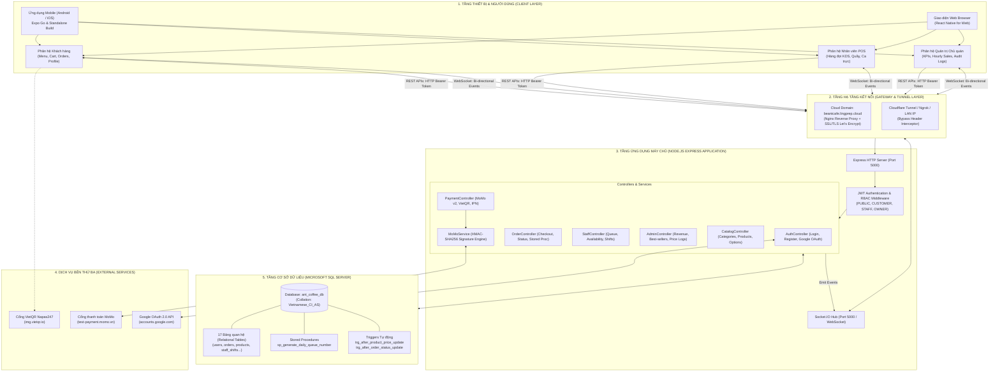
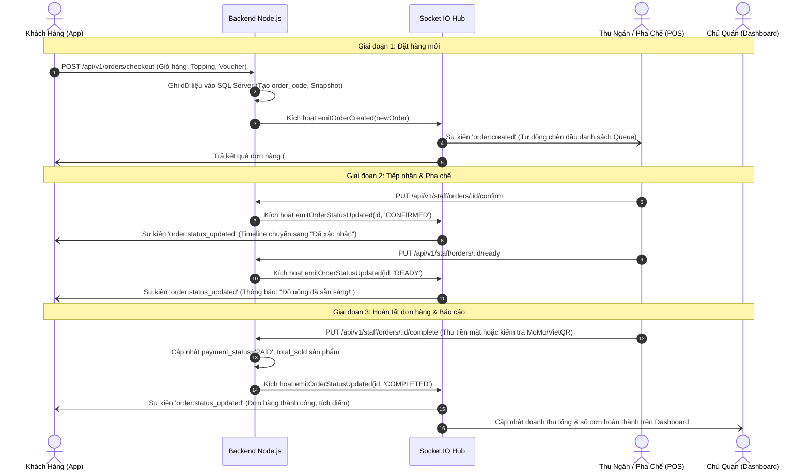
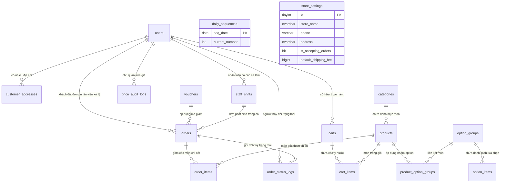

# 🐜 TÀI LIỆU TOÀN DIỆN HỆ THỐNG ANT COFFEE & TEA
> **Enterprise Coffee & Milk Tea Ordering, Real-time POS, and Store Management Platform**  
> *Phiên bản: 1.0.0 | Ngày hoàn thiện: Tháng 10/2026 | Ngôn ngữ: Tiếng Việt*

---

## 📑 MỤC LỤC

1. [TỔNG QUAN DỰ ÁN & MỤC TIÊU PHÁT TRIỂN](#1-tổng-quan-dự-án--mục-tiêu-phát-triển)
   - 1.1. Giới thiệu tổng quan
   - 1.2. Các phân hệ đối tượng người dùng (Multi-Role)
   - 1.3. Các giá trị kỹ thuật cốt lõi & Tính năng nổi bật
2. [TOÀN CẢNH CÔNG NGHỆ (TECHNOLOGY STACK MATRIX)](#2-toàn-cảnh-công-nghệ-technology-stack-matrix)
   - 2.1. Frontend Mobile & Web App (React Native / Expo)
   - 2.2. Backend REST API & Real-time Server (Node.js / Express / Socket.IO)
   - 2.3. Cơ sở dữ liệu quan hệ (Microsoft SQL Server)
   - 2.4. Cổng thanh toán trực tuyến (MoMo API v2 & VietQR Napas247)
   - 2.5. Hạ tầng mạng, Cloud Deployment & Tunneling
3. [KIẾN TRÚC HỆ THỐNG & SƠ ĐỒ THIẾT KẾ (SYSTEM ARCHITECTURE)](#3-kiến-trúc-hệ-thống--sơ-đồ-thiết-kế-system-architecture)
   - 3.1. Kiến trúc phân tầng (High-Level Architecture)
   - 3.2. Sơ đồ luồng dữ liệu thời gian thực (Real-time Event Flow)
   - 3.3. Sơ đồ xử lý đơn hàng đa phân hệ (Order Lifecycle Workflow)
4. [KỸ THUẬT CƠ SỞ DỮ LIỆU & DATA DICTIONARY (DATABASE DESIGN)](#4-kỹ-thuật-cơ-sở-dữ-liệu--data-dictionary-database-design)
   - 4.1. Sơ đồ quan hệ thực thể (ERD - 17 Bảng quan hệ)
   - 4.2. Từ điển dữ liệu chi tiết 17 bảng cốt lõi
   - 4.3. Stored Procedure tự động sinh số thứ tự ngày (`sp_generate_daily_queue_number`)
   - 4.4. Triggers kiểm toán giá và lịch sử trạng thái
   - 4.5. Chiến lược lập chỉ mục (Indexes) tối ưu hóa truy vấn
5. [BACKEND SERVICE & ĐẶC TẢ RESTFUL API (API SPECIFICATION)](#5-backend-service--đặc-tả-restful-api-api-specification)
   - 5.1. Cấu trúc tổ chức mã nguồn Backend
   - 5.2. Cơ chế bảo mật JWT & Phân quyền RBAC
   - 5.3. Bảng tổng hợp toàn bộ 45+ REST API Endpoints
   - 5.4. Đặc tả chi tiết các phân hệ API chính
6. [HỆ THỐNG REAL-TIME WEBSOCKET (SOCKET.IO HUB)](#6-hệ-thống-real-time-websocket-socketio-hub)
   - 6.1. Nguyên lý vận hành & Vòng đời kết nối
   - 6.2. Danh mục các sự kiện WebSocket hai chiều
   - 6.3. Xử lý mất kết nối & Tự động kết nối lại (Auto Reconnect)
7. [FRONTEND APPLICATION & HỆ THỐNG GIAO DIỆN (UI/UX DESIGN SYSTEM)](#7-frontend-application--hệ-thống-giao-diện-uiux-design-system)
   - 7.1. Cấu trúc tổ chức mã nguồn Frontend
   - 7.2. Design System: Glassmorphism & Bộ Tokens cao cấp
   - 7.3. Luồng trải nghiệm Khách hàng (Customer Experience Flow)
   - 7.4. Luồng vận hành Nhân viên Thu ngân & Pha chế (Staff POS Flow)
   - 7.5. Luồng phân tích Quản trị Chủ cửa hàng (Owner Dashboard Flow)
8. [GIẢI PHÁP CỔNG THANH TOÁN (PAYMENT INTEGRATION)](#8-giải-pháp-cổng-thanh-toán-payment-integration)
   - 8.1. Tích hợp Ví điện tử MoMo API v2 (Capture Wallet)
   - 8.2. Tích hợp VietQR Chuẩn Napas 247 Dynamic Code
   - 8.3. Thanh toán Tiền mặt khi nhận hàng (COD) & Quản lý két ca trực
   - 8.4. Chuyển đổi phương thức thanh toán linh hoạt (Payment Switcher)
9. [HẠ TẦNG KẾT NỐI, CLOUD VÀ MÔI TRƯỜNG TRIỂN KHAI](#9-hạ-tầng-kết-nối-cloud-và-môi-trường-triển-khai)
   - 9.1. Cơ chế tự động phát hiện môi trường (Dynamic Resolver)
   - 9.2. Triển khai Cloud Server (`https://beantcafe.lingprep.cloud`)
   - 9.3. Cơ chế vượt rào cảnh báo Tunnel (Tunnel Interstitial Bypass)
10. [HƯỚNG DẪN CÀI ĐẶT, KHỞI CHẠY & KIỂM THỬ TOÀN DIỆN](#10-hướng-dẫn-cài-đặt-khởi-chạy--kiểm-thử-toàn-diện)
    - 10.1. Yêu cầu tiên quyết môi trường
    - 10.2. Khởi tạo Cơ sở dữ liệu và nạp dữ liệu mẫu
    - 10.3. Khởi chạy Backend Server
    - 10.4. Khởi chạy Ứng dụng Mobile / Web Frontend
    - 10.5. Danh mục tài khoản mẫu dùng thử
    - 10.6. Kiểm thử tự động (Automated Test Suites)
11. [ĐỘ TIN CẬY, BẢO MẬT & XỬ LÝ SỰ CỐ (RESILIENCE & TROUBLESHOOTING)](#11-độ-tin-cậy-bảo-mật--xử-lý-sự-cố-resilience--troubleshooting)
    - 11.1. Cơ chế hoạt động ngoại tuyến (Offline Graceful Degradation)
    - 11.2. Xác thực giá kép (Double Price Check)
    - 11.3. Khắc phục sự cố thường gặp (Troubleshooting Guide)
12. [ĐÁNH GIÁ DỰ ÁN & ĐỊNH HƯỚNG PHÁT TRIỂN TIẾP THEO](#12-đánh-giá-dự-án--định-hướng-phát-triển-tiếp-theo)

---

## 1. TỔNG QUAN DỰ ÁN & MỤC TIÊU PHÁT TRIỂN

### 1.1. Giới thiệu tổng quan
**Ant Coffee & Tea** là giải pháp phần mềm quản trị và bán hàng đa kênh (Omnichannel F&B Platform) chuyên biệt cho ngành đồ uống (Cà phê, Trà sữa, Trà trái cây, Bánh ngọt). Hệ thống kết hợp giữa ứng dụng di động cho khách hàng, màn hình điều hành bếp/thu ngân (Kitchen Display System - KDS / POS) cho nhân viên và bảng điều khiển quản trị thông minh (Owner Analytics Dashboard) cho chủ quán.

Dự án được xây dựng với mục tiêu:
- Tối ưu hóa thời gian đặt hàng và chế biến: Loại bỏ việc ghi giấy thủ công, cập nhật trạng thái đơn hàng theo thời gian thực (Real-time).
- Kiểm soát tài chính và chống thất thoát: Quản lý két tiền ca trực chặt chẽ, kiểm toán mọi lịch sử điều chỉnh giá bán và giám sát tỷ lệ hủy đơn hàng.
- Nâng cao trải nghiệm khách hàng: Tùy biến ly nước theo khẩu vị cá nhân (Mức đá, Mức đường, Topping, Size ly), áp dụng mã giảm giá, hỗ trợ đa dạng phương thức thanh toán không tiền mặt.
- Khả năng mở rộng và triển khai linh hoạt: Hỗ trợ chạy mượt mà từ môi trường phát triển cục bộ (Local LAN, Android Emulator), qua các dịch vụ Tunnel (Cloudflare Tunnel, Ngrok) đến hệ thống Production trên Cloud.

### 1.2. Các phân hệ đối tượng người dùng (Multi-Role)
Hệ thống thiết kế theo mô hình **Role-Based Access Control (RBAC)** với 3 đối tượng người dùng chính:

```
                          +-------------------------+
                          |   HỆ THỐNG ANT COFFEE   |
                          +-------------------------+
                                       |
        +------------------------------+-----------------------------+
        |                              |                             |
        v                              v                             v
+----------------+            +-----------------+          +--------------------+
|   CUSTOMER     |            |    STAFF POS    |          |    OWNER ADMIN     |
| (Khách hàng)   |            |  (Nhân viên)    |          |   (Chủ cửa hàng)   |
+----------------+            +-----------------+          +--------------------+
| - Xem thực đơn |            | - Hàng đợi làm  |          | - KPI & Doanh thu  |
| - Custom ly    |            |   món thời gian |          | - Biểu đồ khung giờ|
| - Áp mã voucher|            |   thực          |          | - Best-sellers     |
| - MoMo/VietQR  |            | - Báo hết món   |          | - Price Audit Log  |
| - Live tracking|            | - Đóng/mở két ca|          | - Bật/tắt khẩn cấp |
+----------------+            +-----------------+          +--------------------+
```

1. **Khách hàng (CUSTOMER):**
   - Đăng nhập linh hoạt qua Số điện thoại + Mật khẩu / OTP, hoặc tài khoản Google OAuth 2.0.
   - Trải nghiệm thực đơn trực quan: xem hình ảnh, mô tả, đánh giá sao, nhãn khuyến mãi / bán chạy.
   - Tùy chỉnh chi tiết ly nước: Chọn Size (S/M/L), Mức đá (0%/30%/50%/100%), Độ ngọt (0%/30%/50%/100%), Thêm nhiều loại Topping (Trân châu hoàng kim, Thạch củ năng, Kem cheese...).
   - Giỏ hàng thông minh: Tự động gộp ly cùng cấu hình thông qua mã băm chữ ký (Signature Hash).
   - Thanh toán đa kênh: Ví điện tử MoMo, Quét mã ngân hàng VietQR Napas247 hoặc Tiền mặt khi nhận hàng (COD).
   - Theo dõi trạng thái đơn hàng trực tiếp qua dòng thời gian (Live Order Tracking Timeline).

2. **Nhân viên thu ngân & Pha chế (STAFF POS):**
   - Hàng đợi làm món tự động cập nhật ngay khi khách bấm đặt mà không cần tải lại trang.
   - Thao tác 1 chạm chuyển đổi trạng thái: *Tiếp nhận (PENDING -> CONFIRMED)* -> *Pha chế xong (READY)* -> *Hoàn tất giao nước & Thu tiền (COMPLETED)*.
   - Hủy đơn hàng có kiểm soát: Bắt buộc chọn và ghi rõ lý do hủy (Hết nguyên liệu, Khách yêu cầu hủy, Khách không nhận hàng).
   - Báo hết món nhanh tại quầy (Quick Out-of-Stock): Tắt/bật trạng thái sẵn sàng của món hoặc topping tức thì.
   - Quản lý ca làm việc (Shifts): Khai báo tiền mặt đầu ca, hệ thống tự đối soát doanh số bán hàng trong ca với tiền mặt thực nộp để tính tiền lệch két (`discrepancy_amount`).

3. **Chủ cửa hàng / Quản lý (OWNER):**
   - Bảng điều khiển hiệu suất kinh doanh (Executive Dashboard): Doanh thu trong ngày, Tổng số đơn, Tỷ lệ hủy đơn, Giá trị trung bình trên đơn (AOV - Average Order Value).
   - Biểu đồ phân tích doanh thu theo khung giờ (07:00 đến 21:00) nhằm phân bổ nhân sự hợp lý theo giờ cao điểm.
   - Danh sách món bán chạy nhất (Top Best Sellers) theo thời gian thực.
   - Nhật ký kiểm toán giá (Price Audit Logs): Ghi lại minh bạch ai đã sửa giá món, giá cũ là bao nhiêu, giá mới là bao nhiêu.
   - Công tắc khẩn cấp toàn cửa hàng (`is_accepting_orders`): Đóng nhận đơn trên toàn hệ thống trong trường hợp quán quá tải, mất điện hoặc cần bảo trì quầy pha chế.

### 1.3. Các giá trị kỹ thuật cốt lõi & Tính năng nổi bật
- **Đồng bộ dữ liệu thời gian thực (Real-time Full Duplex):** Khách đặt hàng -> Quầy Barista hiện đơn ngay lập tức -> Barista bấm làm xong -> Khách nhận thông báo trên điện thoại tức thì qua WebSocket (Socket.IO).
- **Hệ cơ sở dữ liệu quan hệ chặt chẽ:** Sử dụng Microsoft SQL Server với 17 bảng liên kết khóa ngoại (`FOREIGN KEY`), các ràng buộc toàn vẹn dữ liệu (`CHECK`, `UNIQUE`), Stored Procedures sinh số thứ tự nguyên tử không trùng lặp và Triggers kiểm toán tự động.
- **Snapshot bảo toàn lịch sử:** Đơn hàng lưu trữ toàn bộ bản sao (Snapshot) của tên sản phẩm, giá gốc và cấu hình tùy chọn tại thời điểm đặt hàng. Khi quán điều chỉnh giá trong tương lai, toàn bộ báo cáo doanh thu và lịch sử đơn cũ không bị sai lệch.
- **Tích hợp cổng thanh toán chuẩn Enterprise:**
  - MoMo API v2: Thuật toán tạo chữ ký điện tử HMAC-SHA256, xử lý Webhook IPN bí mật giữa Server và Server, Deep Link và QR Code động.
  - VietQR Napas247: Tích hợp chuẩn mã QR chuyển khoản ngân hàng quốc gia với thông tin thụ hưởng và nội dung chuyển khoản được mã hóa chính xác theo mã đơn.
- **Thiết kế giao diện đẳng cấp (Luxury Glassmorphism):** Giao diện thiết kế theo triết lý hiện đại với bảng màu Tailored HSL, hiệu ứng đổ bóng mờ ảo nhiều lớp, thẻ kính mờ (Frosted Glass), hỗ trợ Dark & Light UI elements.
- **Khả năng tự thích ứng hạ tầng (Zero-Config Environment Switching):** Tự nhận diện và chuyển đổi thông minh giữa Server Cloud, Local LAN IP, Android Emulator IP và Public Tunnel Domain.

---

## 2. TOÀN CẢNH CÔNG NGHỆ (TECHNOLOGY STACK MATRIX)

| Phân tầng (Layer) | Công nghệ / Thư viện | Phiên bản | Mục đích & Vai trò trong hệ thống |
| :--- | :--- | :--- | :--- |
| **Frontend Core** | React Native | `0.86.3` | Nền tảng xây dựng ứng dụng di động Native đa nền tảng |
| **Frontend Framework** | Expo Framework | `~57.0.29` | Bộ công cụ quản lý vòng đời ứng dụng, build và runtime |
| **UI Library** | React | `19.2.3` | Thư viện quản lý UI Component dựa trên trạng thái (State) |
| **Icons & Typography** | `@expo/vector-icons` | `^15.0.2` | Bộ biểu tượng Ionicons, MaterialIcons, Feather sắc nét |
| **Screen Layout** | `react-native-safe-area-context` | `~5.7.0` | Đảm bảo giao diện hiển thị an toàn trên Notch và Dynamic Island |
| **Cross-Platform Web** | `react-native-web` | `^0.21.2` | Biên dịch ứng dụng React Native chạy trực tiếp trên Trình duyệt Web |
| **Mobile Auth & Browser** | `expo-auth-session`, `expo-web-browser`, `expo-crypto` | `~57.x` | Xác thực đăng nhập Google OAuth 2.0 an toàn qua PKCE |
| **Client Real-time** | `socket.io-client` | `^4.8.4` | Kết nối WebSocket hai chiều với máy chủ Backend |
| **Backend Runtime** | Node.js (ES Modules) | `>= 18.x` | Nền tảng thực thi JavaScript phía máy chủ hiệu năng cao |
| **Web Server Framework** | Express.js | `^4.21.2` | Bộ khung định tuyến RESTful API, Middleware xử lý Request/Response |
| **Server Real-time** | Socket.IO Server | `^4.8.1` | Máy chủ điều phối các phòng (Rooms), sự kiện thời gian thực |
| **Database Engine** | Microsoft SQL Server | `2019 / 2022 / Express` | Hệ quản trị cơ sở dữ liệu quan hệ chuẩn Enterprise, T-SQL |
| **SQL Server Driver** | `mssql` & `msnodesqlv8` | `^11.0.1` / `^5.6.0` | Driver kết nối SQL Server qua ODBC Driver 18 và TDS Protocol |
| **Authentication & Tokens** | `jsonwebtoken` (JWT) | `^9.0.2` | Cấp phát và giải mã Bearer Token phân quyền người dùng |
| **Password Hashing** | `bcryptjs` | `^3.0.3` | Thuật toán băm một chiều mật khẩu kèm muối (Salt rounds) |
| **Network & Security** | `cors`, `morgan`, `dotenv` | Latest | Xử lý Cross-Origin, ghi nhật ký truy cập HTTP, nạp biến môi trường |
| **Payment Gateway** | MoMo E-Wallet API v2 | `Capture Wallet` | Cổng thanh toán ví điện tử MoMo với chữ ký số HMAC-SHA256 |
| **Bank Transfer QR** | VietQR Standard | `Napas 247` | Chuẩn mã QR thanh toán liên ngân hàng nhanh qua MBBank |
| **Tunnel & Gateway** | Cloudflare Tunnel / Ngrok | N/A | Tạo cổng kết nối Internet an toàn từ máy phát triển ra bên ngoài |
| **Cloud Hosting** | Production Cloud VM | `Ubuntu LTS` | Máy chủ chứa Backend API tại `https://beantcafe.lingprep.cloud` |

---

## 3. KIẾN TRÚC HỆ THỐNG & SƠ ĐỒ THIẾT KẾ (SYSTEM ARCHITECTURE)

### 3.1. Kiến trúc phân tầng (High-Level Architecture)



### 3.2. Sơ đồ luồng dữ liệu thời gian thực (Real-time Event Flow)
Hệ thống sử dụng WebSocket thông qua thư viện Socket.IO nhằm đảm bảo thông tin giữa khách hàng và quầy pha chế được đồng bộ ngay tức khắc:



---

## 4. KỸ THUẬT CƠ SỞ DỮ LIỆU & DATA DICTIONARY (DATABASE DESIGN)

### 4.1. Sơ đồ quan hệ thực thể (ERD - 17 Bảng quan hệ)



### 4.2. Từ điển dữ liệu chi tiết 17 bảng cốt lõi

#### 1. Bảng `users` (Quản trị tài khoản đa vai trò)
Lưu trữ thông tin xác thực tập trung cho cả 3 phân quyền.
- `id` (BIGINT, PK, Identity): Mã định danh duy nhất.
- `phone` (VARCHAR(15), UNIQUE, NOT NULL): Số điện thoại đăng nhập.
- `email` (VARCHAR(150), NULL): Email người dùng (hoặc email liên kết Google).
- `password_hash` (VARCHAR(255), NOT NULL): Mật khẩu băm an toàn qua `bcryptjs`.
- `full_name` (NVARCHAR(100), NOT NULL): Họ và tên có dấu.
- `avatar_url` (VARCHAR(500), NULL): Đường dẫn ảnh đại diện.
- `role` (VARCHAR(20), NOT NULL): Phân quyền (`CUSTOMER`, `STAFF`, `OWNER`).
- `status` (VARCHAR(20), NOT NULL): Trạng thái hoạt động (`ACTIVE`, `LOCKED`).
- `loyalty_points` (INT, NOT NULL, DEFAULT 0): Điểm thưởng tích lũy cho khách hàng.
- `last_login_at` (DATETIME2, NULL): Thời điểm đăng nhập gần nhất.
- `created_at`, `updated_at` (DATETIME2): Dấu thời gian hệ thống.

#### 2. Bảng `store_settings` (Cấu hình duy nhất của quán)
- `id` (TINYINT, PK, CHECK `id = 1`): Ràng buộc chỉ cho phép tồn tại duy nhất 1 bản ghi cấu hình.
- `store_name` (NVARCHAR(150)): Tên cửa hàng (mặc định: N'Ant Coffee & Tea').
- `phone` (VARCHAR(20)): Số hotline của quán.
- `address` (NVARCHAR(255)): Địa chỉ quán phục vụ định vị và tính ship.
- `wifi_name`, `wifi_password` (NVARCHAR/VARCHAR): Thông tin mạng wifi phát cho khách.
- `is_accepting_orders` (BIT, NOT NULL, DEFAULT 1): Công tắc khẩn cấp cho phép/ngừng nhận đơn toàn hệ thống.
- `open_time`, `close_time` (TIME): Khung giờ hoạt động mỗi ngày (07:00:00 - 22:30:00).
- `default_shipping_fee` (BIGINT, DEFAULT 15000): Phí vận chuyển mặc định áp dụng cho đơn giao tận nơi.

#### 3. Bảng `customer_addresses` (Sổ địa chỉ giao hàng của khách)
- `id` (BIGINT, PK, Identity): Mã địa chỉ.
- `user_id` (BIGINT, FK -> `users.id`, ON DELETE CASCADE): Chủ sở hữu địa chỉ.
- `label` (NVARCHAR(50)): Nhãn phân loại (N'Nhà riêng', N'Văn phòng', N'Trường học').
- `recipient_name` (NVARCHAR(100)): Tên người nhận hàng tại điểm đến.
- `recipient_phone` (VARCHAR(15)): Số điện thoại liên hệ khi giao hàng.
- `address_detail` (NVARCHAR(500)): Số nhà, tên đường, phường/xã, quận/huyện.
- `latitude`, `longitude` (DECIMAL(10,8) / DECIMAL(11,8)): Tọa độ GPS phục vụ tích hợp bản đồ.
- `is_default` (BIT, DEFAULT 0): Đánh dấu địa chỉ mặc định khi tạo đơn mới.

#### 4. Bảng `staff_shifts` (Quản lý ca làm việc & Két tiền)
- `id` (BIGINT, PK, Identity): Mã ca trực.
- `staff_id` (BIGINT, FK -> `users.id`): Nhân viên chịu trách nhiệm ca trực.
- `shift_date` (DATE): Ngày làm việc của ca.
- `check_in_at`, `check_out_at` (DATETIME2): Thời điểm mở ca và chốt ca.
- `opening_cash` (BIGINT, DEFAULT 0): Số tiền mặt có sẵn trong két lúc nhận ca.
- `system_calculated_cash` (BIGINT, DEFAULT 0): Tổng tiền mặt thu được từ các đơn hoàn thành trong ca.
- `actual_closing_cash` (BIGINT, NULL): Tiền mặt thực tế nhân viên đếm được khi bàn giao.
- `discrepancy_amount` (AS `actual_closing_cash - (opening_cash + system_calculated_cash)` PERSISTED): **Cột tính toán tự động lưu trữ (Computed Column)**. Nếu âm là thiếu tiền két, dương là thừa tiền két.
- `status` (VARCHAR(20), CHECK `status IN ('OPEN', 'CLOSED')`): Trạng thái ca trực.

#### 5. Bảng `categories` (Danh mục đồ uống)
- `id` (BIGINT, PK, Identity): Mã danh mục.
- `name` (NVARCHAR(100)): Tên danh mục (Cà phê pha máy, Trà sữa truyền thống, Trà trái cây...).
- `slug` (VARCHAR(120), UNIQUE): Đường dẫn SEO thân thiện.
- `icon_url` (VARCHAR(500)): Biểu tượng đồ họa cho danh mục.
- `display_order` (INT): Thứ tự sắp xếp trên thanh cuộn menu.
- `is_active` (BIT, DEFAULT 1): Ẩn/Hiện danh mục.

#### 6. Bảng `products` (Đồ uống & Sản phẩm gốc)
- `id` (BIGINT, PK, Identity): Mã sản phẩm.
- `sku` (VARCHAR(50), UNIQUE): Mã quản lý kho (VD: `CF-MUOI-01`).
- `category_id` (BIGINT, FK -> `categories.id`): Danh mục cha.
- `name` (NVARCHAR(150)): Tên món đồ uống.
- `description` (NVARCHAR(MAX)): Mô tả chi tiết hương vị và nguyên liệu.
- `image_url` (VARCHAR(500)): Ảnh chất lượng cao của món.
- `base_price` (BIGINT, CHECK `base_price >= 0`): Giá bán gốc (Size tiêu chuẩn).
- `original_price` (BIGINT, NULL): Giá gạch ngang trước khi giảm giá.
- `discount_tag` (NVARCHAR(50)): Huy hiệu khuyến mãi (VD: N'Giảm 20%', N'Freeship').
- `rating` (DECIMAL(2,1), DEFAULT 5.0): Điểm đánh giá trung bình.
- `is_available` (BIT, DEFAULT 1): Trạng thái còn món hay hết nguyên liệu.
- `is_featured` (BIT, DEFAULT 0): Đánh dấu món nổi bật (Best Seller).
- `total_sold` (BIGINT, DEFAULT 0): Tổng số ly đã bán thành công (tự động cộng dồn qua trigger).

#### 7. Bảng `option_groups` (Nhóm tùy chọn đồ uống)
- `id` (BIGINT, PK, Identity): Mã nhóm.
- `name` (NVARCHAR(100)): Tên nhóm (N'Chọn Size', N'Mức đá', N'Độ ngọt', N'Thêm Topping').
- `internal_code` (VARCHAR(50)): Mã logic nội bộ (`SIZE`, `ICE`, `SUGAR`, `TOPPING`).
- `selection_type` (VARCHAR(20), CHECK `IN ('SINGLE', 'MULTIPLE')`): Quy tắc chọn 1 hay nhiều.
- `is_required` (BIT, DEFAULT 0): Bắt buộc phải chọn hay không.
- `min_select`, `max_select` (INT): Số lượng lựa chọn tối thiểu và tối đa cho phép.

#### 8. Bảng `option_items` (Chi tiết từng lựa chọn)
- `id` (BIGINT, PK, Identity): Mã mục tùy chọn.
- `group_id` (BIGINT, FK -> `option_groups.id`): Thuộc nhóm tùy chọn nào.
- `name` (NVARCHAR(100)): Tên lựa chọn (VD: N'Size L (+6.000đ)', N'Trân châu đen (+8.000đ)').
- `extra_price` (BIGINT, DEFAULT 0): Đơn giá cộng thêm khi khách chọn.
- `is_default` (BIT, DEFAULT 0): Mặc định chọn sẵn khi mở modal món.
- `is_available` (BIT, DEFAULT 1): Còn hàng hay hết hàng tại quầy.

#### 9. Bảng `product_option_groups` (Liên kết món và nhóm tùy chọn)
- `product_id` (BIGINT, FK -> `products.id` ON DELETE CASCADE).
- `group_id` (BIGINT, FK -> `option_groups.id` ON DELETE CASCADE).
- `PRIMARY KEY (product_id, group_id)`.

#### 10. Bảng `carts` & 11. Bảng `cart_items` (Giỏ hàng thông minh)
- Quản lý giỏ hàng phía Server, hỗ trợ khách đăng nhập từ thiết bị khác vẫn giữ nguyên giỏ hàng.
- Bảng `cart_items` chứa trường `signature_hash` (VARCHAR(64)): Được tạo bằng hàm băm (MD5/SHA) từ chuỗi `product_id + JSON.stringify(sorted_selected_options)`. Nhờ trường này và ràng buộc `UNIQUE (cart_id, signature_hash)`, hệ thống sẽ tự động tăng số lượng ly thay vì tạo ra 2 dòng giống nhau khi khách thêm cùng 1 loại ly có cùng Size và Topping vào giỏ.

#### 12. Bảng `vouchers` (Mã giảm giá & Khuyến mãi)
- `id` (BIGINT, PK, Identity): Mã voucher.
- `code` (VARCHAR(30), UNIQUE): Mã áp dụng (VD: `ANTNEW`, `FREESHIP`).
- `title` (NVARCHAR(150)): Tiêu đề khuyến mãi hiển thị.
- `discount_type` (VARCHAR(20), CHECK `IN ('FIXED_AMOUNT', 'PERCENTAGE')`): Giảm theo tiền mặt (VND) hoặc phần trăm (%).
- `discount_value` (BIGINT): Giá trị giảm (VD: 20000 hoặc 15).
- `max_discount_amount` (BIGINT, NULL): Giới hạn số tiền giảm tối đa khi dùng voucher phần trăm.
- `min_order_amount` (BIGINT, DEFAULT 0): Điều kiện giá trị đơn hàng tối thiểu để được áp dụng.
- `start_at`, `end_at` (DATETIME2): Thời gian hiệu lực của chương trình.
- `usage_limit`, `used_count` (INT): Giới hạn số lượt dùng và số lượt đã áp dụng thành công.

#### 13. Bảng `daily_sequences` (Bộ đếm số thứ tự nguyên tử)
- `seq_date` (DATE, PRIMARY KEY): Ngày cần đếm.
- `current_number` (INT, DEFAULT 0): Số đếm hiện tại trong ngày.

#### 14. Bảng `orders` (Đơn hàng tổng)
- `id` (BIGINT, PK, Identity): Mã đơn hàng cơ sở dữ liệu.
- `order_code` (VARCHAR(30), UNIQUE): Mã hiển thị thân thiện cho khách (VD: `ANT-8421`).
- `order_date` (DATE): Ngày đặt hàng.
- `daily_queue_number` (VARCHAR(10)): Số thứ tự tem in ly trong ngày (VD: `A001`, `A002`). Ràng buộc `UNIQUE (order_date, daily_queue_number)`.
- `customer_id` (BIGINT, FK -> `users.id`): Người đặt hàng.
- `staff_id` (BIGINT, FK -> `users.id`): Nhân viên phụ trách pha chế/giao đơn.
- `shift_id` (BIGINT, FK -> `staff_shifts.id`): Ca làm việc ghi nhận đơn hàng.
- `status` (VARCHAR(20), CHECK `IN ('PENDING', 'CONFIRMED', 'READY', 'COMPLETED', 'CANCELLED')`): Tiến trình xử lý.
- `total_items_qty` (INT): Tổng số ly trong đơn.
- `subtotal_amount`, `discount_amount`, `shipping_fee`, `total_amount` (BIGINT): Bóc tách chi tiết dòng tiền của đơn.
- `payment_method` (VARCHAR(30), CHECK `IN ('CASH', 'BANK_TRANSFER', 'MOMO', 'VNPAY')`): Phương thức thanh toán.
- `payment_status` (VARCHAR(20), CHECK `IN ('UNPAID', 'PAID', 'REFUNDED')`): Trạng thái trả tiền.
- `payment_transaction_ref` (VARCHAR(100)): Mã giao dịch đối soát từ MoMo hoặc VietQR.
- `recipient_name`, `recipient_phone`, `shipping_address`, `customer_note` (NVARCHAR/VARCHAR): Thông tin giao nhận.
- `cancel_reason` (NVARCHAR(255)): Lý do hủy đơn nếu đơn bị hủy.
- `confirmed_at`, `ready_at`, `completed_at`, `cancelled_at` (DATETIME2): Dấu mốc thời gian chuyển đổi từng trạng thái.

#### 15. Bảng `order_items` (Chi tiết từng món trong đơn - Snapshot)
- `id` (BIGINT, PK, Identity).
- `order_id` (BIGINT, FK -> `orders.id` ON DELETE CASCADE).
- `product_id` (BIGINT, FK -> `products.id` ON DELETE SET NULL).
- `product_sku_snapshot` (VARCHAR(50)): Mã SKU tại thời điểm mua.
- `product_name_snapshot` (NVARCHAR(150)): Tên món tại thời điểm mua.
- `base_price_snapshot` (BIGINT): Giá gốc tại thời điểm mua.
- `options_snapshot` (NVARCHAR(MAX), CHECK `ISJSON(options_snapshot) = 1`): Bản lưu JSON nguyên trạng toàn bộ Size, Đá, Đường, Topping khách chọn kèm giá tại lúc thanh toán.
- `options_summary_text` (NVARCHAR(500)): Chuỗi tóm tắt in tem ly (VD: N'Size L • 50% Đá • 50% Đường • Trân châu đen').
- `quantity` (INT, CHECK `quantity > 0`): Số lượng ly của cấu hình này.
- `unit_final_price` (BIGINT): Đơn giá 1 ly sau khi cộng thêm các loại Topping và Size.
- `line_total_amount` (BIGINT): Thành tiền của dòng (`unit_final_price * quantity`).

#### 16. Bảng `order_status_logs` (Lịch sử chuyển đổi trạng thái đơn)
- `id` (BIGINT, PK, Identity).
- `order_id` (BIGINT, FK -> `orders.id`).
- `old_status`, `new_status` (VARCHAR(30)): Trạng thái cũ và trạng thái mới.
- `changed_by` (BIGINT, FK -> `users.id`): Ai là người thao tác.
- `note` (NVARCHAR(255)): Ghi chú đi kèm (lý do hủy, ghi chú giao hàng).
- `created_at` (DATETIME2): Thời điểm thực hiện chuyển trạng thái.

#### 17. Bảng `price_audit_logs` (Nhật ký kiểm toán biến động giá)
- `id` (BIGINT, PK, Identity).
- `entity_type` (VARCHAR(20), CHECK `IN ('PRODUCT', 'OPTION_ITEM')`): Đối tượng bị đổi giá (Món gốc hoặc Topping).
- `entity_id` (BIGINT): Mã ID của món hoặc topping.
- `entity_name` (NVARCHAR(150)): Tên của đối tượng được đổi giá.
- `old_price`, `new_price` (BIGINT): Mức giá cũ và mức giá mới sau cập nhật.
- `changed_by` (BIGINT, FK -> `users.id`): Người thực hiện cập nhật giá (chủ quán hoặc quản lý).
- `created_at` (DATETIME2): Thời điểm cập nhật giá.

---

### 4.3. Stored Procedure tự động sinh số thứ tự ngày (`sp_generate_daily_queue_number`)
Quy trình cấp mã tem dán ly (VD: `A001`, `A002`, `A003`...) yêu cầu tính nguyên tử tuyệt đối (Atomic Transaction) để tránh trường hợp 2 khách bấm đặt hàng cùng một mili-giây nhận chung 1 mã số thứ tự.

```sql
CREATE OR ALTER PROCEDURE sp_generate_daily_queue_number
    @p_date DATE,
    @p_queue_number VARCHAR(10) OUTPUT,
    @p_order_code VARCHAR(30) OUTPUT
AS
BEGIN
    SET NOCOUNT ON;
    DECLARE @v_next_num INT;

    BEGIN TRANSACTION;

    -- Khóa hàng ghi đếm của ngày hiện tại với UPDLOCK và HOLDLOCK
    IF EXISTS (SELECT 1 FROM daily_sequences WITH (UPDLOCK, HOLDLOCK) WHERE seq_date = @p_date)
    BEGIN
        UPDATE daily_sequences
        SET @v_next_num = current_number = current_number + 1
        WHERE seq_date = @p_date;
    END
    ELSE
    BEGIN
        INSERT INTO daily_sequences (seq_date, current_number)
        VALUES (@p_date, 1);
        SET @v_next_num = 1;
    END

    COMMIT TRANSACTION;

    -- Định dạng mã số thứ tự: A001, A002...
    SET @p_queue_number = 'A' + RIGHT('000' + CAST(@v_next_num AS VARCHAR(10)), 3);
    -- Định dạng mã đơn hàng chuẩn: ORD-YYYYMMDD-0001
    SET @p_order_code = 'ORD-' + CONVERT(VARCHAR(8), @p_date, 112) + '-' + RIGHT('0000' + CAST(@v_next_num AS VARCHAR(10)), 4);
END;
```

---

### 4.4. Triggers kiểm toán giá và lịch sử trạng thái

#### Trigger 1: Tự động ghi nhật ký khi đổi giá món gốc (`trg_after_product_price_update`)
```sql
CREATE OR ALTER TRIGGER trg_after_product_price_update
ON products
AFTER UPDATE
AS
BEGIN
    SET NOCOUNT ON;
    IF UPDATE(base_price)
    BEGIN
        INSERT INTO price_audit_logs (entity_type, entity_id, entity_name, old_price, new_price, changed_by)
        SELECT 'PRODUCT', i.id, i.name, d.base_price, i.base_price, i.updated_by
        FROM inserted i
        INNER JOIN deleted d ON i.id = d.id
        WHERE i.base_price <> d.base_price;
    END
END;
```

#### Trigger 2: Tự động ghi nhật ký trạng thái và cập nhật lũy kế bán (`trg_after_order_status_update`)
```sql
CREATE OR ALTER TRIGGER trg_after_order_status_update
ON orders
AFTER UPDATE
AS
BEGIN
    SET NOCOUNT ON;
    IF UPDATE(status)
    BEGIN
        -- Ghi log lịch sử thay đổi trạng thái
        INSERT INTO order_status_logs (order_id, old_status, new_status, changed_by, note)
        SELECT 
            i.id, 
            d.status, 
            i.status, 
            CASE WHEN i.status = 'CANCELLED' THEN i.cancelled_by ELSE i.staff_id END,
            i.cancel_reason
        FROM inserted i
        INNER JOIN deleted d ON i.id = d.id
        WHERE i.status <> d.status;

        -- Tự động tăng trường total_sold trong bảng products khi đơn chuyển sang COMPLETED
        UPDATE p
        SET p.total_sold = p.total_sold + oi_sum.qty_sold
        FROM products p
        INNER JOIN (
            SELECT oi.product_id, SUM(oi.quantity) AS qty_sold
            FROM order_items oi
            INNER JOIN inserted i ON oi.order_id = i.id
            INNER JOIN deleted d ON i.id = d.id
            WHERE i.status = 'COMPLETED' AND d.status <> 'COMPLETED'
            GROUP BY oi.product_id
        ) oi_sum ON p.id = oi_sum.product_id;
    END
END;
```

---

### 4.5. Chiến lược lập chỉ mục (Indexes) tối ưu hóa truy vấn
Nhằm đảm bảo tốc độ phản hồi API dưới 50ms khi lượng bản ghi trong database tăng lên hàng chục ngàn dòng, hệ thống áp dụng các Non-Clustered Indexes chuyên biệt:
1. `idx_orders_customer_history`: `orders(customer_id, created_at DESC)` -> Giúp màn hình lịch sử đơn hàng của khách hàng tải tức thì.
2. `idx_orders_pos_queue`: `orders(status, created_at ASC)` -> Giúp màn hình POS của nhân viên lọc các đơn chờ làm theo thứ tự đặt trước làm trước cực nhanh.
3. `idx_products_catalog_display`: `products(category_id, is_active, deleted_at, display_order)` -> Tối ưu hóa tải danh mục menu ngoài trang chủ.
4. `idx_price_audit_lookup`: `price_audit_logs(entity_type, entity_id, created_at DESC)` -> Tối ưu hóa trang thanh tra kiểm toán giá của chủ quán.

---

## 5. BACKEND SERVICE & ĐẶC TẢ RESTFUL API (API SPECIFICATION)

### 5.1. Cấu trúc tổ chức mã nguồn Backend (`/BE`)
```
BE/
├── .env                       # Biến môi trường máy chủ, DB credentials, MoMo keys
├── .env.example               # Mẫu file cấu hình môi trường
├── package.json               # Cấu hình dự án, danh sách dependencies và NPM scripts
├── server.js                  # Entry point chính: Khởi tạo Express, HTTP & Socket.IO server
└── src/
    ├── config/
    │   └── db.js              # Quản lý Connection Pool kết nối MS SQL Server
    ├── controllers/           # Tầng nghiệp vụ xử lý logic theo từng phân hệ
    │   ├── adminController.js     # Báo cáo doanh thu, thống kê theo giờ, audit log
    │   ├── authController.js      # Đăng nhập, đăng ký, xác thực Google OAuth, me
    │   ├── catalogController.js   # Danh mục, sản phẩm, chi tiết options
    │   ├── customerController.js  # Quản lý sổ địa chỉ giao hàng
    │   ├── orderController.js     # Tạo đơn (checkout), cập nhật trạng thái đơn
    │   ├── paymentController.js   # MoMo payment, VietQR, Webhook IPN, chuyển đổi PT thanh toán
    │   ├── staffController.js     # Hàng đợi làm món POS, đổi availability món, ca trực
    │   ├── storeController.js     # Lấy thông tin quán, bật/tắt nhận đơn khẩn cấp
    │   └── voucherController.js   # Lấy danh sách voucher, kiểm tra áp mã
    ├── database/
    │   └── schema.sql         # Toàn bộ script DDL T-SQL tạo 17 bảng, Procedures, Triggers
    ├── middlewares/
    │   ├── auth.js            # Middleware xác thực JWT & phân quyền Role
    │   └── tunnelHeaders.js   # Middleware cấu hình CORS và bypass màn hình cảnh báo Tunnel
    ├── routes/                # Khai báo đường dẫn API RESTful
    ├── scripts/               # Các công cụ dòng lệnh tự động
    │   ├── initDb.js          # Tạo mới cơ sở dữ liệu và các bảng
    │   ├── seedDb.js          # Nạp sẵn tài khoản mẫu, menu món, voucher & đơn hàng
    │   ├── testEndpoints.js   # Script kiểm tra phản hồi toàn bộ endpoints
    │   └── testMoMoPayment.js # Bộ kiểm thử tự động toàn diện MoMo Gateway & Tiền mặt
    ├── services/
    │   └── momoService.js     # Dịch vụ chữ ký HMAC-SHA256, gọi MoMo v2 API
    └── socket/
        └── socketHandler.js   # Điều phối các sự kiện kết nối và phát tin Socket.IO
```

### 5.2. Cơ chế bảo mật JWT & Phân quyền RBAC
Mọi request gửi lên các endpoint được bảo vệ đều phải đính kèm Header:
`Authorization: Bearer <access_token>`

Hệ thống cung cấp middleware `verifyToken` và `requireRole(roles)`:
- `verifyToken`: Giải mã token, kiểm tra hạn dùng và gắn thông tin người dùng vào `req.user`.
- `requireRole(['OWNER', 'STAFF'])`: Kiểm tra vai trò trong token; nếu không đủ quyền, trả về mã lỗi `403 Forbidden`.

### 5.3. Bảng tổng hợp toàn bộ 45+ REST API Endpoints

#### 1. Phân hệ Xác thực & Người dùng (`/api/v1/auth`)
| Method | Endpoint | Quyền | Chức năng mô tả |
| :--- | :--- | :--- | :--- |
| `POST` | `/api/v1/auth/register` | `PUBLIC` | Đăng ký tài khoản Khách hàng mới bằng Số điện thoại |
| `POST` | `/api/v1/auth/login` | `PUBLIC` | Đăng nhập tài khoản bằng SĐT/Email + Mật khẩu |
| `POST` | `/api/v1/auth/google` | `PUBLIC` | Đăng nhập hoặc tạo mới tài khoản qua Google OAuth 2.0 |
| `GET` | `/api/v1/auth/me` | `AUTHENTICATED` | Lấy thông tin người dùng hiện tại và điểm tích lũy |
| `PUT` | `/api/v1/auth/me` | `AUTHENTICATED` | Cập nhật họ tên, ảnh đại diện |
| `PUT` | `/api/v1/auth/change-password` | `AUTHENTICATED` | Đổi mật khẩu tài khoản |

#### 2. Phân hệ Cửa hàng & Thực đơn công khai (`/api/v1/store`, `categories`, `products`, `vouchers`)
| Method | Endpoint | Quyền | Chức năng mô tả |
| :--- | :--- | :--- | :--- |
| `GET` | `/api/v1/store/status` | `PUBLIC` | Xem thông tin quán, giờ mở cửa & trạng thái nhận đơn (`is_accepting_orders`) |
| `PATCH` | `/api/v1/store/toggle-accepting` | `STAFF/OWNER` | Bật/tắt khẩn cấp việc nhận đơn của toàn bộ quán |
| `GET` | `/api/v1/categories` | `PUBLIC` | Lấy danh sách danh mục đồ uống đang hoạt động |
| `GET` | `/api/v1/products` | `PUBLIC` | Lấy danh sách đồ uống (hỗ trợ lọc theo `category_id`, tìm kiếm `search`) |
| `GET` | `/api/v1/products/:id` | `PUBLIC` | Lấy chi tiết đồ uống kèm toàn bộ nhóm Size, Đá, Đường, Topping |
| `GET` | `/api/v1/vouchers/available` | `PUBLIC` | Lấy danh sách các mã giảm giá đang còn hiệu lực |

#### 3. Phân quyền Khách hàng (`/api/v1/customer`, `/api/v1/orders`)
| Method | Endpoint | Quyền | Chức năng mô tả |
| :--- | :--- | :--- | :--- |
| `GET` | `/api/v1/customer/addresses` | `CUSTOMER` | Lấy danh sách địa chỉ giao hàng của khách |
| `POST` | `/api/v1/customer/addresses` | `CUSTOMER` | Thêm địa chỉ nhận hàng mới |
| `PUT` | `/api/v1/customer/addresses/:id` | `CUSTOMER` | Chỉnh sửa địa chỉ hoặc đặt làm địa chỉ mặc định |
| `DELETE` | `/api/v1/customer/addresses/:id` | `CUSTOMER` | Xóa một địa chỉ khỏi sổ địa chỉ |
| `POST` | `/api/v1/orders/checkout` | `CUSTOMER/PUBLIC` | Đặt hàng (Kiểm tra giá, snapshot options, sinh mã đơn, sinh STT ngày) |
| `GET` | `/api/v1/orders/my-history` | `CUSTOMER` | Xem lịch sử các đơn hàng đã đặt của khách |
| `GET` | `/api/v1/orders/:orderCode` | `AUTHENTICATED` | Xem chi tiết tiến trình pha chế và thông tin đơn hàng |
| `PUT` | `/api/v1/orders/:id/cancel` | `CUSTOMER` | Khách tự hủy đơn (chỉ được phép khi đơn ở trạng thái `PENDING`) |

#### 4. Phân hệ Cổng thanh toán (`/api/v1/payment`)
| Method | Endpoint | Quyền | Chức năng mô tả |
| :--- | :--- | :--- | :--- |
| `POST` | `/api/v1/payment/momo/create` | `AUTHENTICATED` | Khởi tạo phiên thanh toán MoMo API v2 (Capture Wallet) |
| `POST` | `/api/v1/payment/momo/ipn` | `PUBLIC (Webhook)` | Webhook nhận kết quả thanh toán từ MoMo Server (Xác thực HMAC) |
| `GET` | `/api/v1/payment/momo/callback` | `PUBLIC` | Trang callback chuyển hướng khách hàng sau khi thanh toán trên MoMo |
| `GET` | `/api/v1/payment/momo/status/:orderCode` | `AUTHENTICATED` | Tra cứu trạng thái thanh toán đơn hàng |
| `POST` | `/api/v1/payment/momo/simulate` | `PUBLIC` | Giả lập thanh toán MoMo thành công phục vụ chấm điểm / dev |
| `POST` | `/api/v1/payment/vietqr/simulate` | `PUBLIC` | Giả lập xác nhận thanh toán chuyển khoản VietQR thành công |
| `POST` | `/api/v1/payment/switch-method` | `AUTHENTICATED` | Chuyển đổi phương thức thanh toán giữa MoMo, VietQR và Tiền mặt |

#### 5. Phân quyền Nhân viên quầy & Pha chế (`/api/v1/staff`)
| Method | Endpoint | Quyền | Chức năng mô tả |
| :--- | :--- | :--- | :--- |
| `GET` | `/api/v1/staff/orders/queue` | `STAFF/OWNER` | Lấy danh sách hàng đợi đơn làm món theo thứ tự đặt trước làm trước |
| `PUT` | `/api/v1/staff/orders/:id/confirm` | `STAFF/OWNER` | Nhận đơn & chốt đơn (`PENDING` -> `CONFIRMED`) |
| `PUT` | `/api/v1/staff/orders/:id/ready` | `STAFF/OWNER` | Báo pha chế xong, sẵn sàng phục vụ (`CONFIRMED` -> `READY`) |
| `PUT` | `/api/v1/staff/orders/:id/complete` | `STAFF/OWNER` | Hoàn tất giao món & thu tiền (`READY` -> `COMPLETED`) |
| `PUT` | `/api/v1/staff/orders/:id/cancel` | `STAFF/OWNER` | Hủy đơn của khách kèm lý do hủy bắt buộc |
| `PATCH` | `/api/v1/staff/products/:id/availability`| `STAFF/OWNER` | Báo hết món / còn món nhanh tại quầy (`is_available` = 0/1) |
| `POST` | `/api/v1/staff/shifts/check-in` | `STAFF/OWNER` | Mở ca làm việc mới & khai báo số tiền mặt ban đầu |
| `POST` | `/api/v1/staff/shifts/check-out` | `STAFF/OWNER` | Đóng ca & nhập tiền mặt thực tế đếm được để tính lệch két |

#### 6. Phân quyền Quản trị Chủ cửa hàng (`/api/v1/admin`)
| Method | Endpoint | Quyền | Chức năng mô tả |
| :--- | :--- | :--- | :--- |
| `GET` | `/api/v1/admin/reports/revenue` | `OWNER` | Thống kê doanh thu hôm nay, tổng số đơn, đơn hủy, AOV, biểu đồ giờ |
| `GET` | `/api/v1/admin/audit/price-logs` | `OWNER` | Lấy danh sách nhật ký các lần điều chỉnh giá bán sản phẩm / topping |
| `GET` | `/api/v1/admin/audit/cancelled-orders` | `OWNER` | Báo cáo chi tiết các đơn bị hủy kèm nhân viên hủy và lý do hủy |
| `GET` | `/api/v1/admin/users` | `OWNER` | Danh sách toàn bộ nhân viên và khách hàng trong hệ thống |
| `PATCH`| `/api/v1/admin/users/:id/status` | `OWNER` | Khóa hoặc mở khóa tài khoản nhân viên nghỉ việc / khách vi phạm |
| `PUT` | `/api/v1/admin/store/settings` | `OWNER` | Thay đổi tên quán, số hotline, địa chỉ, tài khoản wifi, phí vận chuyển |

---

## 6. HỆ THỐNG REAL-TIME WEBSOCKET (SOCKET.IO HUB)

### 6.1. Nguyên lý vận hành & Vòng đời kết nối
Hệ thống sử dụng **Socket.IO v4** chạy đồng thời trên cổng `5000` (chung với Express HTTP server). Khi client (Mobile hoặc Web) khởi động, hàm `initSocketClient()` trong `src/services/socket.js` sẽ thiết lập kết nối WebSocket liên tục.

### 6.2. Danh mục các sự kiện WebSocket hai chiều

| Tên sự kiện (Event Name) | Nguồn phát (Emitter) | Nơi nhận (Listener) | Dữ liệu kèm theo (Payload) | Mô tả nghiệp vụ |
| :--- | :--- | :--- | :--- | :--- |
| `order:created` | Backend Server | Staff POS & Khách | `{ order: {...} }` | Khi khách đặt đơn thành công, đẩy đơn ngay lên hàng đợi nhân viên |
| `order:status_updated` | Backend Server | Khách, Staff, Owner | `{ orderId, newStatus, orderCode }` | Khi nhân viên nhận đơn, làm xong hoặc hoàn tất đơn hàng |
| `order:payment_updated` | Backend Server | Khách & Staff POS | `{ orderId, orderCode, paymentStatus, transId }` | Khi MoMo Webhook hoặc VietQR xác nhận giao dịch thành công |
| `store:status_updated` | Backend Server | Mọi Client (Broadcast)| `{ is_accepting_orders: boolean }` | Khi quán bật/tắt công tắc khẩn cấp nhận đơn |
| `product:availability_updated` | Backend Server | Mọi Client (Broadcast)| `{ productId, is_available: boolean }` | Khi quầy nhân viên bật/tắt nhanh trạng thái còn món |

### 6.3. Xử lý mất kết nối & Tự động kết nối lại (Auto Reconnect)
Client Socket.IO được cấu hình chiến lược thử lại thông minh (Exponential Backoff):
- Tự động thử lại sau mỗi 2 giây, thời gian chờ tối đa 10 giây.
- Cho phép fallback linh hoạt giữa cơ chế `websocket` thuần và `polling` HTTP.
- Khi người dùng chuyển mạng (từ Wifi sang 4G), hệ thống tự tái kết nối trong suốt mà không làm gián đoạn trải nghiệm người dùng.

---

## 7. FRONTEND APPLICATION & HỆ THỐNG GIAO DIỆN (UI/UX DESIGN SYSTEM)

### 7.1. Cấu trúc tổ chức mã nguồn Frontend (`/src` & `/`)
```
antcafe/
├── App.js                     # Root Component điều phối State toàn cục & Navigation
├── app.json                   # Cấu hình dự án Expo (Tên, Version, Permissions, Orientation)
├── assets/                    # Biểu tượng ứng dụng, hình ảnh splash screen
├── src/
│   ├── api/
│   │   ├── client.js          # HTTP Client bọc Fetch API, gắn Token & Headers
│   │   ├── config.js          # Bộ phân giải URL máy chủ thông minh (Cloud / LAN / Tunnel)
│   │   └── services.js        # Tập hợp tất cả các hàm gọi API nghiệp vụ phía Frontend
│   ├── components/            # Các thành phần giao diện người dùng
│   │   ├── AccountModal.js    # Modal hồ sơ cá nhân, điểm thưởng và đăng xuất
│   │   ├── AddressModal.js    # Modal quản lý sổ địa chỉ giao hàng
│   │   ├── CartModal.js       # Giỏ hàng, tính giá, áp voucher, chọn địa chỉ và thanh toán
│   │   ├── FloatingBottomNav.js # Thanh điều hướng nổi dưới đáy màn hình (Dock Glass)
│   │   ├── Header.js          # Thanh đầu trang: Tên quán, nút đổi vai trò (Role Switcher)
│   │   ├── LoginModal.js      # Modal bọc luồng xác thực người dùng
│   │   ├── MoMoPaymentModal.js# Modal quét mã QR và mở ứng dụng MoMo
│   │   ├── OrderSuccessModal.js # Modal chúc mừng đặt hàng thành công
│   │   ├── OrderTrackingModal.js # Modal theo dõi tiến trình làm món trực tiếp
│   │   ├── OwnerView.js       # Giao diện dành riêng cho Chủ cửa hàng (Dashboard)
│   │   ├── ProductCard.js     # Thẻ hiển thị sản phẩm trên lưới menu
│   │   ├── ProductDetailModal.js # Modal tùy chỉnh món (Size, Đá, Đường, Topping)
│   │   ├── SearchModal.js     # Modal tìm kiếm món thông minh theo từ khóa
│   │   ├── StaffView.js       # Giao diện dành cho Nhân viên (KDS Queue, Ca trực)
│   │   ├── VietQRPaymentModal.js # Modal thanh toán chuyển khoản mã VietQR Napas247
│   │   └── common/            # Thư viện component tái sử dụng (Atomic Design)
│   │       ├── AppModal.js, Badge.js, BaseBottomSheet.js, Button.js, ConfirmDialog.js,
│   │       ├── EmptyState.js, ErrorState.js, GlassView.js, IconButton.js, Input.js,
│   │       ├── KPICard.js, OfflineBanner.js, OrderCard.js, QuantityStepper.js,
│   │       └── SectionHeader.js, SkeletonLoader.js, Toast.js
│   ├── config/
│   │   └── googleAuth.js      # Cấu hình Client ID xác thực Google OAuth
│   ├── data/
│   │   └── mockData.js        # Dữ liệu đệm dự phòng khi thiết bị mất mạng (Offline Fallback)
│   ├── screens/
│   │   └── auth/
│   │       └── AuthFlow.js    # Luồng màn hình đăng nhập, đăng ký, quên mật khẩu, OTP
│   ├── services/
│   │   └── socket.js          # Khởi tạo và lắng nghe các kênh sự kiện Socket.IO
│   └── theme/
│       ├── index.js           # Export các token giao diện
│       ├── motion.js          # Tham số hoạt ảnh chuyển động
│       └── theme.js           # Bộ quy chuẩn màu sắc, Glassmorphism, khoảng cách, font chữ
```

### 7.2. Design System: Glassmorphism & Bộ Tokens cao cấp
Giao diện Ant Coffee được xây dựng trên bảng màu HSL cao cấp, hướng tới cảm giác sang trọng, tinh tế của thương hiệu cà phê hiện đại:

- **Bộ màu thương hiệu cốt lõi (Core Brand Palette):**
  - Màu chủ đạo tím đậm sang trọng: `primary: '#7E22CE'`, `primaryDark: '#581C87'`, `primaryLight: '#F3E8FF'`.
  - Màu nhấn cam nhiệt huyết (Accent Orange): `accentOrange: '#FF6B00'`, `orangeLight: '#FFF7ED'`.
  - Màu nền ấm áp tự nhiên: `background: '#F8F7F4'`, `surface: '#FFFFFF'`, `surfaceSoft: '#F4F2EE'`.
  - Màu trạng thái quy chuẩn: Xanh lá (`#10B981` - Hoàn tất), Hổ phách (`#F59E0B` - Chờ xác nhận), Đỏ (`#EF4444` - Đã hủy).
- **Bộ thông số kính mờ (Glassmorphism Tokens):**
  - `bgLight`: `rgba(255, 255, 255, 0.82)`
  - `borderNeutral`: `rgba(231, 229, 228, 0.65)`
  - `navBg`: `rgba(255, 255, 255, 0.90)` tạo thanh dock điều hướng nổi mềm mại.
- **Hệ thống bóng mờ phân tầng (Elevated Shadows):**
  - Đổ bóng thẻ sản phẩm (`SHADOWS.card`), đổ bóng hiệu ứng sáng rực cam tím (`SHADOWS.glowOrange`, `SHADOWS.glowPurple`), đổ bóng nổi thanh Dock (`SHADOWS.floatingNav`).

### 7.3. Luồng trải nghiệm Khách hàng (Customer Experience Flow)
1. **Duyệt menu:** Khách hàng lướt xem danh mục bằng thanh trượt ngang. Thẻ món hiển thị ảnh sắc nét, giá gốc, nhãn giảm giá và đánh giá sao.
2. **Tùy biến ly nước:** Khi bấm vào món, `ProductDetailModal` mở lên. Khách tùy ý chọn Size, Mức đá, Mức đường và các Topping. Tổng tiền của ly được cập nhật trực quan tức thời ngay trên nút "Thêm vào giỏ hàng".
3. **Giỏ hàng & Khuyến mãi:** Khách mở giỏ hàng, xem chi tiết từng ly kèm ghi chú. Hệ thống tự động tính tiền, cho phép nhập hoặc chọn nhanh mã voucher (VD: `ANTNEW` giảm 20.000đ).
4. **Chọn thanh toán:** Khách lựa chọn 1 trong 3 phương thức:
   - **Ví MoMo:** Mở modal quét mã QR hoặc bấm nút chuyển thẳng sang ứng dụng MoMo.
   - **VietQR Napas247:** Hiển thị thẻ VietQR chuẩn quốc gia, cho phép copy nhanh số tài khoản hoặc nội dung chuyển khoản.
   - **Tiền mặt (COD):** Đặt hàng và thanh toán trực tiếp khi nhận nước.
5. **Theo dõi đơn hàng (Live Tracking):** Sau khi đặt thành công, màn hình chuyển sang dòng thời gian 4 nấc hiển thị rõ trạng thái: *Chờ quán nhận đơn* -> *Đang pha chế* -> *Đang giao hàng* -> *Đã hoàn tất*.

### 7.4. Luồng vận hành Nhân viên Thu ngân & Pha chế (Staff POS Flow)
1. **Theo dõi Hàng đợi KDS:** Màn hình phân loại đơn theo 3 cột rõ ràng: *Đơn chờ nhận (PENDING)*, *Đang làm món (CONFIRMED)*, *Sẵn sàng giao (READY)*.
2. **Xử lý nhanh:** Nhân viên bấm "Nhận đơn", hệ thống phát âm thanh xác nhận và chuyển đơn sang trạng thái pha chế. Khi làm xong, bấm "Xong món" để khách nhận thông báo ra quầy lấy nước.
3. **Báo hết món tại quầy:** Khi quầy pha chế hết trân châu hoặc hết cà phê hạt, nhân viên chỉ cần gạt công tắc trong tab "Quầy món" để tạm thời ẩn món đó trên toàn hệ thống mà không cần quyền quản trị viên.
4. **Kiểm kê ca trực:** Đầu ca nhập tiền lẻ bàn giao; cuối ca nhập tiền thực tế đếm được. Hệ thống tự động tính ra tiền chênh lệch két tiền, loại bỏ hoàn toàn việc nhân viên làm thất thoát tiền mặt.

### 7.5. Luồng phân tích Quản trị Chủ cửa hàng (Owner Dashboard Flow)
1. **Thẻ KPI tài chính:** Hiển thị Doanh thu hôm nay, Số lượng đơn thành công, Tỷ lệ đơn hủy và Giá trị trung bình trên đơn (AOV).
2. **Biểu đồ doanh thu theo giờ:** Thể hiện trực quan doanh thu từng mốc 2 tiếng từ 07:00 đến 21:00, đánh dấu khung giờ cao điểm (Peak Hours) để chủ quán tối ưu lịch làm việc của nhân viên.
3. **Danh sách Món bán chạy nhất:** Thống kê top đồ uống được yêu thích nhất kèm số lượng ly đã bán để lên kế hoạch nhập nguyên liệu.
4. **Kiểm soát gian lận (Audit Logs):** Theo dõi lịch sử từng lần chỉnh sửa giá bán và kiểm tra danh sách đơn hủy kèm lý do để ngăn ngừa tình trạng nhân viên tự ý hủy đơn thu tiền ngoài.

---

## 8. GIẢI PHÁP CỔNG THANH TOÁN (PAYMENT INTEGRATION)

### 8.1. Tích hợp Ví điện tử MoMo API v2 (Capture Wallet)
MoMo là ví điện tử số 1 Việt Nam. Ant Coffee tích hợp chuẩn API v2 mới nhất của MoMo:
- **Tạo phiên thanh toán:** Backend tạo yêu cầu gửi tới MoMo Endpoint (`https://test-payment.momo.vn/v2/gateway/api/create`).
- **Thuật toán sinh chữ ký điện tử HMAC-SHA256:**
  Chuỗi chữ ký được ghép theo đúng thứ tự tiêu chuẩn của MoMo:
  `accessKey=$accessKey&amount=$amount&extraData=$extraData&ipnUrl=$ipnUrl&orderId=$orderId&orderInfo=$orderInfo&partnerCode=$partnerCode&redirectUrl=$redirectUrl&requestId=$requestId&requestType=captureWallet`
  Sau đó băm bằng mã khóa bí mật `secretKey`.
- **Phản hồi từ MoMo:** Trả về `payUrl` (mở trên trình duyệt), `deeplink` (mở trực tiếp app MoMo trên điện thoại), và `qrCodeUrl` (hiển thị mã QR để khách quét trên máy khác).
- **Xử lý IPN Webhook an toàn:** Khi khách thanh toán thành công, MoMo gửi một HTTP POST request ngầm tới endpoint `/api/v1/payment/momo/ipn`. Backend kiểm tra lại chữ ký HMAC; nếu khớp, cập nhật đơn hàng thành `PAID` và phát tín hiệu qua Socket.IO tới toàn hệ thống.
- **API Giả lập (`/api/v1/payment/momo/simulate`):** Hỗ trợ kiểm thử và chấm điểm đồ án nhanh chóng khi không có mạng hoặc không mở được ứng dụng MoMo thật.

### 8.2. Tích hợp VietQR Chuẩn Napas 247 Dynamic Code
VietQR là chuẩn chuyển khoản liên ngân hàng 24/7 của Ngân hàng Nhà nước Việt Nam.
- **Tạo mã QR động:** Sử dụng API chính thức của VietQR (`img.vietqr.io`):
  `https://img.vietqr.io/image/{bankId}-{accountNo}-{template}.png?amount={amount}&addInfo={content}&accountName={accountName}`
- **Thông tin thụ hưởng:**
  - Ngân hàng: **MBBank (Ngân hàng TMCP Quân Đội - BIN: 970422)**
  - Số tài khoản: `0901234567`
  - Tên tài khoản: `ANT COFFEE AND TEA`
  - Nội dung chuyển khoản chuẩn hóa: `ANT {order_code}` (VD: `ANT ANT-9021`)
- **Trải nghiệm người dùng:** Modal thanh toán VietQR cho phép khách hàng chạm 1 lần để sao chép nhanh Số tài khoản, Số tiền hoặc Nội dung chuyển khoản, giúp quá trình thanh toán bằng bất kỳ app ngân hàng nào (Vietcombank, Techcombank, BIDV, MBBank...) đều chính xác tuyệt đối.

### 8.3. Thanh toán Tiền mặt khi nhận hàng (COD) & Quản lý két ca trực
- Khi khách chọn "Tiền mặt", đơn hàng được tạo với `payment_method = 'CASH'` và `payment_status = 'UNPAID'`.
- Khi nhân viên giao nước hoặc khách nhận đồ uống tại quầy, nhân viên bấm "Hoàn tất đơn", hệ thống tự động chuyển `payment_status = 'PAID'` và cộng dồn số tiền này vào doanh số tiền mặt của ca trực nhân viên đó (`system_calculated_cash`).

### 8.4. Chuyển đổi phương thức thanh toán linh hoạt (Payment Switcher)
Hệ thống cung cấp API `/api/v1/payment/switch-method`. Khách hàng khi đang ở màn hình chờ thanh toán MoMo hoặc VietQR có thể dễ dàng chuyển sang phương thức khác nếu tài khoản hết tiền mà không cần phải hủy đơn và tạo lại giỏ hàng từ đầu.

---

## 9. HẠ TẦNG KẾT NỐI, CLOUD VÀ MÔI TRƯỜNG TRIỂN KHAI

### 9.1. Cơ chế tự động phát hiện môi trường (Dynamic Resolver)
Trong file `src/api/config.js`, hệ thống tích hợp bộ logic tự động phân giải địa chỉ Backend:

```
                                    +-----------------------------------+
                                    |    src/api/config.js (Resolve)    |
                                    +-----------------------------------+
                                                      |
                  +-----------------------------------+-----------------------------------+
                  |                                   |                                   |
                  v                                   v                                   v
        1. Biến môi trường                  2. Production Cloud Server              3. Fallback Cục bộ
     (EXPO_PUBLIC_API_URL)               (beantcafe.lingprep.cloud)               - Web: localhost:5000
 (Ngrok / Cloudflare / Tunnel)            (Online 24/7, Active DB)               - Mobile: 192.168.0.102:5000
                                                                                 - Emulator: 10.0.2.2:5000
```

1. **Ưu tiên 1:** Biến môi trường `EXPO_PUBLIC_API_URL` (nếu cấu hình trong file `.env`).
2. **Ưu tiên 2:** Địa chỉ máy chủ Cloud Production: `https://beantcafe.lingprep.cloud` (Đang hoạt động trực tuyến 24/7 với cơ sở dữ liệu Microsoft SQL Server).
3. **Ưu tiên 3:** Fallback theo nền tảng chạy:
   - Nếu chạy trên Web Browser: Sử dụng `http://localhost:5000`.
   - Nếu chạy trên điện thoại qua mạng LAN: Sử dụng `http://192.168.0.102:5000`.
   - Nếu chạy trên Android Emulator: Sử dụng `http://10.0.2.2:5000`.

### 9.2. Triển khai Cloud Server (`https://beantcafe.lingprep.cloud`)
Backend của dự án được triển khai sẵn trên máy chủ Cloud:
- **Tên miền API & WebSocket:** `https://beantcafe.lingprep.cloud`
- **Giao thức:** HTTPS & WSS (Bảo mật bằng chứng chỉ SSL Let's Encrypt tự động gia hạn).
- **Reverse Proxy:** Nginx cấu hình chuyển tiếp cả REST HTTP request và nâng cấp kết nối WebSocket (`Upgrade: websocket`).
- **Database Engine:** Kết nối trực tiếp tới cơ sở dữ liệu `ant_coffee_db` trên SQL Server.

### 9.3. Cơ chế vượt rào cảnh báo Tunnel (Tunnel Interstitial Bypass)
Khi lập trình viên sử dụng các dịch vụ tunnel miễn phí như `ngrok` hoặc `localtunnel`, các dịch vụ này thường chặn các request API đầu tiên bằng một trang web HTML cảnh báo ("You are about to visit an ngrok URL..."), làm lỗi cuộc gọi API từ ứng dụng di động.
Hệ thống giải quyết triệt để vấn đề này bằng cách:
1. Phía Client (`src/api/client.js`): Mọi request HTTP luôn được đính kèm các headers:
   ```http
   ngrok-skip-browser-warning: true
   bypass-tunnel-reminder: true
   ```
2. Phía Server (`BE/src/middlewares/tunnelHeaders.js`): Tự động nạp middleware đón nhận và cho phép các headers này đi qua, thiết lập `Access-Control-Allow-Origin: *`.

---

## 10. HƯỚNG DẪN CÀI ĐẶT, KHỞI CHẠY & KIỂM THỬ TOÀN DIỆN

### 10.1. Yêu cầu tiên quyết môi trường
- **Hệ điều hành:** Windows 10/11, macOS hoặc Linux.
- **Node.js:** Phiên bản `18.x` hoặc `20.x` LTS.
- **Microsoft SQL Server:** Phiên bản 2019, 2022 hoặc SQL Server Express (Đã kích hoạt chế độ xác thực kết hợp SQL Server and Windows Authentication mode).
- **ODBC Driver for SQL Server:** Đã cài đặt `ODBC Driver 17` hoặc `ODBC Driver 18 for SQL Server` trên Windows.
- **Thiết bị chạy:** Điện thoại thông minh cài ứng dụng **Expo Go** (có sẵn trên App Store / Google Play) hoặc Trình duyệt Web (Chrome, Edge).

### 10.2. Khởi tạo Cơ sở dữ liệu và nạp dữ liệu mẫu
Mở terminal PowerShell tại thư mục `BE`:

```powershell
cd "A:\Class do DNTU\LT_Android\antcafe\BE"
npm install

# 1. Khởi tạo Database và 17 bảng liên kết
npm run db:init

# 2. Nạp sẵn tài khoản mẫu, danh mục món, topping, vouchers và đơn hàng mẫu
npm run db:seed
```

### 10.3. Khởi chạy Backend Server
Tại thư mục `BE`, chạy lệnh:

```powershell
npm run dev
# Hoặc chạy chế độ Production:
# npm start
```

Màn hình thông báo máy chủ khởi động thành công:
```
[Database] Connected to SQL Server (ant_coffee_db) successfully
[Socket.IO] WebSocket server initialized on port 5000
[Server] Ant Coffee API Server is running on port 5000
```
Kiểm tra sức khỏe hệ thống trên trình duyệt: Truy cập `http://localhost:5000/health`.

### 10.4. Khởi chạy Ứng dụng Mobile / Web Frontend
Mở một cửa sổ terminal mới tại thư mục gốc của dự án:

```powershell
cd "A:\Class do DNTU\LT_Android\antcafe"
npm install
npx expo start -c
```

**Cách trải nghiệm:**
1. **Trên điện thoại thật:** Mở camera (iOS) hoặc app **Expo Go** (Android) quét mã QR hiển thị trên màn hình terminal.
2. **Trên trình duyệt Web:** Bấm phím `w` trên bàn phím máy tính để mở giao diện Web tại `http://localhost:8081`.
3. **Trên máy ảo Android:** Khởi động Android Studio Emulator và bấm phím `a`.

### 10.5. Danh mục tài khoản mẫu dùng thử
Tất cả các tài khoản mẫu đều sử dụng mật khẩu chung: **`123456`**

| Vai trò (Role) | Số điện thoại | Họ và tên | Chức năng kiểm thử nổi bật |
| :--- | :--- | :--- | :--- |
| **OWNER (Chủ quán)** | `0901111111` | Phan Thế An | Xem Dashboard KPI, biểu đồ giờ, xem Price Audit Log, bật/tắt nhận đơn |
| **STAFF (Nhân viên)** | `0902222222` | Trần Thu Ngân | Xem Hàng đợi KDS, nhận đơn, xong món, hoàn tất thu tiền, báo hết món |
| **CUSTOMER (Khách 1)**| `0901234567` | Nguyễn Văn Khách | Đặt món, áp voucher `ANTNEW`, thanh toán MoMo/VietQR/COD, live tracking |
| **CUSTOMER (Khách 2)**| `0903333333` | Lê Thị Trà Sữa | Đặt đơn nhiều ly nước, nhiều topping, đổi địa chỉ giao hàng |

*Mẹo kiểm thử nhanh:* Trên thanh Header của ứng dụng có nút chuyển đổi vai trò nhanh (Role Switcher: Khách hàng / Nhân viên / Quản lý) để giảng viên và người chấm điểm có thể kiểm thử toàn bộ tính năng của cả 3 phân hệ ngay lập tức mà không cần phải đăng xuất đăng nhập nhiều lần.

### 10.6. Kiểm thử tự động (Automated Test Suites)
Hệ thống cung cấp sẵn các bộ kịch bản kiểm thử tự động viết bằng Node.js:

1. **Kiểm thử toàn bộ Endpoints REST API:**
   ```powershell
   cd "A:\Class do DNTU\LT_Android\antcafe\BE"
   npm test
   ```
2. **Kiểm thử chuyên sâu Cổng thanh toán MoMo & Tiền mặt:**
   ```powershell
   npm run test:payment
   ```
   Bộ kiểm thử tự động chạy qua 6 kịch bản thực tế:
   - Khởi tạo đơn hàng thanh toán MoMo.
   - Kiểm tra thuật toán băm chữ ký HMAC-SHA256.
   - Giả lập Webhook IPN từ MoMo Server.
   - Đối soát trạng thái đơn hàng sau thanh toán.
   - Thử nghiệm quy trình thanh toán tiền mặt COD và kết chuyển két tiền.

---

## 11. ĐỘ TIN CẬY, BẢO MẬT & XỬ LÝ SỰ CỐ (RESILIENCE & TROUBLESHOOTING)

### 11.1. Cơ chế hoạt động ngoại tuyến (Offline Graceful Degradation)
Một trong những lỗi phổ biến nhất của các ứng dụng di động là bị "trắng màn hình" hoặc "văng app" (Crash) khi điện thoại mất mạng hoặc server tạm thời bảo trì.
Ant Coffee áp dụng nguyên tắc thiết kế **Phòng thủ đa lớp (Defensive Design)**:
- Toàn bộ các hàm gọi API trong `src/api/services.js` đều được bọc trong khối `try...catch`.
- Khi API gặp lỗi kết nối (Network Error / Timeout), ứng dụng tự động nạp dữ liệu từ bộ nhớ đệm dự phòng `src/data/mockData.js`.
- Giao diện hiển thị thanh thông báo nhẹ nhàng (`OfflineBanner.js`), cho phép người dùng tiếp tục xem thực đơn và cấu hình ly nước mà không bao giờ bị gián đoạn.

### 11.2. Xác thực giá kép (Double Price Check)
Để chống gian lận trong trường hợp người dùng am hiểu kỹ thuật can thiệp vào mã nguồn phía client để sửa giá món (ví dụ: sửa ly trà sữa từ 45.000đ thành 1.000đ):
- Frontend chỉ gửi danh sách `product_id` và mảng các `option_item_id`.
- Khi nhận yêu cầu checkout tại `orderController.js`, Backend tự động truy vấn ngược lại vào SQL Server để lấy giá gốc (`base_price`) và giá từng topping (`extra_price`) để cộng lại từ đầu.
- Nếu tổng tiền client gửi lên sai lệch với tính toán của máy chủ, máy chủ sẽ tự động áp dụng mức giá chính xác từ database.

### 11.3. Khắc phục sự cố thường gặp (Troubleshooting Guide)

1. **Lỗi kết nối SQL Server: `Login failed for user 'sa'` hoặc `Failed to connect to SQLEXPRESS`**
   - *Nguyên nhân:* Dịch vụ SQL Server chưa bật hoặc cấu hình tài khoản `sa` sai mật khẩu.
   - *Cách xử lý:*
     - Mở công cụ `SQL Server Configuration Manager`, đảm bảo dịch vụ `SQL Server (SQLEXPRESS)` và `SQL Server Browser` đang ở trạng thái **Running**.
     - Đảm bảo giao thức **TCP/IP** trong phần *Protocols for SQLEXPRESS* đã được **Enabled** (Port: 1433).
     - Kiểm tra chuỗi kết nối trong file `BE/.env` hoặc mở file `BE/src/config/db.js` để chỉnh đúng tên Instance của máy bạn (VD: `localhost\\SQLEXPRESS`).

2. **Lỗi điện thoại không tải được menu khi chạy Expo Go qua mạng LAN**
   - *Nguyên nhân:* Tường lửa (Windows Firewall) của máy tính chặn cổng 5000 hoặc điện thoại và máy tính không kết nối chung mạng Wifi.
   - *Cách xử lý:*
     - Kiểm tra đảm bảo điện thoại và laptop đang bắt chung 1 mạng Wifi.
     - Mở cmd gõ `ipconfig` lấy địa chỉ IPv4 của laptop và điền vào biến `LAN_IP` trong file `src/api/config.js`.
     - Hoặc đơn giản nhất: Giữ nguyên cấu hình mặc định của dự án để ứng dụng tự động kết nối qua máy chủ Cloud Production `https://beantcafe.lingprep.cloud`.

3. **Lỗi xung đột cổng: `Port 5000 is already in use`**
   - *Cách xử lý:* Mở PowerShell với quyền Administrator và tắt tiến trình đang chiếm cổng:
     ```powershell
     netstat -ano | findstr :5000
     taskkill /PID <PID_TIM_THAY> /F
     ```

---

## 12. ĐÁNH GIÁ DỰ ÁN & ĐỊNH HƯỚNG PHÁT TRIỂN TIẾP THEO

### 12.1. Đánh giá kết quả đạt được
Dự án **Ant Coffee & Tea** đã hoàn thiện toàn diện các yêu cầu của một hệ thống thương mại điện tử F&B hiện đại:
- Kiến trúc chuẩn phân tầng, phân tách rõ ràng giữa Frontend (React Native/Expo) và Backend (Node.js/Express).
- Cơ sở dữ liệu quan hệ Microsoft SQL Server hoàn chỉnh với 17 bảng, đầy đủ khóa chính, khóa ngoại, ràng buộc kiểm tra toàn vẹn, Stored Procedures và Triggers tự động.
- Tính năng thời gian thực mượt mà thông qua Socket.IO kết nối hai chiều giữa khách hàng và quầy bar.
- Đầy đủ 3 phân hệ trải nghiệm cho 3 nhóm người dùng khác nhau (Khách hàng, Nhân viên, Chủ quán).
- Tích hợp 2 cổng thanh toán hiện đại nhất Việt Nam: Ví điện tử MoMo API v2 và Chuyển khoản VietQR Napas247.
- Đã sẵn sàng hoạt động trên môi trường Cloud Production (`https://beantcafe.lingprep.cloud`).

### 12.2. Định hướng nâng cấp & Mở rộng (Roadmap)
1. **Tích hợp máy in tem nhiệt (Thermal Bluetooth Printer):** Kết nối trực tiếp máy in hóa đơn ESC/POS để tự động nhả tem dán lên ly nước ngay khi Barista bấm "Nhận đơn".
2. **Bản đồ số GPS & Định tuyến Shipper:** Tích hợp Google Maps API / Mapbox để ước tính chính xác thời gian và lộ trình di chuyển của tài xế giao hàng.
3. **Trí tuệ nhân tạo gợi ý món (AI Recommendation Engine):** Dựa trên lịch sử mua hàng, thời tiết và khung giờ trong ngày để đề xuất món đồ uống phù hợp nhất cho từng khách hàng.
4. **Hệ thống nhượng quyền đa chi nhánh (Multi-Branch Support):** Mở rộng cơ sở dữ liệu để hỗ trợ chuỗi nhiều cửa hàng, quản lý kho nguyên vật liệu tập trung và điều phối đơn tới chi nhánh gần khách hàng nhất.

---

> **Tài liệu được biên soạn và lưu trữ tại:** `A:\Class do DNTU\LT_Android\antcafe\docs\PROJECT_DOCUMENTATION.md`  
> **Các tài liệu kỹ thuật liên quan:**
> - [API_DOCUMENTATION.md](file:///A:/Class%20do%20DNTU/LT_Android/antcafe/docs/API_DOCUMENTATION.md): Đặc tả chi tiết từng Request/Response của 45+ endpoints REST API & WebSockets.
> - [MOMO_PAYMENT_INTEGRATION_GUIDE.md](file:///A:/Class%20do%20DNTU/LT_Android/antcafe/docs/MOMO_PAYMENT_INTEGRATION_GUIDE.md): Sổ tay tích hợp cổng thanh toán MoMo v2 và COD.
> - [PRODUCT_GUIDE.md](file:///A:/Class%20do%20DNTU/LT_Android/antcafe/docs/PRODUCT_GUIDE.md): Hướng dẫn nhanh tính năng sản phẩm và kiến trúc.
> - [BE/README.md](file:///A:/Class%20do%20DNTU/LT_Android/antcafe/BE/README.md): Hướng dẫn quản trị Backend, cơ sở dữ liệu và kịch bản test.
