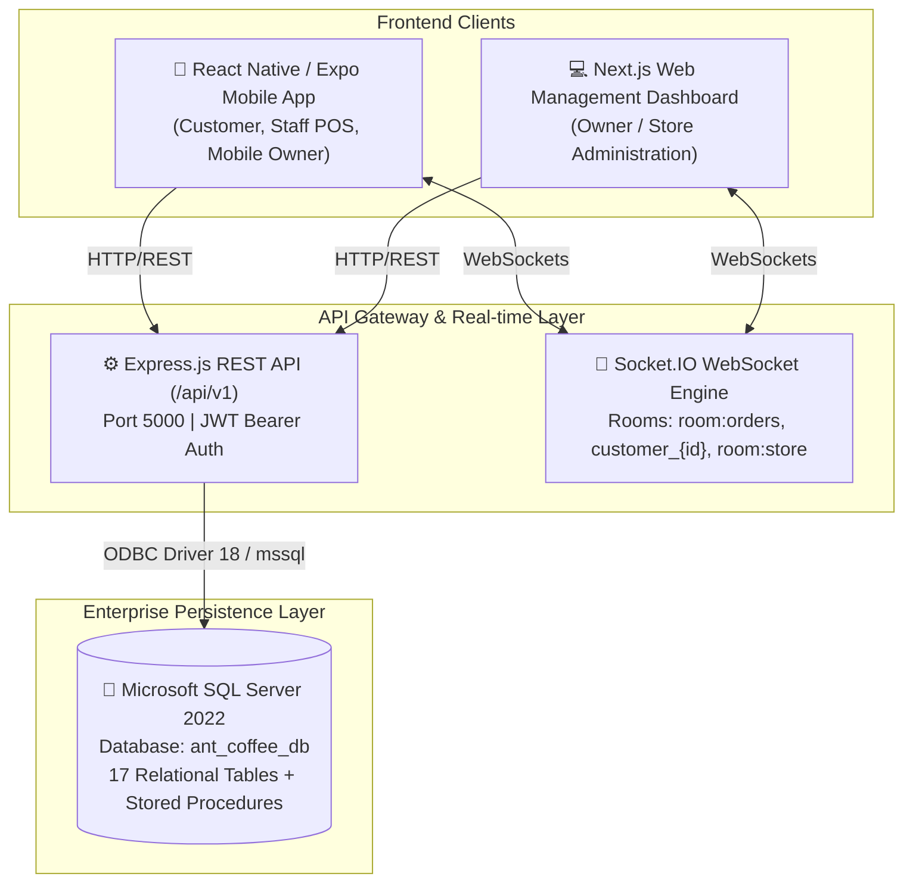

# ANT COFFEE & TEA — SYSTEM ARCHITECTURE SPECIFICATION
**Version:** 2.0.0 (Enterprise Food & Beverage Edition)  
**Target Platform:** React Native (Expo SDK 57) + Next.js Web Management + Node.js Express API + Microsoft SQL Server + Socket.IO  

---

## 1. Executive Architecture Overview

Ant Coffee & Tea is a multi-role food and beverage ordering and store-management ecosystem designed for high-throughput café operations (coffee, tea, milk tea, fruit drinks, pastries, snacks). The system operates on a client-server architecture with strict separation of concerns, server-authoritative business rules, and real-time bidirectional synchronization.

---

## 2. Canonical Role & Permission Matrix

The backend enforces three strictly defined canonical roles in the `users` table:
`role IN ('CUSTOMER', 'STAFF', 'OWNER')`.

| Role | Vietnamese Label | UI Experience | Permissions & Capabilities |
| :--- | :--- | :--- | :--- |
| **`CUSTOMER`** | Khách hàng | Mobile-first consumer app | Browse menu, customize options (size/sugar/ice/toppings), manage addresses, apply vouchers, place orders, make payments (Cash, MoMo, VietQR), track live order status. |
| **`STAFF`** | Nhân viên | Mobile & Tablet POS | View live order queue, accept (`CONFIRMED`), prepare (`READY`), complete (`COMPLETED`) or reject (`CANCELLED`) orders, toggle product availability (out of stock), check-in / check-out cash register shifts. |
| **`OWNER`** | Admin / Chủ quán | Mobile Dashboard & Web Next.js | Real-time store performance analytics (Revenue, AOV, order count, hourly sales, best-sellers), price & order audit logs, store emergency shutdown / order acceptance toggle, voucher & store configuration. |

---

## 3. Brand Identity & Design System Tokens

The visual system adheres to the brand palette specified in the project charter:

| Token Name | Hex Value | Semantic Usage |
| :--- | :--- | :--- |
| `primary` | `#7E22CE` | Royal Purple — primary brand identity, active tabs, buttons |
| `primaryDark`| `#581C87` | Deep Purple — headers, emphasized brand text, ticket sequences |
| `accentOrange` | `#FF6B00` | Citrus Orange — action triggers, cart FAB, prices, hot items |
| `background` | `#F8F7F4` | Warm Sand — background canvas across mobile and web |
| `surface` | `#FFFFFF` | Pure White — cards, sheets, elevated dialogs |
| `border` | `#E7E5E4` | Neutral Hairline — clean section dividers and card borders |
| `accentGreen` | `#10B981` | Emerald Green — completed statuses, positive financial delta |
| `accentRed` | `#EF4444` | Crimson Red — cancelled status, emergency store toggle |

### Liquid Glassmorphism & Elevation System
- **Web Backdrop Filter:** `backdrop-filter: blur(16px)` on web platforms (`FloatingBottomNav`, `Header`).
- **Platform Shadows:** Multi-layered elevation system with colored glows (`glowPurple`, `glowOrange`, `floatingNav`).
- **Touch Target Floor:** Guaranteed minimum `44x44` pt interactive hitboxes across all mobile platforms.

---

## 4. Mobile Application Architecture (`AnTcafe`)

The mobile client is built on **React Native** and **Expo SDK 57**:
- **Root Orchestrator:** `App.js` manages global role switching (`activeRole`), live order collections, cart state, active modals, and socket listener lifecycle.
- **Role-Aware Navigation:**
  - `FloatingBottomNav.js`: Adaptive pill-shaped bottom bar that switches layouts and action triggers based on `CUSTOMER`, `STAFF`, or `OWNER`.
  - `Header.js`: Dynamic top navigation adapting from customer brand header to staff POS status or owner quick-metrics.
- **Component Hierarchy:**
  - `src/components/common/`: 17 reusable atomic design components (`Button`, `Input`, `Badge`, `KPICard`, `GlassView`, `Toast`, etc.).
  - `src/components/`: Role-specific view engines (`OwnerView.js`, `StaffView.js`), modals (`CartModal.js`, `ProductDetailModal.js`, `OrderTrackingModal.js`, `MoMoPaymentModal.js`, `VietQRPaymentModal.js`, `AddressModal.js`, `SearchModal.js`).

---

## 5. Next.js Web Management Dashboard (`ai-website-cloner-template`)

The web management dashboard adapts the visual discipline and information architecture of the Vessa reference into a dedicated café operations console for large screens (desktops and tablets):
- **Framework:** Next.js 16 + React 19 + TypeScript + Tailwind CSS v4 + Lucide React.
- **Modules:**
  1. **Overview Dashboard:** Revenue KPI cards, peak hour order distributions, hourly sales charts, recent order feed.
  2. **Drink & Food Menu:** Searchable catalog, price editing, category assignments, live out-of-stock toggles.
  3. **Order Preparation Queue:** Full-screen multi-column live board (`PENDING`, `CONFIRMED`, `READY`, `COMPLETED`).
  4. **Customer Insights:** Customer database, loyalty points, order frequency.
  5. **Promotions & Vouchers:** Active campaign codes, minimum order value thresholds, discount metrics.
  6. **Store Settings & Audit:** Emergency order acceptance switch, Wi-Fi configuration, price change audit trails.

---

## 6. Real-time Communication & State Synchronization

Bidirectional WebSocket communication is established through **Socket.IO** (`socket.io-client` on mobile, Socket.IO Server on Express):
- **Rooms:**
  - `room:orders`: Subscribed by Staff POS and Owner dashboards for instant ticket generation.
  - `customer_{customerId}`: Private room for per-customer tracking updates.
  - `room:store`: Global store status broadcasts.
- **Event Contracts:**
  - `order:created`: Triggered immediately upon client checkout; notifies staff queues with audio-visual prompt.
  - `order:status_updated`: Pushes state machine transitions (`CONFIRMED`, `READY`, `COMPLETED`, `CANCELLED`).
  - `order:payment_updated`: Pushes gateway status changes (`PAID`, `REFUNDED`).
  - `store:status_updated`: Broadcasts emergency pause or resume of order acceptance.
  - `product:availability_updated`: Updates product in-stock / out-of-stock badges in real-time without page reload.

---

## 7. Security & Server-Authoritative Integrity

1. **Zero Client Trust:** Pricing, modifiers, discounts, and totals are computed and verified by the backend. The client submits only product IDs, option selections, and quantities.
2. **Database Transactions:** Order checkout, voucher consumption, and inventory updates are executed inside SQL transactions with rollbacks on failure.
3. **No Direct Database Access:** Neither mobile nor web clients communicate directly with SQL Server. All access is mediated by the Express API.
4. **Credential Isolation:** JWT signing keys, SQL Server credentials, and payment secret keys are stored exclusively in backend `.env` variables and never packaged into client bundles.
