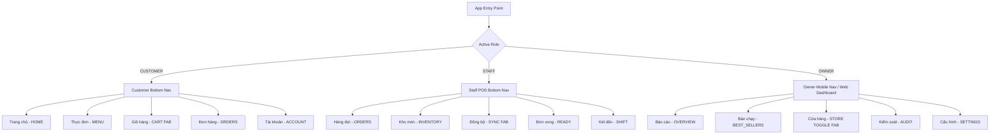

# ANT COFFEE & TEA — UI ROUTE MAP & INTERACTION ARCHITECTURE
**Version:** 2.0.0  
**Target Clients:** React Native Mobile & Tablet Application (`AnTcafe`) + Next.js Web Management Console (`ai-website-cloner-template`)

---

## 1. Multi-Role Navigation Schema

The application implements dynamic, role-aware routing. The interface adapts instantly depending on whether the current session is operated by a **Khách hàng (`CUSTOMER`)**, **Nhân viên (`STAFF`)**, or **Admin / Chủ quán (`OWNER`)**.

---

## 2. Customer Experience Route Map (`CUSTOMER`)

| Screen / Modal | Trigger | Key Components | User Actions & Flow |
| :--- | :--- | :--- | :--- |
| **Trang chủ (`HOME`)** | Default tab | `Header`, Category Pills, Best Seller Slider, Featured Drink Cards, Store Status Banner | - Browse promotional campaigns - Filter by category tag (ALL, BEST_SELLER, DISCOUNT) - Tap drink card to inspect customizations |
| **Thực đơn (`MENU`)** | Bottom Nav Tab 2 | Category horizontal scroll, Drink grid, Out-of-stock badges | - Browse complete drink & pastry offerings - Search by drink keyword - Immediate feedback on item availability |
| **Tùy chỉnh món (`ProductDetailModal`)** | Tap any product card | Image carousel, Size selector (S/M/L), Sugar selector (0%-100%), Ice selector (0%-100%), Topping checkboxes, Note input | - Real-time estimated unit price update - Quantity stepper (+ / -) - Add to cart with animated confirmation |
| **Tìm kiếm món (`SearchModal`)** | Search icon in Header | Input with auto-focus, Recent searches, Instant filter | - Search by name, category, or ingredients - Quick navigation to product detail |
| **Giỏ hàng (`CartModal`)** | Central Orange FAB or Header bag | Itemized list with customization details, Delivery/Pickup toggle, Address selector, Voucher apply field, Price breakdown | - Update item quantities or swipe to remove - Apply voucher (`ANTWELCOME`, `FREESHIP`) - Select payment method (Tiền mặt, MoMo, VietQR) - Server-validated checkout submission |
| **Chọn địa chỉ (`AddressModal`)** | Address row in Header or Cart | Saved addresses list, Add new address form | - Select default delivery address - Add new address with recipient name & phone |
| **Thanh toán MoMo (`MoMoPaymentModal`)** | Checkout with MoMo | MoMo QR Code, Deeplink button, Auto-polling status, Dev simulation button | - Scan MoMo QR or open MoMo app - Real-time payment verification via Webhook/Socket |
| **Thanh toán VietQR (`VietQRPaymentModal`)** | Checkout with VietQR | VietQR banking standard QR, Bank transfer info, Copy account number | - Open banking apps (NAPAS 247) - Automatic verification upon transfer receipt |
| **Thành công (`OrderSuccessModal`)** | Order placed | Order code badge, Estimated prep time, Track order CTA | - Congratulatory animation - Navigate directly to live order tracker |
| **Theo dõi đơn (`OrderTrackingModal`)** | Success modal or Orders tab | 5-Stage progress stepper, Live driver card, Item summary, Cancel order button | - Real-time progress updates via Socket.IO (`PENDING` -> `CONFIRMED` -> `READY` -> `COMPLETED`) - Direct phone call to store/driver |
| **Tài khoản (`AccountModal`)** | Bottom Nav Tab 4 | User avatar, Loyalty points, Order history list, Password change, Logout | - View accumulated reward points - View past order details with 1-tap reorder - Switch role to Staff/Owner (authorized accounts) |

---

## 3. Staff POS & Barista Route Map (`STAFF`)

| Screen / Modal | Trigger | Key Components | Operator Actions & Flow |
| :--- | :--- | :--- | :--- |
| **Hàng đợi đơn (`ORDERS`)** | Default staff tab | Live order cards, Status filter pills (`ALL`, `PENDING`, `CONFIRMED`, `READY`), Time-ago counter, Customer notes | - Real-time incoming order chime & badge - Accept order (`PENDING` ➔ `CONFIRMED`) - Mark drinks prepared (`CONFIRMED` ➔ `READY`) - Handover order (`READY` ➔ `COMPLETED`) |
| **Hủy đơn hàng (`CancelDialog`)** | Reject button on Pending card | Predefined cancellation reasons, Custom note input | - Select reason (Hết nguyên liệu, Quá tải giờ cao điểm, Khách đổi ý) - Server audit logged with operator ID |
| **Kho món (`INVENTORY`)** | Bottom Nav Tab 2 | Search bar, Category filter, Product card with in-stock toggle switch | - Instant 1-tap toggle for out-of-stock items - Immediate broadcast to all active customer apps via Socket.IO |
| **Đơn xong (`READY`)** | Bottom Nav Tab 4 | Cards filtered strictly by `READY` status, Pickup code, Driver info | - Verify customer or delivery driver ticket sequence (`#001`, `#002`) - 1-tap complete handover |
| **Két tiền ca (`SHIFT`)** | Bottom Nav Tab 5 | Opening cash display, Expected cash counter, Actual counted cash input, Discrepancy indicator, Check-out button | - Review cash collected in current shift - Enter physical cash count at handover - Automatic discrepancy calculation (Khớp 100% or Lệch tiền) - Submit shift handover to store manager |

---

## 4. Owner Management Route Map (`OWNER`)

### A. Mobile Owner Experience (`OwnerView.js`)
| Section | Trigger | Key Components | Management Capabilities |
| :--- | :--- | :--- | :--- |
| **Báo cáo (`OVERVIEW`)** | Default tab | 4 KPI Cards (Revenue, Total Orders, Completed, Average Order Value), Hourly sales bar chart, Peak hour badge | - Inspect today's financial performance - Analyze hourly sales curve from 07:00 to 21:00 - Monitor store load |
| **Bán chạy (`BEST_SELLERS`)** | Tab 2 | Top 5 ranked drink cards with unit sales, category, and revenue share | - Identify top performers for inventory planning |
| **Nút khẩn cấp (`STORE TOGGLE`)** | Center FAB | Red/Purple toggle dialog | - 1-tap emergency pause of customer orders during rush hours - Instantly alerts all connected customers |
| **Kiểm soát (`AUDIT`)** | Tab 4 | Timeline of price changes, order cancellations, and shift check-ins | - Audit staff actions, price adjustments, and cancellation reasons |
| **Cấu hình (`SETTINGS`)** | Tab 5 | Store profile, Wi-Fi credentials, Operating hours, Hotline | - Update store contact details and customer Wi-Fi password |

### B. Next.js Web Management Console (`ai-website-cloner-template`)
- **`/dashboard/overview`**: Full-screen store command center with metric cards, interactive revenue charts, and live order alerts.
- **`/dashboard/products`**: Data table of all drinks with price editing, category tags, and stock switches.
- **`/dashboard/orders`**: Kanban / table view of live orders with status transition actions.
- **`/dashboard/analytics`**: Deep financial reporting, hourly sales, best-seller rankings.
- **`/dashboard/settings`**: Operational settings, store emergency switch, Wi-Fi and hotline configuration.
